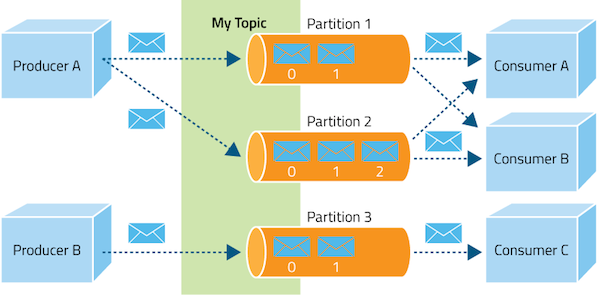
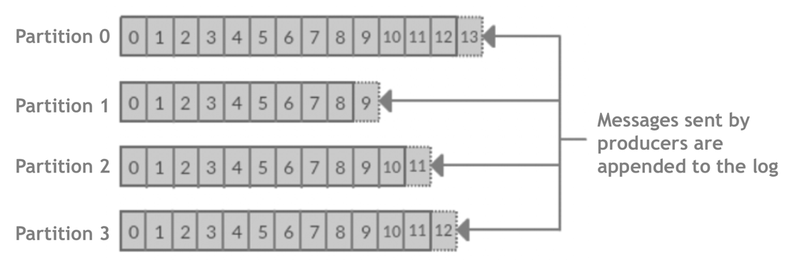

#  Introduction to Kafka

| Title                 | Type   | Duration | Author               |
|-----------------------|--------|----------|----------------------|
| Introduction to Kafka | Lesson | 3:00     | Suresh Melvin Sigera |

## Learning Objectives

By the end of this lesson, students will be able to:

- Understand the publish-subscribe model followed by Apache Kafka.
- Explain the core concepts of Kafka, including messages, producers, consumers, topics, partitions, consumer groups,
  brokers, and clusters.
- Describe the role of messages as the fundamental unit of data in Kafka.
- Explain the responsibilities of producers and consumers in the Kafka ecosystem.

## Introduction to Kafka (5 minutes)

In this lesson, we will explore Apache Kafka, a distributed streaming platform that follows a publish-subscribe model.
Kafka is designed to handle real-time data streams with high scalability and fault tolerance. We will delve into the
core concepts of Kafka, including messages, producers, consumers, topics, partitions, consumer groups, brokers, and
clusters. By understanding these concepts, you will gain insights into how Kafka enables efficient and reliable data
streaming and processing in various industries and use cases.

### What is Kafka? (5 minutes) 

Apache Kafka is an open-source stream-processing software platform developed by the Apache Software Foundation, written
in Scala and Java. It is designed to provide a high-throughput, low-latency platform for handling real-time data feeds.
Kafka is fundamentally a distributed event streaming platform capable of handling trillions of events a day.

Initially conceived as a messaging queue, Kafka is based on an abstraction of a distributed commit log. Since being
created at LinkedIn in 2011, Kafka has quickly evolved from simply queues, where messages are processed in
order, to a comprehensive event streaming platform.

### Publish-Subscribe Model (20 minutes)

Apache Kafka follows a publish-subscribe model, which is a messaging pattern that enables decoupled communication
between producers and consumers.

In this model, there are two main components: **publishers** (producers) and **subscribers** (consumers).

- **Publishers (Producers)**:
    - Publishers are entities responsible for generating data or events.
    - In Kafka, publishers are known as producers.
    - Producers publish messages to topics without knowing the details of the subscribers or their locations.
- **Subscribers (Consumers)**:
    - Subscribers are entities interested in receiving specific messages or events.
    - In Kafka, subscribers are known as consumers.
    - Consumers subscribe to one or more topics to receive messages published to those topics.
- **Topics**:
    - Topics are logical channels or categories to which messages are published.
    - Producers publish messages to specific topics, and consumers subscribe to those topics to receive the messages.
    - Topics serve as a way to organize and partition data streams based on their purpose or origin.

The publish-subscribe model in Kafka decouples producers and consumers, allowing them to operate independently. This
means:

- Introduction to Kafka: Producers can publish messages without waiting for consumers to be ready, and consumers
  can consume messages at their own pace.
- Introduction to Kafka: Multiple producers can publish to the same topic, and multiple consumers can subscribe to the
  same topic, facilitating horizontal scaling.
- Introduction to Kafka: Producers and consumers are loosely coupled, as they do not need to know the details of each
  other, promoting flexibility and modularity.
- **Fault Tolerance**: Messages are persisted in Kafka until they are consumed, ensuring no data loss even if a consumer
  is temporarily unavailable.

The publish-subscribe model is a fundamental concept in Kafka, enabling efficient and reliable data streaming and
processing. It allows for real-time data pipelines, event-driven architectures, and various use cases involving data
integration, transformation, and analysis in different industries and domains.

### Apache Kafka Architecture (20 minutes)



- **Messages**:
    - In Kafka, messages form the basic unit of data. Each message consists of a key/value pair, where the key is
      optional and used for partitioning purposes. Kafka treats messages as byte arrays, allowing it to handle data of
      any type. Messages are immutable, meaning they cannot be modified once produced.
- **Producers**:
    - Producers are the entities responsible for publishing data to Kafka topics. They send records or events to Kafka,
      specifying the topic and partition to which the data should be written. Producers have the ability to choose which
      partition to send the data to, either by using a partitioning key or allowing Kafka to determine the partition
      based on a round-robin algorithm. This allows for load balancing and ensures that data is evenly distributed
      across partitions.
- **Consumers**:
    - On the other side of the equation are consumers. Consumers are the entities that read and process data from Kafka
      topics. They subscribe to one or more topics and read the records from the partitions in the order they were
      produced. Consumers maintain their own offset, which represents the position of the last consumed record. This
      allows
      consumers to resume reading from where they left off, even if they disconnect or crash.
- **Topics** :
    - Topics are the logical categories or feeds to which messages are published. They provide a way to organize and
      separate different types of messages. Producers write messages to topics, and consumers subscribe to the topics
      they are interested in. Topics are partitioned and distributed across the Kafka cluster for scalability and fault
      tolerance.
- **Partitions**:
    - Partitions are a unique feature of Kafka that enables horizontal scalability. Each topic is divided into one or
      more partitions, and each partition is an ordered, immutable sequence of messages. Partitions are distributed
      across multiple brokers in the Kafka cluster, providing redundancy and allowing parallel processing. Messages
      within a partition are assigned a unique offset, representing their position in the partition.
      
- **Offsets**:
    - An offset is a unique identifier assigned to each record within a partition. It represents the position of the
      record in the partition. Consumers use offsets to keep track of their position in the partition and to resume
      reading from where they left off. Offsets are maintained by Kafka and are durable, allowing consumers to recover
      from failures and avoid missing or duplicating records.
- **Consumer Groups**:
    - To achieve scalability and fault tolerance, Kafka introduces the concept of consumer groups. A consumer group is a
      set of consumers that work together to consume records from one or more topics. Each consumer within a group is
      responsible for reading from a subset of the partitions. This allows for parallel consumption of records, as
      different consumers can process different partitions simultaneously. Consumer groups enable horizontal scaling, as
      adding more consumers to a group allows for increased throughput and fault tolerance.
- **Replication aka Brokers** :
    - Replication is another essential aspect of the Kafka architecture. Kafka ensures data durability and fault
      tolerance by replicating partitions across multiple servers, known as brokers. Each partition can have one or more
      replicas, with one replica designated as the leader and the others as followers. The leader handles all read and
      write requests for the partition, while the followers passively replicate the leader. If the leader fails, one of
      the followers is automatically promoted to become the new leader, ensuring high availability and fault tolerance.
- **Cluster**:
    - A Kafka cluster is a collection of brokers working together to provide a unified view of the messaging system. One
      broker in the cluster acts as the controller, responsible for managing the cluster's metadata, assigning
      partitions to brokers, and handling failures. The cluster ensures high availability, fault tolerance, and
      scalability by distributing data and processing across multiple brokers.

In summary, the Kafka architecture revolves around topics, which are partitioned for scalability and parallelism.
Producers publish data to topics, while consumers read and process data from topics. Consumer groups enable parallel
consumption and fault tolerance. Replication ensures data durability by maintaining multiple copies of partitions across
brokers. Offsets are used to uniquely identify records within partitions and allow consumers to keep track of their
position. This architecture enables Kafka to handle high-throughput, real-time data feeds with low latency and fault
tolerance.

### The Role of ZooKeeper (15 minutes)

Apache ZooKeeper is a critical component in the Kafka ecosystem, providing distributed coordination and configuration
management services. ZooKeeper plays a vital role in ensuring the smooth operation and synchronization of Kafka
clusters. Here's an overview of the key responsibilities of ZooKeeper in Kafka:

- **Cluster Coordination**:
    - ZooKeeper acts as a centralized service for coordinating the Kafka brokers within a cluster. It maintains the
      metadata information about the cluster, including the list of active brokers, topic configurations, and partition
      assignments. Brokers register themselves with ZooKeeper and periodically send heartbeats to indicate their
      availability. ZooKeeper notifies the cluster of any changes in the broker topology, such as the addition or
      removal of brokers.
- **Controller Election**:
    - ZooKeeper facilitates the election of the Kafka controller, which is responsible for managing the cluster's state
      and performing administrative tasks. When a new controller needs to be elected (e.g., due to a failure), ZooKeeper
      provides a distributed consensus mechanism to ensure that only one broker becomes the controller at a time. The
      elected controller coordinates tasks such as partition leadership assignment and topic creation/deletion.
- **Topic Configuration Management**:
    - ZooKeeper stores and manages the configuration information for Kafka topics. Topic configurations, such as the
      number of partitions, replication factor, and other settings, are stored in ZooKeeper. When a topic is created or
      modified, the configuration changes are persisted in ZooKeeper and propagated to all the brokers in the cluster.
      Consumers and producers can access the topic configuration information from ZooKeeper to understand the structure
      and properties of the topics they interact with.
- **Consumer Group Coordination**:
    - ZooKeeper plays a crucial role in coordinating consumer groups in Kafka. When a consumer joins or leaves a group,
      ZooKeeper helps in managing the group membership and partition assignment. ZooKeeper maintains the offsets of each
      consumer group, allowing consumers to resume consumption from the last committed offset in case of failures or
      restarts. Consumer group rebalancing, which occurs when consumers join or leave a group, is also coordinated
      through ZooKeeper.
- **Quotas and ACLs**:
    - ZooKeeper can store and manage quotas and access control lists (ACLs) for Kafka. Quotas define the limits on
      resource usage, such as the maximum message size or the maximum number of connections, for specific clients or
      topics. ACLs provide security by controlling the permissions and access rights of clients to perform operations on
      Kafka resources. ZooKeeper acts as a central repository for storing and enforcing these quotas and ACLs across the
      Kafka cluster.
- **Cluster State Backup**:
    - ZooKeeper serves as a reliable storage for the cluster's state information. It regularly takes snapshots of the
      cluster's metadata, configuration, and other important state information. In case of a catastrophic failure or
      data loss, the cluster can be restored from the state information stored in ZooKeeper, minimizing data loss and
      ensuring a faster recovery.

ZooKeeper's distributed nature, strong consistency guarantees, and fault-tolerant design make it well-suited for
providing coordination and configuration management services in Kafka. It ensures that all the brokers in the cluster
have a consistent view of the system state and enables them to work together seamlessly.
However, it's worth noting that recent versions of Kafka (starting from version 2.8) have introduced KIP-500, which aims
to remove the dependency on ZooKeeper by integrating its functionalities directly into Kafka itself. This change
simplifies the deployment and management of Kafka clusters while maintaining the same level of coordination and
reliability.

### Key Features of Kafka (5 minutes)

- **High Throughput**: Kafka can handle thousands of messages per second, supporting high-volume event streams such as
  real-time analytics and data ingestion pipelines.
- **Scalability**: It can scale horizontally on commodity hardware, which means you can add more machines to your Kafka
  cluster to increase capacity. Kafka's partitions allow you to parallelize processing across multiple consumer
  instances.
- **Durability** and Reliability: Kafka replicates data and can handle failures of servers in the cluster. Messages are
  persisted on disk and replicated within the cluster to prevent data loss.
- **Fault Tolerance**: It is designed to function even if a significant number of its servers fail, making it highly
  available and resilient to node failures.
- **Low Latency**: Messages produced by producers are quickly made available to consumers, often within milliseconds,
  supporting near-real-time applications.
- **Real-Time Processing**: Kafka is not only a messaging system but also has the capability to process streams of data
  in real time.
- **Multiple Clients and Language Support**: Kafka supports a wide range of clients and programming languages, allowing
  integration with various systems and applications.
- **Monitoring and Management Tools**: Kafka offers a range of monitoring and management tools, enabling efficient
  cluster management, performance monitoring, and troubleshooting.

### Use Cases of Kafka (5 minutes)

- **Messaging**: Kafka is widely used as a replacement for traditional message brokers, due to its higher throughput,
  reliability, and replication.
- **Website Activity Tracking**: Its original use case at LinkedIn. It can track user activity and log data in real
  time, which can be used for analytic purposes to improve user experience.
- **Metrics**: Kafka is often used for operational monitoring data. This involves aggregating statistics from
  distributed applications to produce centralized feeds of operational data.
- **Log Aggregation Solution**: Kafka can be used across an organization to collect logs from multiple services and make
  them available in a standard format to multiple consumers.
- **Stream Processing**: Many companies use Kafka for real-time stream processing of data. Kafka streams, a client
  library, allows processing data stored in Kafka with exactly-once capabilities.
- **Event Sourcing**: Kafka can be used as a source of truth for generating and storing immutable events that represent
  state changes. This is useful in environments where complete recall of historical actions is necessary.
- **Integration with Big Data Technologies**: It integrates well with Apache Hadoop, Apache Spark, and other big data
  tools for real-time data analytics.

### Setting Up Kafka with Docker (5 minutes)

- To confirm that both Docker and Docker Compose are installed successfully on your system, you can use the following
  commands to check their versions:
    - ```docker --version```
- You should be able to see something like this in the output:
    - ```Docker version 20.10.25, build b829f3```
- Check docker compose version:
    - ```docker compose version```
- You should be able to see something like this in the output:
    - ```Docker Compose version v2.20.3```

### Configuration Steps (20 minutes)

Once you've installed Docker and Docker Compose, you'll need to create a `docker-compose.yml` file. You can save this
file in any location, but make sure you have the necessary permissions to access and modify it. Insert the following
code into your Docker Compose file:

```docker
version: "3"

networks:
  mynetwork:

services:
  zookeeper:
    image: 'bitnami/zookeeper:latest'
    ports:
      - '2181:2181'
    environment:
      - ALLOW_ANONYMOUS_LOGIN=yes
    networks:
      - mynetwork

  kafka:
    image: 'bitnami/kafka:latest'
    user: root
    ports:
      - '9092:9092'
    environment:
      - KAFKA_BROKER_ID=1
      - KAFKA_LISTENERS=PLAINTEXT://:9092
      - KAFKA_ADVERTISED_LISTENERS=PLAINTEXT://127.0.0.1:9092
      - KAFKA_ZOOKEEPER_CONNECT=zookeeper:2181
      - ALLOW_PLAINTEXT_LISTENER=yes
    volumes:
      - ./Kafka:/bitnami/kafka
    networks:
      - mynetwork
    depends_on:
      - zookeeper
```

This Docker Compose file configures two services: Zookeeper and Kafka, which operate on the same network to facilitate
smooth communication between them. Even if you don't explicitly define a network, Docker Compose will automatically
create one. The ports for Zookeeper (`2181`) and Kafka (`9092`) are mapped from your local machine to the respective
containers to allow external access.

Several environment variables are set to configure both services. Using the root user for the Kafka service is optional
but can help resolve any permission issues. Additionally, a volume is attached at `/bitnami/kafka` to ensure that
topics, partitions, and messages are retained, even if the containers are removed.

First, create a `docker-compose.yml` file in the lesson directory by running the following command:

```text
touch docker-compose.yml
```

Once you have defined your services in the `docker-compose.yml` file, you can deploy them by executing the following
command in the same directory containing the `docker-compose.yml` file.

```text
sudo docker compose up -d
```

Docker Compose will retrieve both images from your default registry if they are not already present on your local
machine. Using the `-d` flag indicates that the containers will run in detached mode, meaning they will operate in the
background. You can expect the following output, although note that the process might take a little time to complete.

```text
[+] Running 4/4
 ✔ zookeeper 1 layers [⣿]      0B/0B      Pulled                                          31.7s 
   ✔ ddd7f1a41311 Pull                    complete                                        4.8s 
 ✔ kafka 1 layers [⣿]          0B/0B      Pulled                                          32.9s 
   ✔ 9bb44e3263fd Pull                    complete                                        5.2s 
[+] Running 3/3
 ✔ Network   introduction-to-kafka_mynetwork    Created                                   0.1s 
 ✔ Container introduction-to-kafka-zookeeper-1  Started                                   3.0s 
 ✔ Container introduction-to-kafka-kafka-1      Started     
 ````

To identify your container ID and check for existing Kafka topics, use the following steps:

- To find your container ID, execute the following command in your terminal and look for "kafka" in the output. Then,
  copy the container ID:
    - `sudo docker ps`
- To check for existing Kafka topics, execute the following command:
    - `sudo docker exec -it <your_container_id> kafka-topics.sh --bootstrap-server localhost:9092 --list`

### Simulation Process (15 minutes)

In this step, we will populate the topics by adding events using the console producer to send messages to the topics
line by line. Subsequently, we will employ the console consumer to monitor these events from another terminal.

Execute the following command in your first terminal. Before you start sending messages, ensure you run the subsequent
command in a different terminal to keep track of the events.

```text
sudo docker exec -it <your_container_id> kafka-console-producer.sh --bootstrap-server localhost:9092 --topic test-tp
```

In your second terminal run this command:

```text
sudo docker exec -it <your_container_id> kafka-console-consumer.sh --from-beginning --bootstrap-server localhost:9092 --topic test-tp
```

Now, feel free to type any messages you like in the first terminal and observe the results in the second terminal. To
exit, simply press 'Ctrl + C'.

Congratulations! You've successfully set up Apache Kafka and Apache Zookeeper using Bitnami's Docker packages.

### Kafka Commands with Docker (10 minutes)

- Start a Kafka container :
    - `sudo docker run -d --name kafka -p 9092:9092 -e KAFKA_ADVERTISED_HOST_NAME=localhost -e KAFKA_ZOOKEEPER_CONNECT=zookeeper:2181 confluentinc/cp-kafka`
- Create a Kafka topic :
    - `sudo docker exec -it <your_container_id> kafka-topics.sh --create --topic <your-topic-name> --partitions 1 --replication-factor 1 --if-not-exists --bootstrap-server localhost:9092`
- List Kafka topics :
    - `sudo docker exec -it <your_container_id> kafka-topics.sh --list --bootstrap-server localhost:9092`
- Describe a Kafka topic :
    - `sudo docker exec -it <your_container_id> kafka-topics.sh --describe --topic <your-topic-name> --bootstrap-server localhost:9092`
- Produce messages to a Kafka topic :
    - `sudo docker exec -it <your_container_id> kafka-console-producer.sh --bootstrap-server localhost:9092 --topic <your-topic-name>`
- Consume messages from a Kafka topic :
    - `sudo docker exec -it <your_container_id> kafka-console-consumer.sh --bootstrap-server localhost:9092 --topic <your-topic-name> --from-beginning`
- Alter the configuration of a Kafka topic
    - `sudo docker exec -it <your_container_id> kafka-configs.sh --alter --entity-type topics --entity-name <your-topic-name> --add-config retention.ms=86400000 --bootstrap-server localhost:9092`
- Delete a Kafka topic
    - `sudo docker exec -it <your_container_id> kafka-topics.sh --delete --topic <your-topic-name> --bootstrap-server localhost:9092`
- Get consumer groups
    - `sudo docker exec -it <your_container_id> kafka-consumer-groups.sh --list --bootstrap-server localhost:9092`
- Describe a consumer group
    - `sudo docker exec -it kafka kafka-consumer-groups.sh --describe --group <your-group-name> --bootstrap-server localhost:9092`

### Summary (5 minutes)

Apache Kafka is a distributed streaming platform that follows a publish-subscribe model. Producers publish messages to
topics, and consumers subscribe to those topics to consume the messages. The core concepts of Kafka include messages,
producers, consumers, topics, partitions, consumer groups, brokers, and clusters. Messages are the fundamental unit of
data in Kafka. Producers are entities responsible for publishing messages to topics, while consumers are subscribers
that consume messages from topics. Topics are logical categories to which messages are published and from which
consumers read. Partitions are a mechanism for splitting topics across the cluster for scalability. Consumer groups
achieve parallel consumption and load balancing among consumers. Brokers are individual servers in a Kafka cluster that
store and serve partitions, and a cluster is a collection of brokers working together as a unified system. Offsets
represent the position of each message within a partition, used by consumers to track consumption progress. ZooKeeper
provides essential services for cluster coordination and management. Kafka's architecture enables high scalability,
fault tolerance, and real-time processing of data streams.

### Key Takeaways (5 minutes)

- Kafka follows a publish-subscribe model, where producers publish messages to topics, and consumers subscribe to those
  topics.
- Messages are the fundamental unit of data in Kafka.
- Producers are responsible for publishing messages to topics.
- Consumers subscribe to topics and consume messages from them.
- Topics are logical categories for organizing messages.
- Partitions split topics across the cluster for scalability.
- Consumer groups enable parallel consumption and load balancing among consumers.
- Brokers are individual servers in a Kafka cluster that store and serve partitions.
- A cluster is a collection of brokers working together as a unified system.
- Offsets represent the position of each message within a partition, helping consumers track consumption progress.
- ZooKeeper provides essential services for cluster coordination and management.
- Kafka's architecture enables high scalability, fault tolerance, and real-time processing of data streams.
