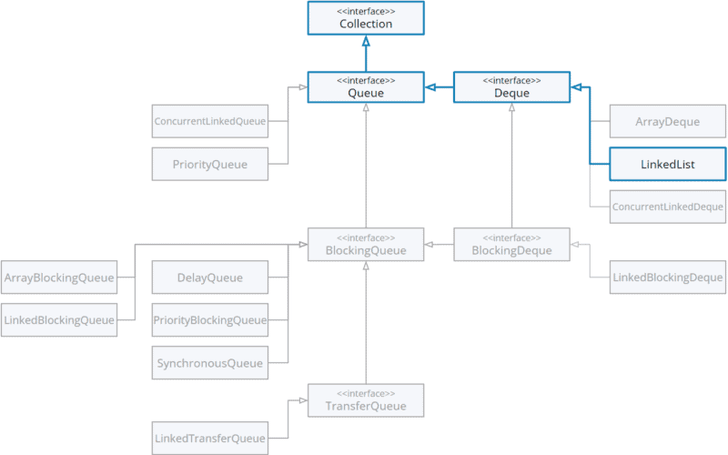

#  Array blocking queue, Synchronus queue and Linked blocking queue

| Title                                                            | Type   | Duration | Author               |
|------------------------------------------------------------------|--------|----------|----------------------|
| Array blocking queue, Synchronus queue and Linked blocking queue | Lesson | 3:00     | Suresh Melvin Sigera |

## Learning objectives

- Understand the characteristics and features of `ArrayBlockingQueue`.
- Explore implementation details and internals of `ArrayBlockingQueue`.
- Examine the unique characteristics and differences of `SynchronousQueue` compared to other queue implementations.
- Understand the implementation details and internals of `SynchronousQueue`.
- Understand the underlying data structure and design principles of `LinkedBlockingQueue`.
- Examine thread-safety mechanisms and concurrency control in `LinkedBlockingQueue`.
- Provide real-life examples and use cases for each type of queue implementation.
- Discuss the importance of choosing the right queue implementation based on application requirements.

### Introduction to Queues (20 mins)

In the realm of queues, two fundamental operations reign supreme: `enqueue` and `dequeue`. These operations form the
backbone of queue functionality, dictating how elements are added to and removed from the queue.

`Enqueue`: Imagine yourself at a bustling supermarket checkout. As you place your items on the conveyor belt, each one
is enqueued onto the queue of items waiting to be scanned and processed. Enqueueing, in technical terms, refers to the
action of adding an element to the back of the queue.

`Dequeue`: Now, as the cashier scans each item, they are dequeued from the queue, starting with the item that was first
enqueued. This process follows the `FIFO` (`First-In-First-Out`) principle, ensuring that the first item enqueued is
also the first to be dequeued. Just as the first person to join the line at the supermarket is the first to check out,
elements in a queue are processed in the order they were added.

**FIFO (First-In-First-Out) Principle**:

The `FIFO` principle lies at the heart of queue data structures. Much like waiting in line at the supermarket, where the
first person to arrive is also the first to be served, `FIFO` ensures fairness and orderliness in processing elements.

In technical terms, `FIFO` dictates that the element added first to the queue will also be the first to be removed. This
principle ensures that the chronological order of element arrival is preserved, maintaining a consistent and predictable
behavior in queue operations.

**Real-life Examples of Queues**:

Now, let's delve into real-life scenarios where queues play a pivotal role:

- **Supermarket Checkout**: As mentioned earlier, the checkout line at a supermarket is a classic example of a queue.
  Customers join the line (enqueue), and the cashier serves them in the order they arrived (dequeue), following
  the `FIFO` principle.
- **Traffic at Toll Booths**: Picture yourself driving on a busy highway, approaching a toll booth. Vehicles line up to
  pay tolls, forming a queue. Each vehicle waits its turn to pay and then proceeds through the toll booth, mirroring the
  enqueue and dequeue operations of a queue.
- **Print Queue**: In office environments, multiple users often send print jobs to a shared printer. These print jobs
  are enqueued in a print queue, awaiting their turn to be processed. The printer dequeues the jobs one by one, printing
  them in the order they were received.

In essence, queues are ubiquitous in both the digital and physical worlds, facilitating orderly and efficient processing
of tasks, requests, and resources. Whether at the supermarket checkout or in computer memory, the principles of enqueue,
dequeue, and `FIFO` govern their behavior, ensuring smooth operation and fairness.

### Java's Queue Interface (20 mins)

Within the Java Collections Framework, the Queue interface stands as a key abstraction for representing `FIFO` (
First-In-First-Out) data structures. It extends the Collection interface, adding specific operations that facilitate
queue-like behavior. Queues are widely used in Java applications for their ability to manage elements in a sequence
based on the order of insertion.

**Common Methods and Their Usage**:

- `add(E e)`: This method adds the specified element to the queue if it is possible to do so immediately without
  violating capacity restrictions. If the queue is full, it throws an `IllegalStateException`.
- `offer(E e)`: Similar to `add()`, `offer()` adds an element to the queue but returns false if the element cannot be
  added due to capacity restrictions.
- `remove()`: This method removes and returns the head of the queue. If the queue is empty, it throws
  a `NoSuchElementException`.
- `poll()`: `Poll()` retrieves and removes the head of the queue, returning null if the queue is empty.
- `element()`: Returns the head of the queue without removing it. If the queue is empty, it throws
  a `NoSuchElementException`.
- `peek()`: Similar to `element()`, `peek()` retrieves the head of the queue without removing it and returns null if the
  queue is empty.

These methods provide essential functionality for adding, removing, and inspecting elements within a queue. Depending on
the specific requirements of your application, you can choose the appropriate method to interact with the queue.



- `ArrayDeque`: `ArrayDeque` is a resizable-array implementation of the Deque interface, which also extends the Queue
  interface. It is not thread-safe but offers high-performance operations and is suitable for most queue applications.
- `LinkedList`: `LinkedList` implements the Queue interface and provides a doubly-linked list implementation. It offers
  constant-time performance for insertion and removal operations but may have higher overhead compared to ArrayDeque.
- `PriorityQueue`: `PriorityQueue` is an unbounded priority queue based on a priority heap. It orders elements according
  to their natural ordering or by a specified Comparator. It is not thread-safe and does not guarantee `FIFO` behavior.
- `ConcurrentLinkedQueue`: `ConcurrentLinkedQueue` is a thread-safe implementation of the Queue interface, suitable for
  concurrent applications. It uses lock-free algorithms for high concurrency and performance.

Each implementation has its advantages and trade-offs in terms of performance, thread-safety, and memory usage.
Understanding these differences allows you to select the most appropriate queue implementation for your specific
application requirements.

### ArrayBlockingQueue (40 mins)

`ArrayBlockingQueue` is a bounded blocking queue implementation in Java, which means it has a fixed capacity that cannot
be changed after initialization. It follows the `FIFO` (First-In-First-Out) principle, ensuring that elements are
retrieved in the order they were added. `ArrayBlockingQueue` is part of the `java.util.concurrent` package and is widely
used in concurrent programming scenarios where thread safety and blocking behavior are required.

#### Characteristics and Features:

- **Fixed Capacity**: `ArrayBlockingQueue` has a fixed capacity specified during initialization, making it suitable for
  scenarios where a bounded queue size is desired.
- **Blocking Operations**: The queue supports blocking operations such as `put()` and `take()`, which block the calling
  thread if the queue is full (for `put()`) or empty (for `take()`), until space becomes available or an element is
  added.
- **FIFO Order**: Elements are retrieved from the queue in the same order they were added, adhering to the `FIFO`
  principle.
- **Thread-Safe**: `ArrayBlockingQueue` is designed to be thread-safe, making it suitable for concurrent applications
  where multiple threads may access the queue simultaneously.

#### Implementation Details:

`ArrayBlockingQueue` is implemented using a fixed-size array to store elements. It maintains two indices, one for the
head (front) of the queue and another for the tail (end) of the queue, which are updated as elements are added or
removed. The queue uses intrinsic locks to ensure thread safety during concurrent access.

#### Thread-Safe Operations:

All operations provided by `ArrayBlockingQueue`, including `add()`, `offer()`, `put()`, `remove()`, `poll()`, `take()`,
etc., are thread-safe. This means that multiple threads can safely add and remove elements from the queue without
encountering data corruption or race conditions.

#### Blocking Behavior and Its Significance:

The blocking behavior of `ArrayBlockingQueue` is crucial in concurrent programming scenarios. When the queue is full,
the `put()` operation blocks the calling thread until space becomes available, preventing producers from overloading the
system with tasks. Similarly, when the queue is empty, the `take()` operation blocks the calling thread until an element
becomes available, ensuring that consumers wait for tasks to be produced before attempting to consume them.

**Use Cases and Scenarios Where ArrayBlockingQueue Shines**:

- **Producer-Consumer Scenarios**: `ArrayBlockingQueue` is commonly used in producer-consumer scenarios where one or
  more producer threads produce tasks or data, and one or more consumer threads consume them. The blocking behavior
  of `ArrayBlockingQueue` helps regulate the flow of tasks between producers and consumers, preventing resource
  exhaustion and thread contention.
- **Task Queues**: In multi-threaded applications, `ArrayBlockingQueue` can be used as a task queue to manage the
  execution of asynchronous tasks or background processes. Threads submit tasks to the queue, and worker threads dequeue
  and execute them in a controlled manner.
- **Bounded Buffer**: `ArrayBlockingQueue` can serve as a bounded buffer in scenarios where a limited number of items
  can be processed or stored concurrently. It helps prevent memory exhaustion and ensures that the system operates
  within predefined constraints.

**Performance Considerations**:

- **Fixed Capacity**: The fixed capacity of `ArrayBlockingQueue` imposes limitations on scalability. If the capacity is
  too small, it may lead to contention and blocking behavior as threads wait for space to become available. Conversely,
  if the capacity is too large, it may result in wasted memory.
- **Blocking Operations**: While blocking operations provide synchronization and thread safety, they can also introduce
  latency and overhead, especially in high-throughput systems. Careful consideration should be given to the impact of
  blocking behavior on overall system performance.

#### Code Along Code Snippets and Demonstrations:

```java
package org.example.codealong;

import java.util.concurrent.ArrayBlockingQueue;

public class ArrayBlockingQueueExample {
    public static void main(String[] args) {
        // Create an ArrayBlockingQueue with capacity 10
        ArrayBlockingQueue<Integer> queue = new ArrayBlockingQueue<>(10);

        // Producer thread
        Thread producer = new Thread(() -> {
            try {
                for (int i = 0; i < 10; i++) {
                    queue.put(i); // Add elements to the queue
                    System.out.println("Produced: " + i);
                    Thread.sleep(1000); // Simulate some processing time
                }
            } catch (InterruptedException e) {
                e.printStackTrace();
            }
        });

        // Consumer thread
        Thread consumer = new Thread(() -> {
            try {
                for (int i = 0; i < 10; i++) {
                    int value = queue.take(); // Remove and retrieve elements from the queue
                    System.out.println("Consumed: " + value);
                    Thread.sleep(2000); // Simulate some processing time
                }
            } catch (InterruptedException e) {
                e.printStackTrace();
            }
        });

        // Start producer and consumer threads
        producer.start();
        consumer.start();
    }
}

```

In this example, we create a producer-consumer scenario using `ArrayBlockingQueue`. The producer thread adds integers to
the queue using the `put()` method, while the consumer thread removes and consumes them using the `take()` method. The
blocking behavior of `ArrayBlockingQueue` ensures that the consumer waits for elements to become available before
consuming them, maintaining synchronization between producer and consumer threads.

This demonstration illustrates how `ArrayBlockingQueue` can be used to coordinate communication and data exchange
between multiple threads in a concurrent application, while ensuring thread safety and synchronization.

### SynchronousQueue (40 mins)

#### Introduction to SynchronousQueue:

`SynchronousQueue` is a specialized type of queue in Java's concurrency utilities that facilitates a rendezvous between
threads. Unlike other blocking queues, `SynchronousQueue` has no internal capacity and acts as a rendezvous point where
producers and consumers synchronize to exchange data directly. It is designed for scenarios where strict one-to-one
communication between threads is required, ensuring that a producer thread blocks until a consumer thread is ready to
receive the data, and vice versa.

#### Unique characteristics and differences from other queues:

- **Zero Capacity**: Unlike traditional blocking queues such as `ArrayBlockingQueue`
  or `LinkedBlockingQueue`, `SynchronousQueue` has zero internal capacity. It does not store elements but instead relies
  on direct handoff between producer and consumer threads.
- **One-to-One Rendezvous**: `SynchronousQueue` enforces a strict one-to-one rendezvous between producer and consumer
  threads. A producer thread blocks until a consumer thread is ready to consume the data, and vice versa, ensuring
  synchronization and coordination between threads.
- **No Storage**: `SynchronousQueue` does not store elements internally, making it suitable for scenarios where
  immediate handoff and synchronization between threads are required without buffering or queuing data.

#### Implementation details and internals:

`SynchronousQueue` is implemented using lock-free algorithms and low-level concurrency primitives such as `CAS` (
Compare-And-Swap) operations. It maintains two internal nodes representing the producers and consumers. When a producer
thread attempts to add an element to the queue, it blocks until a consumer thread is ready to consume the data.
Similarly, when a consumer thread attempts to remove an element from the queue, it blocks until a producer thread is
ready to provide the data.

#### One-to-one rendezvous concept:

The one-to-one rendezvous concept of `SynchronousQueue` ensures that each data exchange between producer and consumer
threads occurs in a synchronized manner. A producer thread cannot proceed until a consumer thread is ready to receive
the data, and a consumer thread cannot proceed until a producer thread is ready to provide the data. This strict
synchronization guarantees orderly and synchronized communication between threads.

#### Use cases and scenarios where SynchronousQueue is beneficial:

- **Task Execution**: `SynchronousQueue` can be used to coordinate the execution of tasks between producer and consumer
  threads in a thread pool or executor service, ensuring that tasks are processed immediately without queuing.
- **Handoff of Resources**: `SynchronousQueue` is suitable for scenarios where resources need to be transferred directly
  between threads, such as passing control signals, tokens, or access tokens between threads.
- **Event-Based Systems**: In event-driven architectures or systems where events need to be processed in a synchronous
  manner, SynchronousQueue can ensure that event producers and consumers synchronize their actions without buffering or
  delaying events.

#### Thread-handling mechanisms

`SynchronousQueue` employs blocking operations such as `put()` and `take()` to synchronize producer and consumer
threads. When a producer thread calls `put()`, it blocks until a consumer thread is ready to consume the data.
Similarly, when a consumer thread calls `take()`, it blocks until a producer thread is ready to provide the data. This
blocking behavior ensures that threads synchronize their actions and exchange data in a coordinated manner.

#### Performance comparison with other queue implementations

In terms of performance, `SynchronousQueue` offers low latency and high throughput for scenarios where direct handoff
between threads is required. Since it has zero internal capacity and does not buffer elements, it minimizes context
switching and thread contention, leading to efficient thread coordination and synchronization.
However, `SynchronousQueue` may incur higher overhead compared to traditional blocking queues in scenarios where
buffering or queuing of data is necessary.

#### Code along

```java
package org.example.codealong;

import java.util.concurrent.SynchronousQueue;

public class SynchronousQueueExample {
    public static void main(String[] args) {
        // Create a SynchronousQueue
        SynchronousQueue<Integer> queue = new SynchronousQueue<>();

        // Producer thread
        Thread producer = new Thread(() -> {
            try {
                int data = 42;
                System.out.println("Producer is waiting to hand off data: " + data);
                queue.put(data); // Block until a consumer is ready to receive the data
                System.out.println("Producer handed off data: " + data);
            } catch (InterruptedException e) {
                e.printStackTrace();
            }
        });

        // Consumer thread
        Thread consumer = new Thread(() -> {
            try {
                System.out.println("Consumer is waiting to receive data");
                int data = queue.take(); // Block until a producer is ready to provide the data
                System.out.println("Consumer received data: " + data);
            } catch (InterruptedException e) {
                e.printStackTrace();
            }
        });

        // Start producer and consumer threads
        producer.start();
        consumer.start();
    }
}


```

In this example, we create a producer-consumer scenario using `SynchronousQueue`. The producer thread attempts to put
data into the queue using the `put()` method, blocking until a consumer thread is ready to receive the data. The
consumer thread, in turn, attempts to take data from the queue using the `take()` method, blocking until a producer
thread is ready to provide the data. This demonstration showcases the one-to-one rendezvous concept
of `SynchronousQueue`, ensuring synchronized communication between producer and consumer threads without buffering or
queuing data.

### LinkedBlockingQueue (40 mins)

#### Introduction to LinkedBlockingQueue:

`LinkedBlockingQueue` is a bounded blocking queue implementation in Java that is backed by a linked list data structure.
It is part of the `java.util.concurrent` package and provides a thread-safe `FIFO` (First-In-First-Out) queue that
supports blocking operations. `LinkedBlockingQueue` is particularly useful in scenarios where multiple producer and
consumer threads need to interact safely and efficiently.

#### Underlying data structure and design principles:

`LinkedBlockingQueue` is implemented using a linked list data structure, where each element in the queue is stored as a
node with references to the next and previous elements. This design allows for efficient insertion and removal
operations at both ends of the queue, ensuring constant-time performance for most operations.

The queue maintains two pointers, one pointing to the head (front) of the queue and another pointing to the tail (end)
of the queue. These pointers are updated as elements are added or removed, ensuring that the `FIFO` order of elements is
preserved.

#### Thread-safety mechanisms:

`LinkedBlockingQueue` is designed to be thread-safe, meaning that it can be safely accessed and modified by multiple
threads concurrently without causing data corruption or race conditions. It achieves thread safety through the use of
intrinsic locks and condition variables, which synchronize access to critical sections of code.

#### Blocking operations and concurrency control:

`LinkedBlockingQueue` supports blocking operations such as `put()` and ta`ke()`, which block the calling thread if the
queue is full (for `put()`) or empty (for `take()`), until space becomes available or an element is added. These
blocking operations ensure that producers and consumers synchronize their actions and maintain proper concurrency
control.

#### Scalability and performance aspects:

`LinkedBlockingQueue` offers good scalability and performance characteristics, especially in scenarios where the number
of elements in the queue is relatively small or bounded. Since it uses a linked list data
structure, `LinkedBlockingQueue` can efficiently handle dynamic resizing and memory management, making it suitable for
high-throughput applications with frequent insertions and removals.

#### Use cases and scenarios where LinkedBlockingQueue excels:

- **Thread Pool Management**: `LinkedBlockingQueue` is commonly used in thread pool implementations to manage the
  execution of tasks by multiple worker threads. The queue acts as a buffer for incoming tasks, ensuring that tasks are
  processed in an orderly and efficient manner.
- **Event Notification Systems**: In event-driven architectures or systems where events need to be processed
  asynchronously, `LinkedBlockingQueue` can be used to store and dispatch event notifications to event consumers. The
  queue ensures that events are processed in the order they were received, maintaining consistency and reliability.
- **Data Pipeline Processing**: `LinkedBlockingQueue` is suitable for building data pipelines or processing pipelines
  where data flows through multiple stages of processing. Each stage of the pipeline can use a `LinkedBlockingQueue` to
  buffer and transfer data between producer and consumer threads, ensuring smooth and efficient data processing.

#### Code Along:

```java
package org.example.codealong;

import java.util.concurrent.LinkedBlockingQueue;

public class LinkedBlockingQueueExample {
    public static void main(String[] args) {
        // Create a LinkedBlockingQueue with capacity 10
        LinkedBlockingQueue<Integer> queue = new LinkedBlockingQueue<>(10);

        // Producer thread
        Thread producer = new Thread(() -> {
            try {
                for (int i = 0; i < 10; i++) {
                    queue.put(i); // Add elements to the queue
                    System.out.println("Produced: " + i);
                    Thread.sleep(1000); // Simulate some processing time
                }
            } catch (InterruptedException e) {
                e.printStackTrace();
            }
        });

        // Consumer thread
        Thread consumer = new Thread(() -> {
            try {
                for (int i = 0; i < 10; i++) {
                    int value = queue.take(); // Remove and retrieve elements from the queue
                    System.out.println("Consumed: " + value);
                    Thread.sleep(2000); // Simulate some processing time
                }
            } catch (InterruptedException e) {
                e.printStackTrace();
            }
        });

        // Start producer and consumer threads
        producer.start();
        consumer.start();
    }
}

```

In this example, we create a producer-consumer scenario using `LinkedBlockingQueue`. The producer thread adds integers
to the queue using the `put()` method, while the consumer thread removes and consumes them using the `take()`
method. `LinkedBlockingQueue` ensures thread safety and proper synchronization between producer and consumer threads,
allowing for efficient data exchange and processing.

#### Best Practices and Considerations When Using LinkedBlockingQueue:

- **Choose the Right Capacity**: When initializing a `LinkedBlockingQueue`, consider the appropriate capacity based on
  your application's requirements. A larger capacity may improve throughput but could lead to increased memory usage,
  while a smaller capacity may result in blocking and contention.
- **Handle Interruptions Properly**: Be sure to handle `InterruptedExceptions` properly when using blocking operations
  such as `put()` and `take()`. These exceptions indicate that the current thread has been interrupted while waiting,
  and appropriate cleanup or error handling should be performed.
- **Avoid Deadlocks**: Be cautious when using `LinkedBlockingQueue` in combination with other synchronization mechanisms
  such as locks or conditions to avoid potential deadlocks. Deadlocks can occur if threads block indefinitely waiting
  for resources that are held by other threads, leading to a system-wide deadlock.
- **Monitor Queue Size**: Keep an eye on the size of the `LinkedBlockingQueue` to ensure that it does not grow
  excessively and cause memory issues. Consider implementing monitoring and logging mechanisms to track queue size and
  identify potential bottlenecks or performance issues.
- **Test Concurrency Scenarios**: Thoroughly test your application under various concurrency scenarios to ensure
  that `LinkedBlockingQueue` behaves as expected and handles concurrent access safely and efficiently. Use stress
  testing and performance profiling tools to identify and resolve any potential concurrency issues.

### Comparative Analysis and Q&A (20 mins)

#### Recap of key points for each queue implementation:

- **ArrayBlockingQueue**:
    - Fixed capacity, array-based implementation of a blocking queue.
    - Supports blocking operations with `FIFO` behavior.
    - Thread-safe and suitable for scenarios with a fixed number of elements.
    - Provides good performance for most use cases but may lead to contention if capacity is exceeded.
- **SynchronousQueue**:
    - Zero-capacity, rendezvous-based implementation for direct handoff between threads.
    - Ensures strict one-to-one communication between producer and consumer threads.
    - Offers low-latency, high-throughput performance for synchronized data exchange.
    - Ideal for scenarios where immediate handoff and synchronization between threads are required.
- **LinkedBlockingQueue**:
    - Bounded, linked list-based implementation of a blocking queue.
    - Supports blocking operations with `FIFO` behavior and scalable capacity.
    - Thread-safe and suitable for concurrent access in multi-threaded environments.
    - Provides good performance and scalability, especially for dynamic-sized queues.

#### Comparative analysis of ArrayBlockingQueue, SynchronousQueue, and LinkedBlockingQueue:

- **Capacity**: `ArrayBlockingQueue` has a fixed capacity, `SynchronousQueue` has zero capacity,
  and `LinkedBlockingQueue` has a scalable capacity.
- **Synchronization**: `ArrayBlockingQueue` and `LinkedBlockingQueue` provide blocking operations for synchronization,
  while `SynchronousQueue` offers strict one-to-one rendezvous between threads.
- **Underlying Data Structure**: `ArrayBlockingQueue` uses an array, `LinkedBlockingQueue` uses a linked list,
  and `SynchronousQueue` does not store elements internally.
- **Use Cases**: `ArrayBlockingQueue` is suitable for bounded buffer scenarios, `SynchronousQueue` is ideal for direct
  handoff between threads, and `LinkedBlockingQueue` is versatile for general-purpose queuing with scalable capacity.

#### Performance benchmarks and considerations:

- `ArrayBlockingQueue` typically offers good performance for most use cases, especially when the capacity is
  appropriately sized.
- `SynchronousQueue` provides low-latency, high-throughput performance for synchronized handoff between threads.
- `LinkedBlockingQueue` offers good scalability and performance for dynamic-sized queues but may incur higher overhead
  due to its linked list implementation.

#### Pros and cons of each implementation:

**ArrayBlockingQueue**:

- Pros: Fixed capacity, thread-safe, predictable performance.
- Cons: Limited scalability, potential contention at high loads.

**SynchronousQueue**:

- Pros: Zero capacity, low-latency handoff, strict synchronization.
- Cons: Limited use cases, potential for thread starvation if not used properly.

**LinkedBlockingQueue**:

- Pros: Scalable capacity, efficient for dynamic-sized queues, thread-safe.
- Cons: Higher overhead compared to array-based queues, potential for memory fragmentation with frequent resizing.

### Summary (10 mins)

Selecting the appropriate queue implementation according to the particular needs of the application guarantees the
efficient utilization of system resources and achieves optimal performance. Conversely, employing an unsuitable queue
implementation can result in problems such as contention, blocking, or inefficient resource utilization, thereby
affecting the overall scalability and responsiveness of the system. Therefore, careful consideration and evaluation of
the requirements are essential to ensure the chosen queue implementation aligns with the desired performance and
scalability goals of the application.

### Resources for Further Learning and Exploration:

- **Java Documentation**: Explore the official Java documentation for detailed information on Queue interfaces and
  implementations in the Java Collections Framework.
    - [Java Queue Documentation](https://docs.oracle.com/en/java/javase/17/docs/api/java.base/java/util/Queue.html)
    - [Java Concurrent Collections Documentation](https://docs.oracle.com/en/java/javase/17/docs/api/java.base/java/util/concurrent/package-summary.html)

- **Books and Tutorials**: Dive deeper into concurrent programming concepts and data structures through books and online
  tutorials focusing on Java concurrency and data structures.
    - "Java Concurrency in Practice" by Brian Goetz et al.
    - "Effective Java" by Joshua Bloch.