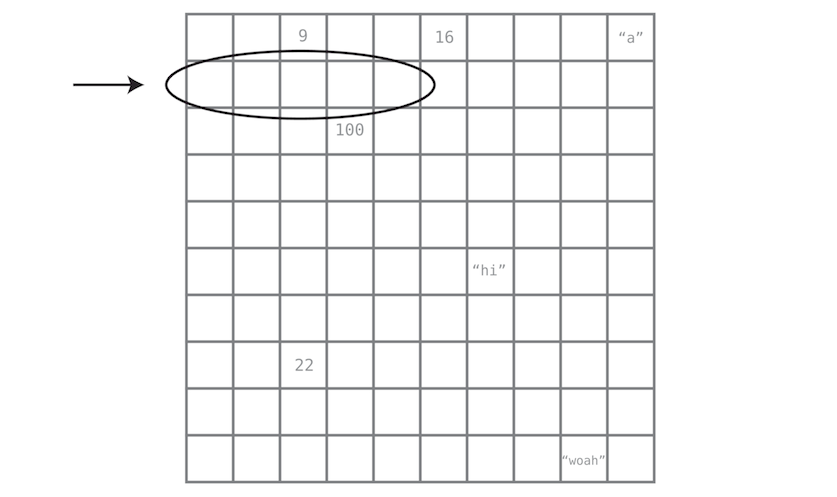
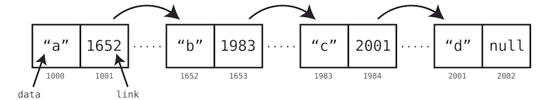

#  Understanding Linked Lists

## Introduction

In this lesson, we will explore the fundamental concepts of linked lists, a common data structure used in computer
science. Unlike arrays, linked lists store elements in non-contiguous memory locations, linked by pointers. This
structure allows for efficient insertion and removal of elements.

## Learning Objectives

By the end of this lesson, you will be able to:

1. Explain the structure of linked lists and how they differ from arrays in terms of data storage.
2. Implement basic and advanced operations on both singly and doubly linked lists, including insertion, deletion, and
   traversal.
3. Evaluate the performance differences between linked lists and arrays, and solve practical problems using linked
   lists.
4. Enhance debugging and problem-solving skills through hands-on exercises that focus on real-world applications of
   linked lists.

## Lesson Overview (120 minutes)

1. [Concept and Structure of Linked Lists](#Concept-and-Structure-of-Linked-Lists)
2. [Basic Operations](#Basic-Operations)
3. [Comparative Analysis with Arrays](#Comparative-Analysis-with-Arrays)
4. [Implementation in Java](#implementation-in-java)
5. [Summary and Takeaways](#Summary-and-Takeaways)

## Concept and Structure of Linked Lists

In computer science, a linked list is a linear collection of data elements, in which linear order is not given by their
physical placement in memory. Instead, each element points to the next. It is a data structure consisting of a group of
nodes which together represent a sequence.

Under the simplest form, each node is composed of data and a reference (in other words, a link) to the next node in the
sequence. This structure allows for efficient insertion or removal of elements from any position in the sequence during
iteration. More complex variants add additional links, allowing efficient insertion or removal from arbitrary element
references.

A drawback of linked lists is that access time is linear (and difficult to pipeline). Faster access, such as random
access, is not feasible. Arrays have better cache locality as compared to linked lists.

Like an array, a linked list is a data structure that represents a list of items. While on the surface, arrays and
linked lists look and act quite similarly, there are big differences under the hood.



You also saw that the computer has the ability to access any memory address in one step, and can use that power to also
immediately access any index within the array. If you wrote code that said, “Look up the value at index 4,” your
computer could locate that cell in a single step. Again, this is because your program knows which memory address the
array starts at—say, memory address 1000—and therefore knows that if it wants to look up index 4, it should simply jump
to memory address 1004.

Linked lists, on the other hand, work quite differently. Instead of being a contiguous block of memory, the data from
linked lists can be scattered across different cells throughout the computer’s memory.

Connected data that is dispersed throughout memory are known as nodes. In a linked list, each node represents one item
in the list. The big question, then, is: if the nodes are not next to each other in memory, how does the computer know
which nodes are part of the same linked list?

This is the key to the linked list: each node also comes with a little extra information, namely, the memory address of
the next node in the list.

This extra piece of data—this pointer to the next node’s memory address—is known as a link. Here is a visual depiction
of a linked list:



In this example, we have a linked list that contains four pieces of data: "a", "b", "c", and "d". However, it uses eight
cells of memory to store this data, because each node consists of two memory cells. The first cell holds the actual
data, while the second cell serves as a link that indicates where in memory the next node begins. The final node’s link
contains null since the linked list ends there.

Note: A linked list’s first node can also be referred to as its head, and its final node as its tail.

The fact that a linked list’s data can be spread throughout the computer’s memory is a potential advantage it has over
the array. An array, by contrast, needs to find an entire block of contiguous cells to store its data, which can get
increasingly difficult as the array size grows. Now, these details are managed by your programming language under the
hood, so you may not have to worry about them. However, you’ll see shortly that there are more tangible differences
between linked lists and arrays that we can sink our teeth into.

## Basic Operations

Implement and understand operations such as insertion, deletion, and traversal using Java code examples provided in the
class materials.

## Comparative Analysis with Arrays

Arrays and linked lists have distinct performance characteristics that make them suitable for different applications.
Arrays, with their static memory allocation, offer constant time complexity (O(1)) for accessing elements by index,
making them exceptionally fast for read operations. However, their fixed size can lead to inefficiency, and inserting or
deleting elements requires shifting subsequent elements, resulting in linear time complexity `(O(n))`. Additionally,
arrays require contiguous blocks of memory, which can lead to fragmentation for large arrays. On the other hand, linked
lists dynamically allocate memory at runtime, allowing them to grow and shrink as needed without predefined limits.

Although accessing elements in a linked list involves linear time complexity `(O(n))` due to traversal, they provide
constant time complexity `(O(1))` for insertions and deletions, making them ideal for applications that require frequent
modifications, such as real-time data processing or transaction logs. Linked lists also reduce memory waste by
allocating memory as needed and can use scattered memory locations, which is advantageous in memory-constrained
environments.

Furthermore, linked lists offer flexibility in implementing other data structures like stacks, queues, and
graphs, making them beneficial for complex data manipulation tasks. While arrays are preferred for scenarios requiring
fast and predictable access to elements, linked lists excel in dynamic data manipulation, offering flexibility,
efficient memory usage, and fast insertions and deletions. Understanding the strengths and weaknesses of both structures
is crucial for selecting the appropriate data structure for a given application.

## Implementation in Java

Here’s what the implementation of a linked list looks like in Java:

### Node Definition

```java
/**
 * This class is the nodes of the SinglyLinked List. They consist of a value and a pointer to the
 * node after them.
 */
public class Node {
    /**
     * The value of the node
     */
    public int value;

    /**
     * Point to the next node
     */
    public Node next;

    Node() {
    }

    /**
     * Constructor
     *
     * @param value Value to be put in the node
     */
    public Node(int value) {
        this(value, null);
    }

    /**
     * Constructor
     *
     * @param value Value to be put in the node
     * @param next  Reference to the next node
     */
    Node(int value, Node next) {
        this.value = value;
        this.next = next;
    }
}
```

### Linked List Operations

````java
import java.util.StringJoiner;

public class SinglyLinkedList {
    /**
     * Head refer to the front of the list
     */
    private Node head;

    /**
     * Size of SinglyLinkedList
     */
    private int size;

    /**
     * Init SinglyLinkedList
     */
    public SinglyLinkedList() {
        head = null;
        size = 0;
    }

    /**
     * Init SinglyLinkedList with specified head node and size
     *
     * @param head the head node of list
     * @param size the size of list
     */
    public SinglyLinkedList(Node head, int size) {
        this.head = head;
        this.size = size;
    }

    /**
     * Inserts an element at the head of the list
     *
     * @param x element to be added
     */
    public void insertHead(int x) {
        insertNth(x, 0);
    }

    /**
     * Insert an element at the tail of the list
     *
     * @param data element to be added
     */
    public void insert(int data) {
        insertNth(data, size);
    }

    /**
     * Inserts a new node at a specified position of the list
     *
     * @param data     data to be stored in a new node
     * @param position position at which a new node is to be inserted
     */
    public void insertNth(int data, int position) {
        checkBounds(position, 0, size);
        Node newNode = new Node(data);
        if (head == null) {
            /* the list is empty */
            head = newNode;
            size++;
            return;
        } else if (position == 0) {
            /* insert at the head of the list */
            newNode.next = head;
            head = newNode;
            size++;
            return;
        }
        Node cur = head;
        for (int i = 0; i < position - 1; ++i) {
            cur = cur.next;
        }
        newNode.next = cur.next;
        cur.next = newNode;
        size++;
    }

    /**
     * Deletes a node at the head
     */
    public void deleteHead() {
        deleteNth(0);
    }

    /**
     * Deletes an element at the tail
     */
    public void delete() {
        deleteNth(size - 1);
    }

    /**
     * Deletes an element at Nth position
     */
    public void deleteNth(int position) {
        checkBounds(position, 0, size - 1);
        if (position == 0) {
            head = head.next;
            size--;
            return;
        }
        Node cur = head;
        for (int i = 0; i < position - 1; ++i) {
            cur = cur.next;
        }
        cur.next = cur.next.next;
        size--;
    }

    /**
     * @param position to check position
     * @param low      low index
     * @param high     high index
     * @throws IndexOutOfBoundsException if {@code position} not in range {@code low} to {@code high}
     */
    public void checkBounds(int position, int low, int high) {
        if (position > high || position < low) {
            throw new IndexOutOfBoundsException(position + "");
        }
    }

    /**
     * Clear all nodes in the list
     */
    public void clear() {
        Node cur = head;
        while (cur != null) {
            cur = cur.next;
        }
        head = null;
        size = 0;
    }

    /**
     * Checks if the list is empty
     *
     * @return {@code true} if list is empty, otherwise {@code false}.
     */
    public boolean isEmpty() {
        return size == 0;
    }

    /**
     * Returns the size of the linked list.
     *
     * @return the size of the list.
     */
    public int size() {
        return size;
    }

    /**
     * Get head of the list.
     *
     * @return head of the list.
     */
    public Node getHead() {
        return head;
    }

    /**
     * Calculate the count of the list manually
     *
     * @return count of the list
     */
    public int count() {
        int count = 0;
        Node cur = head;
        while (cur != null) {
            cur = cur.next;
            count++;
        }
        return count;
    }

    /**
     * Test if the value key is present in the list.
     *
     * @param key the value to be searched.
     * @return {@code true} if key is present in the list, otherwise {@code false}.
     */
    public boolean search(int key) {
        Node cur = head;
        while (cur != null) {
            if (cur.value == key) {
                return true;
            }
            cur = cur.next;
        }
        return false;
    }

    /**
     * Return element at special index.
     *
     * @param index given index of element
     * @return element at special index.
     */
    public int getNth(int index) {
        checkBounds(index, 0, size - 1);
        Node cur = head;
        for (int i = 0; i < index; ++i) {
            cur = cur.next;
        }
        return cur.value;
    }

    @Override
    public String toString() {
        StringJoiner joiner = new StringJoiner("->");
        Node cur = head;
        while (cur != null) {
            joiner.add(cur.value + "");
            cur = cur.next;
        }
        return joiner.toString();
    }
}
````

### Usage Example

```java
public class SinglyLinkedListDemo {
    public static void main(String[] arg) {
        SinglyLinkedList list = new SinglyLinkedList();
        assert list.isEmpty();
        assert list.isEmpty() && list.count() == 0;
        assert list.toString().isEmpty();

        /* Test insert function */
        list.insertHead(5);
        list.insertHead(7);
        list.insertHead(10);
        list.insert(3);
        list.insertNth(1, 4);
        assert list.toString().equals("10->7->5->3->1");
        System.out.println(list);

        /* Test search function */
        assert list.search(10) && list.search(5) && list.search(1) && !list.search(100);

        /* Test get function */
        assert list.getNth(0) == 10 && list.getNth(2) == 5 && list.getNth(4) == 1;

        /* Test delete function */
        list.deleteHead();
        list.deleteNth(1);
        list.delete();
        assert list.toString().equals("7->3");
        System.out.println(list);
        System.out.println(list.search(7));
        assert list.size() == 2 && list.size() == list.count();
        list.clear();
        assert list.isEmpty();
        System.out.println(list);

        try {
            list.delete();
            assert false; /* this should not happen */
        } catch (Exception e) {
            assert true; /* this should happen */
        }
    }
}
```

## Summary and Takeaways

Linked lists are a versatile and fundamental data structure in computer science, useful for many applications where
dynamic data manipulation is required. The key takeaways from this lesson are:

- Understanding the structural differences between linked lists and arrays.
- Mastery of basic operations within linked lists.
- Insight into choosing the right data structure based on the operation efficiency.

Remember to practice the exercises provided to solidify your understanding and application of linked lists in real-world
scenarios.
