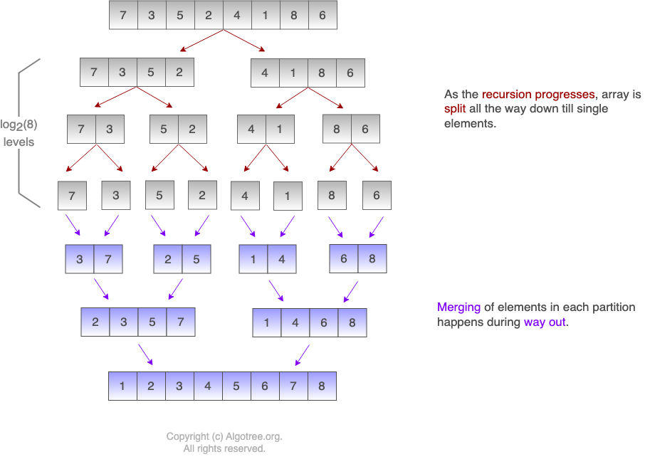

#  Understanding Merge Sort

## Introduction

Merge Sort is a sorting algorithm that utilizes the divide and conquer method to organize elements within an array. The process starts by dividing the array into two halves, and this division continues recursively until each sub-array consists of a single element. Once the division reaches this level, the merging phase starts. During this phase, the sub-arrays are combined in a sorted manner into an auxiliary array, ensuring that the elements are ordered correctly as they are merged back together.

## Learning Objectives

By the end of this lesson, students will be able to:

- Comprehend the divide and conquer strategy used by Merge Sort to partition arrays and recursively sort the partitions.
- Assess the time complexities of Merge Sort in best, average, and worst-case scenarios, and understand the space complexity implications.
- Explore optimization techniques such as iterative implementations and hybrid algorithms to enhance Merge Sort’s efficiency and minimize resource usage.
- Implement Merge Sort in Java and understand the practical considerations for its use.
- Apply knowledge of Merge Sort’s characteristics and optimizations to make informed decisions about its implementation based on specific dataset properties and computational constraints.

## Table of Contents

1. [Introduction](#introduction)
2. [How Merge Sort Works](#how-merge-sort-works)
3. [Time and Space Complexity](#time-and-space-complexity)
4. [Optimizations and Practical Considerations](#optimizations-and-practical-considerations)
5. [Implementation in Java](#implementation-in-java)
6. [Summary and Key Takeaways](#summary-and-key-takeaways)

### Merge Sort

Merge Sort is a sorting algorithm that utilizes the divide and conquer method to organize elements within an array. The
process starts by dividing the array into two halves, and this division continues recursively until each sub-array
consists of a single element. Once the division reaches this level, the merging phase starts. During this phase, the
sub-arrays are combined in a sorted manner into an auxiliary array, ensuring that the elements are ordered correctly as
they are merged back together.

### How Merge Sort Works

1. **Divide the Array**: Start by dividing the array into two halves. If the array has an odd number of elements, one
   half will have one more element than the other.
2. **Recursively Sort**: Continue splitting each half recursively until you are left with sub-arrays that each contain
   only one element. A single element is considered sorted by default.
3. **Merge the Halves**: Begin merging the sub-arrays. To merge two halves, take the smallest element from each half and
   compare them. Append the smaller element to the result array and move the index forward in the array of the element
   that was added.
4. **Continue Merging**: Continue the process until all elements in the two halves have been completely merged into the
   result array. This result array will now be sorted.
5. **Repeat for All Sub-arrays**: Apply steps 1 through 4 recursively to all sub-arrays created by the initial and
   subsequent splits until the entire array is reassembled as a fully sorted array.

By repeatedly dividing the array into smaller and smaller parts and then merging them back together in a sorted order,
Merge Sort efficiently organizes the entire array.



## Time and Space Complexity

#### Time Complexity

Merge Sort is renowned for its consistent performance across all cases—best, average, and worst—with a time complexity
of \(O(n \log n)\). This efficiency stems from the algorithm's strategy of dividing the array into halves and then
merging them back together. Each division reduces the array size logarithmically, while merging them back requires
linear time at each recursion level.

#### Space Complexity of Merge Sort

Unlike some other sorting algorithms, Merge Sort is not an in-place algorithm and therefore requires additional space.
The space complexity for Merge Sort is \(O(n)\) due to the necessity of allocating an auxiliary array to help in merging
the sorted sub-arrays. This factor becomes particularly significant when dealing with large arrays, as the additional
space requirement can be substantial.

## Optimizations and Practical Considerations

1. **Non-Recursive Implementation**: Although traditionally implemented recursively, Merge Sort can also be written
   iteratively which can help in reducing the overhead associated with recursive calls.
2. **Block Merge Sort**: An optimization known as Block Merge Sort (or WikiSort) utilizes a combination of merging and
   insertion sort to minimize the use of additional space and improve performance on nearly sorted arrays.
3. **Hybrid Algorithms**: For smaller arrays, Merge Sort can be less efficient due to its recursive overhead. Hybrid
   sorting algorithms, like Timsort (which combines Merge Sort and Insertion Sort), optimize sorting for smaller or
   partially sorted datasets by switching to a simpler sorting method when dataset sizes decrease below a certain
   threshold.

Understanding these complexities and considerations allows Merge Sort to be tailored effectively to meet specific needs,
balancing between time efficiency and space usage depending on the application context.

## Implementation in Java

Here’s what the implementation of a Merge Sort looks like in Java:

### Selection Merge Sort Definition

```java
public class DivideAndConquerMergeSort {
    private final int[] aux_array;

    // Allocate space to auxiliary array which is to be used for merging the sorted elements
    DivideAndConquerMergeSort(int sz) {
        aux_array = new int[sz];
    }

    // Function to merge the sorted sub-arrays into a bigger array.
    //void Merge (int[] aux_array, int[] array, int low, int mid, int high) {
    void Merge(int[] array, int low, int mid, int high) {

        int left_index = low;
        int right_index = mid + 1;
        int aux_index = low;

        /* Merge elements from array[low : mid] and array[mid+1 : high]
                                      ^                     ^
                                      |                     |
                                  left_index         right_index */

        // Pick the smaller number between the left part and the right part
        while (left_index <= mid && right_index <= high) {
            if (array[left_index] <= array[right_index]) {
                aux_array[aux_index++] = array[left_index++];
            } else {
                aux_array[aux_index++] = array[right_index++];
            }
        }

        if (left_index <= mid) {
            // There are still some unpicked numbers in the left part
            for (int i = left_index; i <= mid; i++) {
                aux_array[aux_index++] = array[i];
            }
        } else {
            // There are still some unpicked numbers in the right part
            for (int i = right_index; i <= high; i++) {
                aux_array[aux_index++] = array[i];
            }
        }

        // Copy numbers from the sorted auxiliary array into the original array
        if (high + 1 - low >= 0) System.arraycopy(aux_array, low, array, low, high + 1 - low);
    }

    // MergeSort function splits each sub-array till only a single element is available in the sub-array
    // and then proceeds with the merge of the sub-arrays into a bigger auxiliary array.
    //void MergeSort (int[] aux_array, int[] array, int low, int high) {
    void MergeSort(int[] array, int low, int high) {

        int mid;
        if (low < high) {
            mid = (low + high) / 2;
            MergeSort(array, low, mid); // Recursively splits left half of the array
            MergeSort(array, mid + 1, high); // Recursively splits right half of the array
            Merge(array, low, mid, high); // Merge left and right half of the array keeping it sorted.
        }
    }
}
```

### Usage Example

```java
public class MergeSortDemo {
    public static void main(String[] args) {

        int[] array = {7, 3, 5, 2, 4, 1, 8, 6};
        //int[] aux_array = new int[array.length];

        System.out.print("Unsorted array: ");

        for (int j : array) System.out.print(j + " ");
        System.out.println();

        DivideAndConquerMergeSort divideAndConquerMergeSort = new DivideAndConquerMergeSort(array.length);
        divideAndConquerMergeSort.MergeSort(array, 0, array.length - 1);
        System.out.print("Sorted array using Merge-Sort: ");

        for (int j : array) System.out.print(j + " ");
    }
}
```

## Summary and Key Takeaways

Merge Sort is a highly effective sorting algorithm that utilizes the divide and conquer approach to achieve efficient
sorting of arrays across various scenarios. Here are the essential points and takeaways:

1. **Consistent Performance**: Merge Sort guarantees a time complexity of \(O(n \log n)\) regardless of the input's
   initial order. This makes it highly reliable for performance-critical applications where predictability in execution
   time is crucial.

2. **Space Requirements**: While Merge Sort is powerful in terms of its sorting capabilities, it does require additional
   space. The space complexity is \(O(n)\), which is necessary for the auxiliary arrays used during the merge process.
   This can be a drawback when handling extremely large datasets or in environments with limited memory resources.

3. **Divide and Conquer Strategy**: The core of Merge Sort's efficiency lies in its ability to break down the problem
   into smaller, more manageable sub-problems (sub-arrays), sort those recursively, and then combine (merge) them back
   into a sorted whole. This method is particularly useful for sorting linked lists and large arrays efficiently.

4. **Suitability for Large Data Sets**: Due to its stable sorting and non-in-place nature, Merge Sort is well-suited for
   sorting large datasets that do not fit entirely into memory. It is commonly used in external sorting applications.

5. **Trade-offs and Applications**: Users of Merge Sort must consider the trade-off between time efficiency and space
   usage. Despite its additional space requirement, its predictable time complexity makes it a preferred choice in
   scenarios where stability and consistency are paramount.

Understanding these key points about Merge Sort helps in selecting the right sorting algorithm based on specific needs
and constraints, ensuring optimal performance and resource utilization in software development and data processing
tasks.
