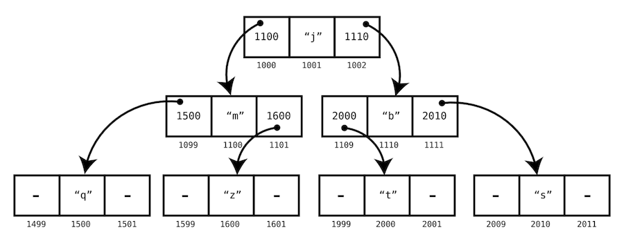
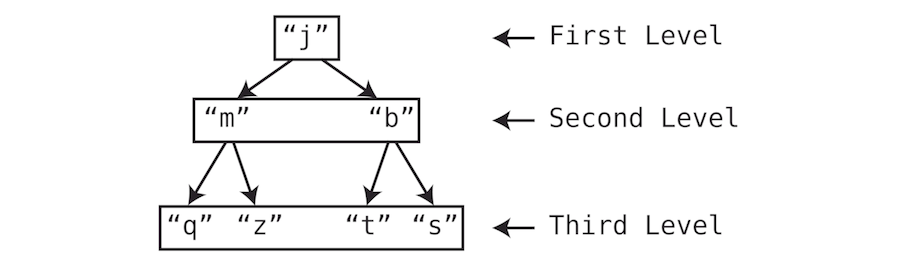

#  Tree Algorithms

## Introduction

In a traditional linked list, each node is linked to a single other node. However, a tree, another node-based structure, differs in that each node can have links to multiple nodes.

## Learning Objectives

By the end of this lesson, students will be able to:

- Understand the structure and terminology of trees, including nodes, roots, parents, children, descendants, and ancestors.
- Explain the concept and properties of Binary Search Trees (BST), including their ordered structure and efficient search operations.
- Implement search, insertion, and deletion operations in a BST, maintaining its ordering property.
- Perform tree traversals (Inorder, Preorder, Postorder) and understand their use cases.
- Evaluate the time and space complexities of BST operations and identify scenarios where BSTs are advantageous.


## Course Overview (180 minutes)

1. [Introduction](#introduction-to-trees)
2. [Tree Terminology and Structure](#tree-terminology-and-structure)
3. [Binary Search Trees](#binary-search-trees)
4. [Search Operation in BST](#search-operation-in-bst)
5. [Insertion Operation in BST](#insertion-operation-in-bst)
6. [Deletion Operation in BST](#deletion-operation-in-bst)
7. [Traversing Trees](#traversing-trees)
8. [Implementation in Java](#implementation-in-java)
9. [Summary and Key Takeaways](#summary-and-key-takeaways)


## Introduction to Trees

In a traditional linked
list, each node is linked to a single other node. However, a tree, another node-based structure, differs in that each
node can have links to multiple nodes. Below is a simple visualization of a tree:



In this instance, every node has links directing to two other nodes. For simplicity's sake, we can visually represent
this tree without displaying all the memory addresses:


Trees have their own unique nomenclature:

- The topmost node (in our example, "j") is referred to as the root. In our illustration, the root is situated at the
  apex, as is customary in tree depictions.
- In our example, we would describe "j" as the parent of "m" and "b." Conversely, "m" and "b" are the children of "j."
  Similarly, "m" is the parent of "q" and "z," while "q" and "z" are its children.
- Similar to a family tree, nodes in a tree can have descendants and ancestors. Descendants are all nodes stemming from
  a particular node, while ancestors are all nodes from which a node originates. In our example, "j" is the ancestor of
  all other nodes, making all other nodes descendants of "j."
- Trees are organized into levels, with each level representing a row within the tree. Our example tree consists of
  three levels:
- A key characteristic of a tree is its balance. A tree achieves balance when the subtrees of its nodes contain an equal
  number of nodes.



For example, the aforementioned tree is considered perfectly balanced. Upon examining each node, you'll notice that its
two subtrees contain an equal number of nodes. Take the root node ("j"), for instance, which has two subtrees, each
containing three nodes. This balance holds true for every node in the tree. For instance, node "m" also exhibits two
subtrees, each housing one node.

Conversely, the subsequent tree is unbalanced:


As observed, the right subtree of the root contains more nodes than its left subtree, resulting in an imbalance.

## Binary Search Trees

Let's explore the Binary Search Tree (BST) concept in depth before delving into its attributes.

A Binary Search Tree belongs to the family of binary trees, which are hierarchical data structures comprising nodes,
each having at most two children: a "left" child and a "right" child. What sets a BST apart from a standard binary tree
is its specific organization of values.

To grasp this concept better, let's dissect the terminology: "binary" and "search."

In essence, a binary tree accommodates nodes with zero, one, or two children.

Now, a binary search tree (BST) is a type of binary tree that adheres to a particular set of regulations:

- Every node may have at most one "left" child and one "right" child.
- The values within a node's "left" subtree must be inferior to the node's value, while those within its "right" subtree
  must be superior.

For instance, consider this numerical example of a binary search tree:

```text
        10
       /  \
      5    15
     / \   / \
    2   8 12  20
```

In this BST:

- The root node is 10.
- The left subtree of 10 contains values less than 10 (5, 2, 8).
- The right subtree of 10 contains values greater than 10 (15, 12, 20).

In a BST:

- Each node holds a value.
- The "left" child of a node harbors a value smaller than the node's value.
- The "right" child of a node harbors a value greater than the node's value.
- These principles are applied recursively throughout the tree.

This hierarchical arrangement facilitates efficient search operations within the tree. During a search, comparisons
steer the process left or right based on whether the sought-after value is lesser or greater than the current node's
value. This binary search strategy continues until the value is located or determined to be absent from the tree.

Now, let's delineate the prominent features and characteristics of a Binary Search Tree:

1. **Ordered Structure**: BSTs maintain an ordered structure based on the values stored in their nodes. This ordering
   facilitates operations like searching, insertion, and deletion, offering logarithmic time complexity on average.
2. **Efficient Searching**: Due to their ordered nature, BSTs enable efficient searching. The binary search algorithm
   efficiently narrows down the search space by traversing the tree in a binary manner, making comparisons at each node
   to determine the next step.
3. **Space Efficiency**: BSTs offer space efficiency in terms of memory consumption. Unlike other tree structures like
   balanced trees, AVL trees, or red-black trees, BSTs do not require additional balancing mechanisms, resulting in
   simpler implementations and less memory overhead.
4. **Dynamic Structure**: BSTs can dynamically adjust their structure through insertion and deletion operations while
   preserving their ordering property. When a new value is inserted or an existing value is deleted, the tree's
   structure is adjusted accordingly to maintain the binary search tree properties.
5. **Versatile Application**: Binary search trees find applications in various domains, including database indexing,
   dynamic sets, and search algorithms. Their efficient searching capabilities make them valuable in scenarios where
   quick retrieval of data is essential.

By understanding these features, one can appreciate the utility and significance of Binary Search Trees as a fundamental
data structure in computer science and software development.

## Search Operation in BST

Searching for a node within a Binary Search Tree (BST) involves traversing the tree based on the value being searched
for, guided by the BST's ordering property. Here's an explanation of the search process along with its algorithm and
time complexity:

#### Explanation:

To search for a node with a specific value in a BST:

1. Start at the root node.
2. Compare the target value with the value of the current node.
3. If the target value matches the current node's value, return the node.
4. If the target value is less than the current node's value, move to the left subtree.
5. If the target value is greater than the current node's value, move to the right subtree.
6. Repeat steps 2-5 until the target value is found or until reaching a leaf node (indicating the value is not present
   in the tree).

#### Algorithm

```text
search(root, target):
    1. Set current to the root node.
    2. While current is not null:
    3.     If target equals current's value, return current.
    4.     If target is less than current's value, set current to current's left child.
    5.     If target is greater than current's value, set current to current's right child.
    6. Return null (indicating target not found).
```

#### Time Complexity:

The time complexity of searching in a Binary Search Tree is determined by the height of the tree. In a balanced BST,
where the tree is evenly distributed, the height is logarithmic (log n), resulting in an average-case time complexity of
O(log n), where n is the number of nodes in the tree.

However, in the worst-case scenario, where the tree is skewed (i.e., resembling a linked list), the height becomes
linear (n), resulting in a worst-case time complexity of O(n).

#### Example:

Consider the following BST:

```text
        10
       /  \
      5    15
     / \   / \
    2   8 12  20
```

Let's search for the node with the value 12:

1. Start at the root node (10).
2. Compare 12 with the root's value (10).
3. Since 12 is greater than 10, move to the right subtree.
4. Compare 12 with the value of the current node (15).
5. Since 12 is less than 15, move to the left subtree.
6. Compare 12 with the value of the current node (12).
7. Found the node with the value 12. Return this node.

## Insertion Operation in BST

Inserting a new node into a Binary Search Tree (BST) involves maintaining the tree's ordering property while finding the
appropriate position for the new node. Below is an explanation of the insertion process along with its algorithm and
time complexity:

#### Explanation:

To insert a new node with a specific value into a BST:

1. Start at the root node.
2. Compare the value of the new node with the value of the current node.
3. If the new node's value is less than the current node's value, move to the left subtree.
4. If the new node's value is greater than the current node's value, move to the right subtree.
5. Repeat steps 2-4 until finding an empty spot (a leaf node) where the new node can be inserted.
6. Insert the new node at that spot while maintaining the BST property.

#### Algorithm:

```text
insert(root, value):
    1. If the tree is empty, create a new node with the given value and make it the root.
    2. Otherwise, start at the root.
    3. While true:
    4.     If value is less than the current node's value:
    5.         If the left child of the current node is null:
    6.             Create a new node with the given value and set it as the left child of the current node.
    7.             Break the loop.
    8.         Else:
    9.             Move to the left child.
    10.    Else if value is greater than the current node's value:
    11.        If the right child of the current node is null:
    12.            Create a new node with the given value and set it as the right child of the current node.
    13.            Break the loop.
    14.        Else:
    15.            Move to the right child.
```

#### Time Complexity:

The time complexity of inserting into a Binary Search Tree depends on the height of the tree. In a balanced BST, the
height is logarithmic (log n), resulting in an average-case time complexity of O(log n), where n is the number of nodes
in the tree.

However, in the worst-case scenario, where the tree is skewed, the height becomes linear (n), resulting in a worst-case
time complexity of O(n).

#### Example:

Consider the following BST:

````text
        10
       /  \
      5    15
     / \   / \
    2   8 12  20
````

Let's insert a new node with the value 9:

1. Start at the root node (10).
2. Compare 9 with the value of the current node (10).
3. Since 9 is less than 10, move to the left subtree.
4. Compare 9 with the value of the current node (5).
5. Since 9 is greater than 5, move to the right subtree.
6. Compare 9 with the value of the current node (8).
7. Since 9 is greater than 8 and the right child of 8 is null, insert the new node with the value 9 as the right child
   of 8.

After inserting the new node with the value 9 into the given BST, the resulting tree would look like this:

```text
        10
       /  \
      5    15
     / \   / \
    2   8 12  20
         \
          9
```

The new node with the value 9 is inserted as the right child of the node with the value 8, maintaining the BST property
where all values in the left subtree are less than the node's value, and all values in the right subtree are greater.

## Deletion Operation in BST

Deleting a node from a Binary Search Tree (BST) involves rearranging the tree while maintaining its ordering property.
Below is an explanation of the deletion process along with its algorithm and time complexity:

#### Explanation:

To delete a node with a specific value from a BST:

1. Start at the root node.
2. Search for the node to be deleted.
3. If the node has no children (leaf node), simply remove it from the tree.
4. If the node has one child, replace the node with its child.
5. If the node has two children, replace the node with the value of its inorder successor (or predecessor), and then
   delete the successor (or predecessor) node.

```text
delete(root, value):
    1. If the tree is empty, return null.
    2. Find the node to be deleted:
    3.     If value is less than the current node's value, move to the left subtree.
    4.     If value is greater than the current node's value, move to the right subtree.
    5.     If value equals the current node's value, perform deletion based on the number of children:
    6.         If the node has no children or one child:
    7.             Replace the node with its child (or null if it has no children).
    8.         If the node has two children:
    9.             Find the inorder successor (or predecessor) of the node.
    10.            Replace the node's value with the successor's (or predecessor's) value.
    11.            Recursively delete the successor (or predecessor) node from its subtree.
```

#### Time Complexity:

The time complexity of deleting a node from a Binary Search Tree depends on the height of the tree. In a balanced BST,
the height is logarithmic (log n), resulting in an average-case time complexity of O(log n), where n is the number of
nodes in the tree.

However, in the worst-case scenario, where the tree is skewed, the height becomes linear (n), resulting in a worst-case
time complexity of O(n).

#### Example:

Consider the following BST:

```text
        10
       /  \
      5    15
     / \   / \
    2   8 12  20
         \
          9
```

Let's delete the node with the value 8:

1. Start at the root node (10).
2. Compare 8 with the value of the current node (10).
3. Since 8 is less than 10, move to the left subtree.
4. Compare 8 with the value of the current node (5).
5. Since 8 is greater than 5, move to the right subtree.
6. Compare 8 with the value of the current node (8).
7. Node with the value 8 is found and has one child (9).
8. Replace node 8 with its child (9).

The resulting tree after deletion:

```text
        10
       /  \
      5    15
     / \   / \
    2   9 12  20
```

## Traversing Trees

Traversing a Binary Search Tree (BST) involves visiting each node in a specific order. The three common methods of tree
traversal are Inorder, Preorder, and Postorder. Below, I'll explain each traversal method along with its algorithm and
time complexity, using the same BST provided earlier.

```text
        10
       /  \
      5    15
     / \   / \
    2   8 12  20
         \
          9
```

#### Inorder Traversal:

In an Inorder Traversal, nodes are visited in the order: left subtree, root, right subtree.

#### Algorithm:

1. Traverse the left subtree recursively:
    - Start from the root (10) and move to its left subtree.
    - From node 10, move to node 5.
    - Traverse the left subtree of 5, which is rooted at 2.
    - Continue traversing the left subtree of 2 until reaching the leftmost node.
    - Visit the leftmost node (2).
2. Visit the current node:
    - After completing the left subtree, visit the current node.
    - Visit node 5.
3. Traverse the right subtree recursively:
    - After visiting the current node, traverse its right subtree recursively.
    - From node 5, move back up to its parent node 10.
    - Traverse the right subtree of 10, which is rooted at 15.
    - Visit the left subtree of 15, which is rooted at 12.
    - Continue traversing the left subtree of 12 until reaching the leftmost node.
    - Visit the leftmost node (12).
4. Visit the current node:
    - After completing the left subtree, visit the current node.
    - Visit node 15.
5. Traverse the right subtree recursively:
    - After visiting the current node, traverse its right subtree recursively.
    - From node 15, move back up to its parent node 10.
    - Traverse the right subtree of 10, which is rooted at 20.
    - Visit the left subtree of 20.
    - Visit the leftmost node (20).

Following this sequence, we obtain the Inorder Traversal:

```text
2 -> 5 -> 8 -> 9 -> 10 -> 12 -> 15 -> 20
```

Each node is visited after its left subtree has been traversed and before its right subtree is traversed recursively.

#### Time Complexity:

The time complexity of Inorder Traversal is O(n), where n is the number of nodes in the tree.

#### Preorder Traversal:

In a Preorder Traversal, nodes are visited in the order: root, left subtree, right subtree.

#### Algorithm:

1. Visit the current node:
    - Start from the root (10) and visit it first.
2. Traverse the left subtree recursively:
    - After visiting the root, move to its left subtree.
    - From node 10, move to node 5.
    - Continue traversing the left subtree of 5 until reaching the leftmost node (2).
    - No further left subtree exists for node 2, so move back up.
3. Traverse the right subtree recursively:
    - After completing the left subtree, traverse the right subtree of the current node.
    - From node 2, move back to its parent node 5.
    - Traverse the right subtree of 5, which is rooted at 8.
    - Continue traversing the right subtree of 8 until reaching the rightmost node (9).
    - No further right subtree exists for node 9, so move back up.

Following this sequence, we obtain the Preorder Traversal:

```text
10 -> 5 -> 2 -> 8 -> 9 -> 15 -> 12 -> 20
```

Each node is visited before its left and right subtrees are traversed recursively.

#### Time Complexity:

The time complexity of Preorder Traversal is O(n), where n is the number of nodes in the tree.

#### Postorder Traversal:

In a Postorder Traversal, nodes are visited in the order: left subtree, right subtree, root.

#### Algorithm:

1. Traverse the left subtree recursively:
    - Starting from the root (10), move to the left subtree.
    - Traverse the left subtree of 10, which is rooted at 5.
    - In the left subtree of 5, traverse the left subtree of 5, which is rooted at 2.
    - No further left subtree exists for node 2, so move back up.
2. Traverse the right subtree recursively:
    - After completing the left subtree, traverse the right subtree of the current node.
    - From node 2, move back to its parent node 5.
    - Traverse the right subtree of 5, which is rooted at 8.
    - In the right subtree of 8, traverse the left subtree of 8, which is rooted at 9.
    - No further left subtree exists for node 9, so move back up.
3. Visit the current node:
    - After traversing both left and right subtrees of the current node, visit the current node.
    - Starting from the root, visit node 10.

Following this sequence, we obtain the Postorder Traversal:

```text
2 -> 9 -> 8 -> 5 -> 12 -> 20 -> 15 -> 10
```

Each node is visited only after its left and right subtrees have been traversed recursively.

#### Time Complexity:

The time complexity of Postorder Traversal is O(n), where n is the number of nodes in the tree.

These traversal methods provide different perspectives on the structure of the tree and are useful for various
applications such as searching, printing, and evaluating expressions.

## Implementation in Java

Here’s what the implementation of a BST looks like in Java:

### BST Node Definition

```java
class BSTNode {
    BSTNode left, right;
    int data;

    /* Constructor */
    public BSTNode() {
        left = null;
        right = null;
        data = 0;
    }

    /* Constructor */
    public BSTNode(int n) {
        left = null;
        right = null;
        data = n;
    }

    /* Function to set left node */
    public void setLeft(BSTNode n) {
        left = n;
    }

    /* Function to set right node */
    public void setRight(BSTNode n) {
        right = n;
    }

    /* Function to get left node */
    public BSTNode getLeft() {
        return left;
    }

    /* Function to get right node */
    public BSTNode getRight() {
        return right;
    }

    /* Function to set data to node */
    public void setData(int d) {
        data = d;
    }

    /* Function to get data from node */
    public int getData() {
        return data;
    }
}
```

### BST Definition

```java
import java.util.Scanner;

class BST {
    private BSTNode root;

    /* Constructor */
    public BST() {
        root = null;
    }

    /* Function to check if tree is empty */
    public boolean isEmpty() {
        return root == null;
    }

    /* Functions to insert data */
    public void insert(int data) {
        root = insert(root, data);
    }

    /* Function to insert data recursively */
    private BSTNode insert(BSTNode node, int data) {
        if (node == null)
            node = new BSTNode(data);
        else {
            if (data <= node.getData())
                node.left = insert(node.left, data);
            else
                node.right = insert(node.right, data);
        }
        return node;
    }

    /* Functions to delete data */
    public void delete(int k) {
        if (isEmpty())
            System.out.println("Tree Empty");
        else if (!search(k))
            System.out.println("Sorry " + k + " is not present");
        else {
            root = delete(root, k);
            System.out.println(k + " deleted from the tree");
        }
    }

    private BSTNode delete(BSTNode root, int k) {
        BSTNode p, p2, n;
        if (root.getData() == k) {
            BSTNode lt, rt;
            lt = root.getLeft();
            rt = root.getRight();
            if (lt == null && rt == null)
                return null;
            else if (lt == null) {
                p = rt;
                return p;
            } else if (rt == null) {
                p = lt;
                return p;
            } else {
                p2 = rt;
                p = rt;
                while (p.getLeft() != null)
                    p = p.getLeft();
                p.setLeft(lt);
                return p2;
            }
        }
        if (k < root.getData()) {
            n = delete(root.getLeft(), k);
            root.setLeft(n);
        } else {
            n = delete(root.getRight(), k);
            root.setRight(n);
        }
        return root;
    }

    /* Functions to count number of nodes */
    public int countNodes() {
        return countNodes(root);
    }

    /* Function to count number of nodes recursively */
    private int countNodes(BSTNode r) {
        if (r == null)
            return 0;
        else {
            int l = 1;
            l += countNodes(r.getLeft());
            l += countNodes(r.getRight());
            return l;
        }
    }

    /* Functions to search for an element */
    public boolean search(int val) {
        return search(root, val);
    }

    /* Function to search for an element recursively */
    private boolean search(BSTNode r, int val) {
        boolean found = false;
        while ((r != null) && !found) {
            int rval = r.getData();
            if (val < rval)
                r = r.getLeft();
            else if (val > rval)
                r = r.getRight();
            else {
                found = true;
                break;
            }
            found = search(r, val);
        }
        return found;
    }

    /* Function for inorder traversal */
    public void inorder() {
        inorder(root);
    }

    private void inorder(BSTNode r) {
        if (r != null) {
            inorder(r.getLeft());
            System.out.print(r.getData() + " ");
            inorder(r.getRight());
        }
    }

    /* Function for preorder traversal */
    public void preorder() {
        preorder(root);
    }

    private void preorder(BSTNode r) {
        if (r != null) {
            System.out.print(r.getData() + " ");
            preorder(r.getLeft());
            preorder(r.getRight());
        }
    }

    /* Function for postorder traversal */
    public void postorder() {
        postorder(root);
    }

    private void postorder(BSTNode r) {
        if (r != null) {
            postorder(r.getLeft());
            postorder(r.getRight());
            System.out.print(r.getData() + " ");
        }
    }
}
```

### Usage Example

```java
import java.util.Scanner;

class BinarySearchTreeDemo {
    public static void main(String[] args) {
        Scanner scan = new Scanner(System.in);
        /* Creating object of BST */
        BST bst = new BST();
        System.out.println("Binary Search Tree Test\n");
        char ch;
        /*  Perform tree operations  */
        do {
            System.out.println("\nBinary Search Tree Operations\n");
            System.out.println("1. insert ");
            System.out.println("2. delete");
            System.out.println("3. search");
            System.out.println("4. count nodes");
            System.out.println("5. check empty");

            int choice = scan.nextInt();
            switch (choice) {
                case 1:
                    System.out.println("Enter integer element to insert");
                    bst.insert(scan.nextInt());
                    break;
                case 2:
                    System.out.println("Enter integer element to delete");
                    bst.delete(scan.nextInt());
                    break;
                case 3:
                    System.out.println("Enter integer element to search");
                    System.out.println("Search result : " + bst.search(scan.nextInt()));
                    break;
                case 4:
                    System.out.println("Nodes = " + bst.countNodes());
                    break;
                case 5:
                    System.out.println("Empty status = " + bst.isEmpty());
                    break;
                default:
                    System.out.println("Wrong Entry \n ");
                    break;
            }
            /*  Display tree  */
            System.out.print("\nPost order : ");
            bst.postorder();
            System.out.print("\nPre order : ");
            bst.preorder();
            System.out.print("\nIn order : ");
            bst.inorder();

            System.out.println("\nDo you want to continue (Type y or n) \n");
            ch = scan.next().charAt(0);
        } while (ch == 'Y' || ch == 'y');
    }
}
```

## Summary and Key Takeaways

Binary Search Trees (BSTs) are fundamental data structures in computer science, offering efficient searching, insertion,
and deletion operations. Let's summarize the key aspects and takeaways of BSTs:

- **Definition**:
    - A Binary Search Tree is a binary tree in which each node has at most two children, and the left subtree contains
      nodes with values less than the current node, while the right subtree contains nodes with values greater than the
      current node.
- **Properties**:
    - **Ordered Structure**: BSTs maintain an ordered structure based on the values stored in their nodes, facilitating
      efficient searching operations.
    - **Efficient Searching**: Searching in BSTs follows a binary search algorithm, resulting in a time complexity of O(
      log n) in average cases.
    - **Dynamic Structure**: BSTs can dynamically adjust their structure through insertion and deletion operations while
      preserving their ordering property.
- **Operations**:
    - **Insertion**: Adding a new node to the BST while maintaining its ordering property.
    - **Deletion**: Removing a node from the BST while ensuring that the tree remains a valid BST.
    - **Searching**: Finding a node with a specific value in the BST using a binary search algorithm.
- **Traversal Methods**:
    - **Inorder Traversal**: Visiting nodes in ascending order.
    - **Preorder Traversal**: Visiting the current node before its children.
    - **Postorder Traversal**: Visiting the children before the current node.
- **Time Complexity**:
    - The time complexity of basic operations like insertion, deletion, and searching in a BST depends on the height of
      the tree.
    - In balanced BSTs, these operations have an average time complexity of O(log n), while in skewed BSTs, they can
      degrade to O(n).

Binary Search Trees are versatile data structures used in various applications, including database indexing, dynamic
sets, and search algorithms. Understanding BSTs and their operations is essential for efficient algorithm design and
problem-solving in computer science.
