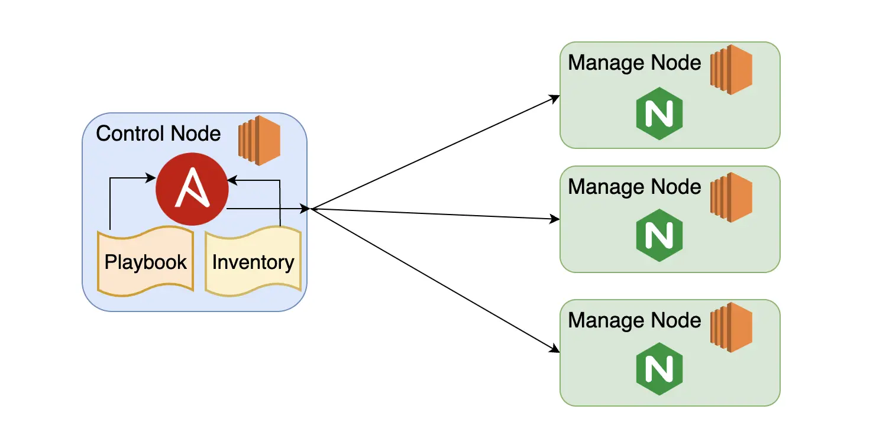
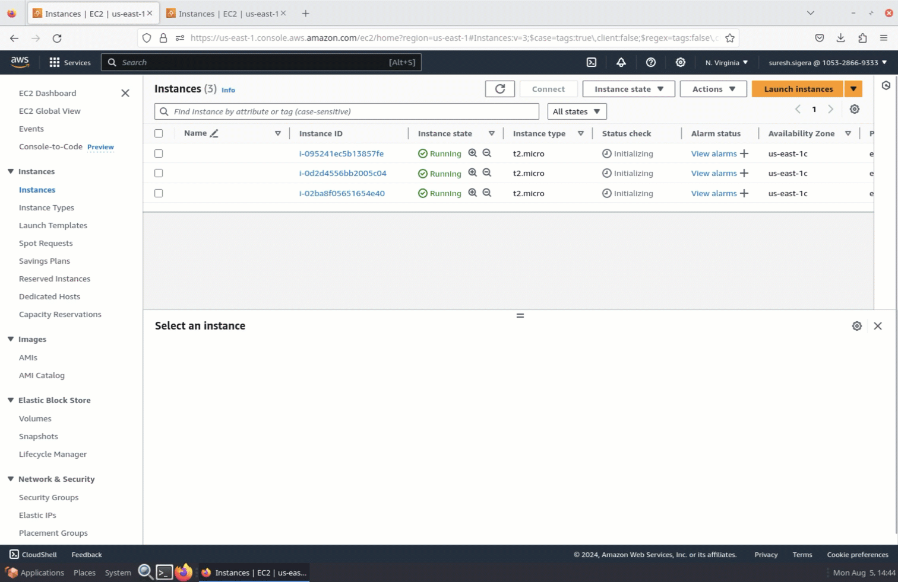

#  Ansible Configuration Management with AWS EC2 Instances

|                          Title                          |  Type   | Duration |       Creator        |
|:-------------------------------------------------------:|:-------:|:--------:|:--------------------:|
| Ansible Configuration Management with AWS EC2 Instances | Lecture |   4:00   | Suresh Melvin Sigera |

## Objectives:

- Set up multiple EC2 instances on AWS for Ansible management.
- Install and configure Ansible on a designated control node.
- Establish secure SSH connections between the control node and managed nodes.
- Create and understand the structure of an Ansible inventory file.
- Develop an Ansible playbook to automate the installation and configuration of Nginx.
- Execute an Ansible playbook and understand its output.
- Verify the results of Ansible automation across multiple servers.
- Gain practical experience with basic Ansible concepts including inventories, playbooks, and tasks.

## Prerequisites

Before we start, you'll need:

1. An active AWS account
2. Basic knowledge of AWS EC2 instances
3. Familiarity with command-line interfaces

### What is Ansible? (5 minutes)

Ansible is an automation tool that allows you to configure and manage multiple computers simultaneously. It uses two
types of computers:



- **Control Node**: This is where you install Ansible and run commands from.
- **Managed Nodes**: These are the remote computers you want to manage.

### Step 1: Set Up SSH key pair (10 minutes)

An SSH key pair is a crucial security mechanism used to access AWS EC2 instances. It consists of two parts: a public
key, which AWS stores, and a private key file, which you keep. This system functions similarly to a lock and key, where
the public key is the lock and the private key is your unique key to access the instance. SSH key pairs are important
because they enhance security by providing a more secure login method compared to passwords. They also facilitate
automation, as key pairs are essential for automated scripts and tools, and they allow for easy access control by
managing the distribution of private keys.

- Log into the AWS Management Console
- Navigate to the EC2 dashboard
- Find "Key Pairs" under "Network & Security"
- Click "Create Key Pair"
- Name your key pair (firstname.lastname)
- Choose the file format (.pem for OpenSSH, .ppk for PuTTY)
- Click "Create"
- Save the downloaded private key file securely

### Step 2: Set Up EC2 Instances (30 minutes)

In this step, we will set up four EC2 instances: one will serve as the control node and the remaining three will act as
managed nodes. Here's a detailed guide to ensure a smooth setup process.

- **Launch Instances:**
    - On the EC2 dashboard, click the "Launch Instances" button to start the instance creation process.
- **Choose Amazon Linux 2023:**
    - In the "Choose an Amazon Machine Image (AMI)" step, select "Amazon Linux 2023 AMI (HVM), SSD Volume Type." This is
      a widely used and well-supported operating system for various AWS services and automation tools.
- **Configure Instance Details:**
    - In the "Instance Type" step, select the instance type that suits your needs (e.g., t2.micro for free tier eligible
      instances).
    - Click "Next: Configure Instance Details" to proceed.
    - Ensure the "Number of instances" is set to `4`.
    - In the "Network" section, select the VPC and subnet that match your networking requirements.
    - Keep the default settings for other options unless you have specific configurations in mind.
- **Add Storage:**
    - In the "Add Storage" step, keep the default storage settings or adjust as needed for your workload.
- **Configure Security Group:**
    - In the "Configure Security Group" step, you can create a new security group or select an existing one.
    - Ensure the security group has the following rules:
        - SSH (port `22`): Allows you to SSH into your instances.
            - Type: SSH
            - Protocol: TCP
            - Port Range: `22`
            - Source: Anywhere (`0.0.0.0/0`)
        - HTTP (port `80`): Allows web traffic to your instances.
            - Type: HTTP
            - Protocol: TCP
            - Port Range: `80`
            - Source: Anywhere (`0.0.0.0/0`)
- **Review and Launch:**
    - Click "Review and Launch" to proceed to the final review step.
    - Review your instance configuration to ensure everything is set up correctly.
      Click "Launch."
- **Select Key Pair:**
    - Use the keypair you created earlier: `firstname.lastname`
- **Launch Instances:**
    - Click "Launch Instances" to start the instance creation process.
    - Once the instances are launched, navigate to the "View Instances" button to see your running instances.
- **Verify Instances:**
    - Ensure that all four instances are running and have passed their initial status checks.
    - Note the public IP addresses of your instances for SSH access and further configuration.
- **Add Tags:**
    - Optionally, add tags to help identify and manage your instances. For example, you can tag one instance
      as `Control Node` and the others as `Managed Node`.
    - 

By following these steps, you will have successfully set up four EC2 instances with one designated as the control node
and three as managed nodes, ready for further configuration and use.

### Step 3: Install Ansible on the Control Node (20 minutes)

In this step, we'll install Ansible on the designated control node. This node will be responsible for managing the other
instances.

- **Open an SSH client:** On Windows, you might use PuTTY or Windows Subsystem for Linux (WSL). On macOS or Linux, you
  can use the built-in Terminal.
- **Locate your private key file:** Find the .pem file you downloaded earlier. In this case, it's named "
  firstname.lastname.pem". Ensure you know the full path to this file.
- **Set appropriate permissions for the key file:** For security reasons, your key must not be publicly viewable. Run
  this command in your terminal:
    - `chmod 400 /path/to/your/firstname.lastname.pem`
    - This sets read permission for the owner only.
- **Connect to your control node:** Use the following command to SSH into your control node. Replace <control-node-ip>
  with the actual public IP address of your control node:
    - `ssh -i /path/to/your/firstname.lastname.pem ec2-user@<control-node-ip>`
        - For example, if your control node's IP address is `3.91.32.232`, you would use:
            - `ssh -i /path/to/your/firstname.lastname.pem ec2-user@3.91.32.232`
- **Switch to root user:**
    - To simplify subsequent commands and avoid using `sudo` for each operation, switch to the root user:
    - `sudo su`
        - Your prompt should change to indicate you're now the root user.
- **Update the system and install Ansible:**
    - Run the following commands to update the system and install Ansible:
        - `sudo dnf update -y`
        - `sudo dnf install ansible-core -y`
    - Note: Amazon Linux 2023 uses `dnf` as its package manager. Since AL2023.2 (October 2023), Ansible is available directly in the Amazon Linux repositories.
- **Verify the installation:**
    - Check that Ansible was installed correctly by running:
        - `ansible --version`
        - This should display the version of Ansible installed along with some configuration information.

By following these steps, you will have successfully connected to your control node, switched to the root user, and
installed Ansible, preparing it to manage your other EC2 instances. The control node is now ready for further
configuration and to begin managing the other nodes in your setup.

### Step 4: Set Up SSH Access (20 minutes)

To manage the other instances, the control node needs SSH access to them. We'll set this up by copying the SSH key to
the control node and testing the connection.

- Open a terminal on your local machine, and `cd` into the directory where your SSH key is stored.
- **Copy your SSH key to the control node:** On your local machine, use the following command to securely copy your SSH
  key to the control node. Replace the placeholders with your actual values:
    - ```scp -i "firstname.lastname.pem" "firstname.lastname.pem" ec2-user@<control-node-ip>:~/.ssh/```
    - For example, if your control node's IP is `3.91.32.232`, the command would be:
        - ```scp -i "firstname.lastname.pem" "firstname.lastname.pem" ec2-user@3.91.32.232:~/.ssh/```
        - This command securely copies your SSH key to the control node's `.ssh` directory.
- **Set correct permissions for the copied key:**
    - Once you're on the control node, set the correct permissions for the copied key:
        - `chmod 400 ~/.ssh/firstname.lastname.pem`
- **Test SSH access to a managed node:**
    - From the control node, attempt to SSH into one of your managed nodes. Replace `<managed-node-ip>` with the actual
      IP of one of your managed nodes:
    - `ssh -i ~/.ssh/firstname.lastname.pem ec2-user@<managed-node-ip>`
- **Verify connection:**
    - If the connection is successful, you should see the welcome message of the managed node. Type `exit` to return to
      the control node.
- **Repeat for other managed nodes:**
    - Repeat step 4 for each of your managed nodes to ensure the control node has SSH access to all of them.

By completing these steps, you've ensured that your control node has the necessary SSH access to manage all the other
instances in your setup. This SSH access is crucial for Ansible to perform its management and configuration tasks on the
managed nodes.

### Step 5: Create an Inventory File (15 minutes)

An inventory file is crucial for Ansible as it defines the managed nodes and can include specific connection details for
each node. Let's create this file on the control node.

- **Navigate to the home directory:** First, ensure you're in the home directory of the ec2-user:
    - `cd ~`
- **Create the inventory file:** Use a text editor like vi to create and edit the inventory file:
    - `vi myinventory.ini`
    - Once vi opens, press `i` to enter insert mode before adding your content.
    - **Add the managed nodes to the inventory:** In the vi editor, enter the following content:
    ```
  [mynginx]
  node1 ansible_host=<managed-node-1-ip> ansible_user=ec2-user ansible_ssh_private_key_file=/home/ec2-user/.ssh/firstname.lastname.pem
  node2 ansible_host=<managed-node-2-ip> ansible_user=ec2-user ansible_ssh_private_key_file=/home/ec2-user/.ssh/firstname.lastname.pem
  node3 ansible_host=<managed-node-3-ip> ansible_user=ec2-user ansible_ssh_private_key_file=/home/ec2-user/.ssh/firstname.lastname.pem
  ```
    - Replace `<managed-node-1-ip>`, `<managed-node-2-ip>`, and `<managed-node-3-ip>` with the actual IP addresses of your managed nodes.
- **Save and exit vi:** After adding your content:
    - Press `Esc` to exit insert mode
    - Type `:wq` and press Enter to save the file and quit vi (`w` for write, `q` for quit)
- **Verify the inventory file:** Display the contents of the file to ensure it was created correctly:
    - `cat myinventory.ini`

`[mynginx]` serves as a group name, allowing you to collectively refer to all hosts within this group in Ansible
commands and playbooks. The labels `node1`, `node2`, and `node3` are aliases assigned to each host, enabling you to use these
names in place of IP addresses when executing Ansible commands. The `ansible_host` parameter specifies the actual IP
address or hostname that Ansible will use to establish connections with each node. This structure provides a flexible
and readable way to define and organize your managed nodes within the Ansible ecosystem.

### Step 6: Test Ansible Connection (10 minutes)

Let's use an Ansible ad-hoc command to test our setup:

```
ansible mynginx -m ping -i myinventory.ini -vvv
```

This command pings all nodes in the `mynginx` group defined in our inventory file.

### Step 7: Create a Playbook (30 minutes)

A playbook in Ansible is a YAML file that defines a set of tasks to be executed on managed nodes. It's a fundamental
concept in Ansible for configuration management and application deployment. Let's create a playbook to install and
configure Nginx on our managed nodes.

Create the playbook file: Use the vi text editor to create and edit the playbook:

```
vi nginx-playbook.yaml
```

Press `i` to enter insert mode in vi.

Add the playbook content: Copy and paste the following content into the file:

```yaml
---
- name: Install and configure nginx to serve Hello World
  hosts: mynginx
  become: yes
  tasks:
    - name: Update all packages
      dnf:
        name: '*'
        state: latest
        update_only: yes

    - name: Install nginx
      dnf:
        name: nginx
        state: present

    - name: Create a simple Hello World HTML page
      copy:
        content: |
          <!DOCTYPE html>
          <html>
          <head>
              <title>Hello World</title>
          </head>
          <body>
              <h1>Hello, World!</h1>
          </body>
          </html>
        dest: /usr/share/nginx/html/index.html
        owner: nginx
        group: nginx
        mode: '0644'

    - name: Start and enable nginx
      service:
        name: nginx
        state: started
        enabled: yes
```

- **Save and exit vi: After adding the content:**
    - Press 'Esc' to exit insert mode
    - Type ':wq' and press Enter to save the file and quit vi

This Ansible playbook is designed to install and configure the Nginx web server on a specified host and serve a simple "
Hello World" HTML page. Let's break down the tasks and their purposes step by step.

First, the playbook starts by specifying the name of the task, "Install and configure nginx to serve Hello World," and
the targeted host group, `mynginx`. The `become: yes` directive is included to ensure that the tasks are executed with
elevated privileges, which is necessary for installing packages and modifying system files.

The initial task is "Update all packages," which utilizes the `dnf` module to update all installed packages on the system
to their latest versions. The `name: '*'` specifies that all packages should be considered, and `state: latest` ensures
they are updated. The `update_only: yes` option ensures that only packages already present on the system are updated,
rather than installing any new ones.

Following the update, the playbook proceeds to "Install nginx." This task also uses the `dnf` module to ensure that the
Nginx package is present on the system. By setting `state: present`, it guarantees that Nginx is installed, but it will
not update the package if it's already present.

The next task is "Create a simple Hello World HTML page." This task employs the `copy` module to create a basic HTML file
that will be served by Nginx. The `content` parameter includes the HTML content, which consists of a simple "Hello World"
message. The `dest` parameter specifies the destination path for the HTML file, `/usr/share/nginx/html/index.html`, which
is the default location for Nginx's root directory. The `owner`, `group`, and `mode` parameters ensure that the file has the
correct ownership and permissions, setting it to be owned by the nginx user and group with read and write permissions
for the owner and read permissions for others.

Finally, the playbook includes the "Start and enable nginx" task. This task uses the `service` module to start the Nginx
service and ensure that it is enabled to start on boot. By setting `state: started`, it ensures that the service is
running, and `enabled: yes` guarantees that Nginx will automatically start during system boot.

Together, these tasks automate the process of updating the system, installing Nginx, creating a simple web page, and
ensuring that Nginx is running and enabled on the specified host. This playbook provides a streamlined approach to
deploying a basic web server that serves a "Hello World" message.

**Note on Package Manager:** While this playbook uses the `dnf` module (which is the correct package manager for Amazon Linux 2023), Ansible also provides a `yum` module that works identically on AL2023 since `yum` is aliased to `dnf`. Either module will work correctly on Amazon Linux 2023.

### Step 8: Run the Playbook (20 minutes)

Syntax check: Before running the playbook, it's a good practice to check its syntax:

```text
ansible-playbook --syntax-check nginx-playbook.yaml
```

Execute the playbook: Now, run the playbook to install and configure Nginx on all managed nodes:

```text
ansible-playbook -i myinventory.ini nginx-playbook.yaml
```

This playbook, when executed, will install Nginx on all hosts in the `mynginx` group, start and enable the Nginx
service, and create a custom homepage. It demonstrates some common Ansible modules like `dnf`, `service`, and `copy`. In a production environment, you might want to add more error handling, use more specific modules, and possibly include additional configuration tasks for Nginx.

### Step 9: Verify the Result (15 minutes)

After running the playbook, it's crucial to verify that Nginx has been correctly installed and configured on each
managed node.

**Check Nginx status on managed nodes:**

- From the control node, you can check the status of Nginx on each managed node:
    - ```ansible mynginx -i myinventory.ini -m shell -a "systemctl status nginx"```
    - This should show that Nginx is active and running on each node.
- **Verify the web server response:**
    - There are two ways to check if the web server is responding correctly:
        - Using a web browser:
            - Open a web browser on your local machine
            - Enter the public IP address of each EC2 instance
            - You should see "Hello, World!" displayed
        - Using the curl command from your control node:
            - `curl http://<managed-node-1-ip>`
            - `curl http://<managed-node-2-ip>`
            - `curl http://<managed-node-3-ip>`
            - Replace `<managed-node-1-ip>`, `<managed-node-2-ip>`, and `<managed-node-3-ip>` with the actual IP addresses of your managed
              nodes.
            - Each command should return the HTML content with "Hello, World!"

### Conclusion (10 minutes)

In this lesson, we explored the basics of using Ansible for configuration management with AWS EC2 instances. Here's a
brief overview of what we covered:

- **EC2 Instance Setup:** We created four EC2 instances on AWS, designating one as the control node and three as managed
  nodes.
- **Ansible Installation:** We installed Ansible on the control node using the dnf package manager, which is the standard for Amazon Linux 2023.
- **SSH Configuration:** We set up SSH access from the control node to the managed nodes, ensuring secure communication.
- **Inventory Creation:** We created an Ansible inventory file, defining our managed nodes and their grouping.
- **Playbook Development:** We wrote an Ansible playbook to install and configure Nginx on the managed nodes,
  demonstrating basic Ansible tasks.
- **Playbook Execution:** We ran the playbook, applying our configuration to all managed nodes simultaneously.
- **Result Verification:** We learned how to verify the results of our Ansible run, checking Nginx installation and
  configuration.

This lesson provided hands-on experience with key Ansible concepts including inventories, playbooks, and tasks. We saw
how Ansible can efficiently manage multiple servers, automating the process of software installation and configuration.
This forms a foundation for more advanced Ansible usage in larger and more complex infrastructure environments.

**Key Takeaways:**
- Ansible provides agentless automation using SSH
- The dnf package manager is the standard for Amazon Linux 2023
- Inventory files organize and define managed hosts
- Playbooks define automation tasks in a readable YAML format
- A single playbook execution can configure multiple servers simultaneously
- Ansible is idempotent - running the same playbook multiple times produces the same result
