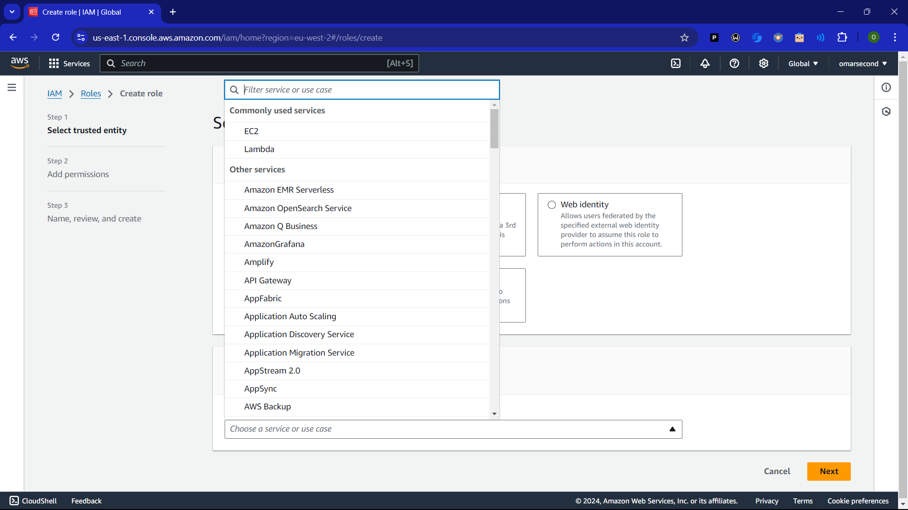
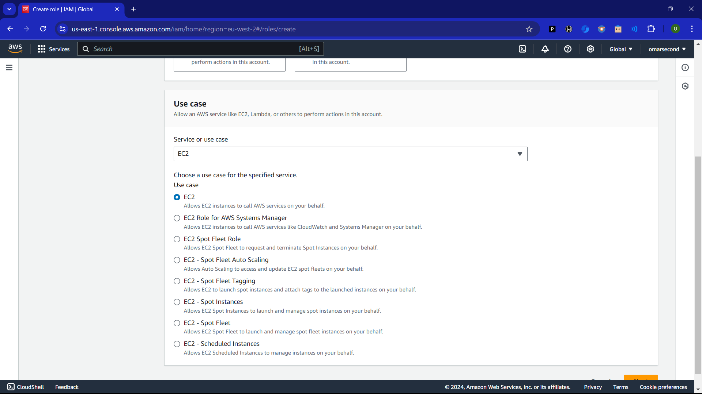
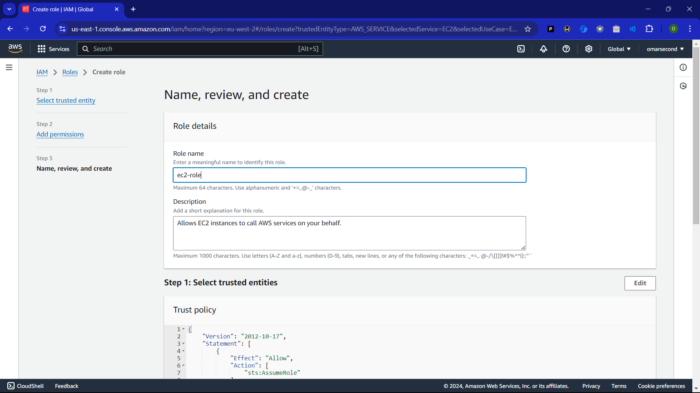
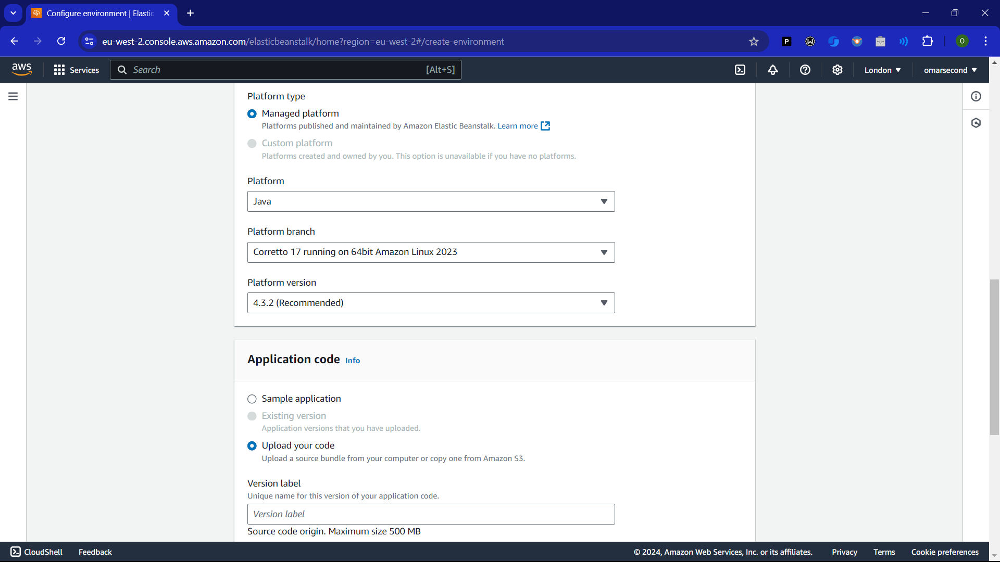
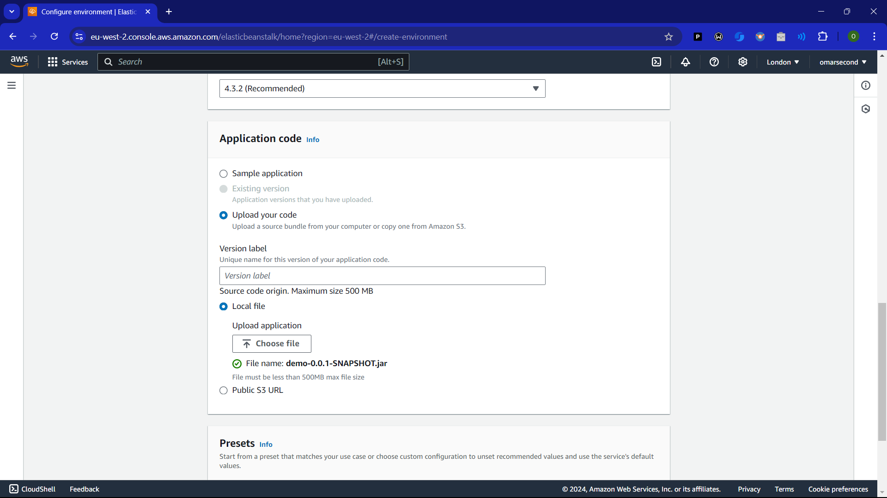
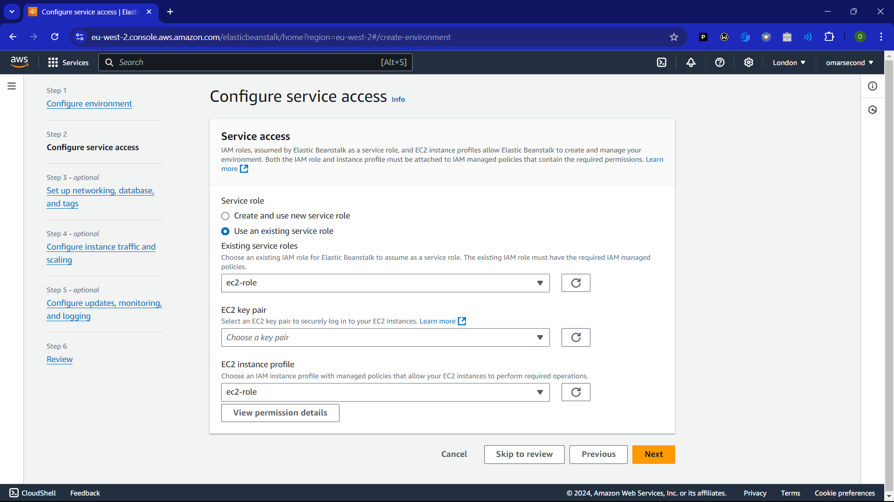
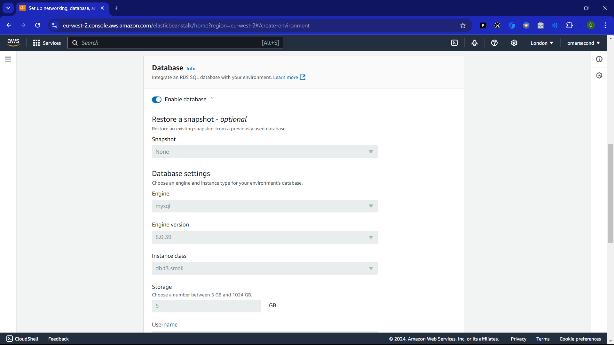
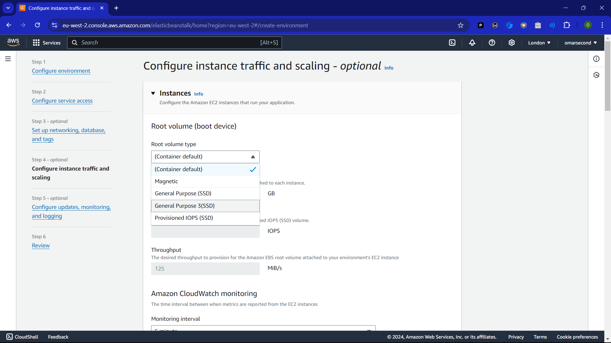

# Deploying a Springboot RestAPI Application on AWS Elastic Beanstalk

| Title | Type | Duration | Author |
| -- | -- | -- | -- |
| Deploying a Springboot RestAPI Application on AWS Elastic Beanstalk | Lesson | 3:00 | Suresh Melvin Sigera |

## LEARNING OBJECTIVES
- Configuring Amazon ELB.
- Build and manage projects using Maven
- Setting Up a Spring Boot Profile
- Setting up Amazon RDS

In this final chapter in the series, you learn how to deploy a Spring Boot application on Amazon Web Services (AWS) with AWS Elastic Beanstalk (EB). EB is a service that orchestrates other AWS services like virtual servers, load balancers, storage, and databases.

## Preparing the application for production

Before you can deploy the application, you need to make it ready for production. More specifically, you need to build the application with production mode enabled and add a separate configuration file to configure the production database and ports.

When you build a production version of a Recipe app, the following happens:    
-   Recipe app runs in production mode to hide debugging and other sensitive information from the browser.

### Creating a separate configuration for production

The application uses different databases during development and in production. To support this, you need to create a separate configuration file for the production build.

Create a new file,  `application-prod.properties`, in  `src/main/resources`.

NOTE: ***Do not store sensitive information in properties files***

Do not store sensitive information like passwords in properties files that get committed to a version control system like Git. Instead, use environment variables and keep them on the server.

```
spring.application.name=recipes
spring.datasource.url=jdbc:postgresql://${RDS_HOSTNAME:postgres-db}:${RDS_PORT:5432}/${RDS_DB_NAME:food}
spring.datasource.username=${RDS_USERNAME:postgres}
spring.datasource.password=${RDS_PASSWORD:1234}
spring.datasource.driver-class-name=org.postgresql.Driver
spring.jpa.hibernate.ddl-auto=update
spring.datasource.initialization-mode=always
spring.jpa.show-sql=true
server.port=5000
```

1.  Elastic Beanstalk maps the internal port 5000 to the external port 80 to expose the application to the internet.
    
2.  Elastic Beanstalk provides environment variables with information about the database so you don’t need to store them in the property file.

DO YOU KNOW: 

`spring.jpa.hibernate.ddl-auto=create` deletes and re-creates the database on every deployment.

### Update POM.xml file for production settings

```text
<profiles>
	<profile>
	<id>production</id>
	<activation>
		<activeByDefault>true</activeByDefault>
	</activation>
  </profile>  
</profiles>
```

### Enable CORS

```java
package com.food.demo;

import org.springframework.context.annotation.Bean;
import org.springframework.context.annotation.Configuration;
import org.springframework.web.servlet.config.annotation.CorsRegistry;
import org.springframework.web.servlet.config.annotation.WebMvcConfigurer;

@Configuration
public class CorsConfig {
    @Bean
    public WebMvcConfigurer corsConfigurer() {
        return new WebMvcConfigurer() {
            @Override
            public void addCorsMappings(CorsRegistry registry) {
                registry.addMapping("/**")
                    .allowedMethods("GET", "POST", "PUT", "DELETE")
                    .allowedHeaders("*")
                    .allowedOrigins("*");
            }
        };
    }
}
```

### Creating a production build of the Recipe application

Use the Maven  `production`  profile to create a production-optimized build. Add the  `skipTests`  parameter to avoid running tests.

```
 mvn clean package -Pproduction -DskipTests
```

You now have a production-ready application JAR in  `target/demo-0.0.1-SNAPSHOT.jar`. Next, set up the AWS environment for deploying it.

## Creating an AWS account

The first thing you need to do is create an  [AWS account](https://aws.amazon.com/premiumsupport/knowledge-center/create-and-activate-aws-account/), if you don’t already have one. You can sign up for an AWS Free Tier account that provides limited usage of many AWS products.

## Setting up a Java application on Elastic Beanstalk

First create the application environment on Elastic Beanstalk:

1. Go to IAM service and go to roles section
2. Create a new role
3. Under service or use case pick EC2  
4. Name your role 
5. Create a new application in the  [Elastic Beanstalk console](https://console.aws.amazon.com/elasticbeanstalk).
6. Create an environment for the application
7. Under the **Select environment tier** Web server environment 
8. Click select
-   **Application name**: spring-boot-recipe-api
-   **Platform**: Java
-   **Platform branch**: Corretto 17 running on 64bit Amazon  Linux 2 
-   **Platform version**: 3.1.7 (Recommended)
-   **Application code**: upload your jar file.

9. Click create enviroment
10. In step two add the role you created as follows 
11. In step 3: enable the RDS database instance: and give a username and password
12*-/. In step 4: change the root volume type of General Purpose 3(SSD) 
 

Congratulations, you have successfully deployed a Springboot app to Amazon Elastic Beanstalk. Now go ahead and check all your endpoints.

