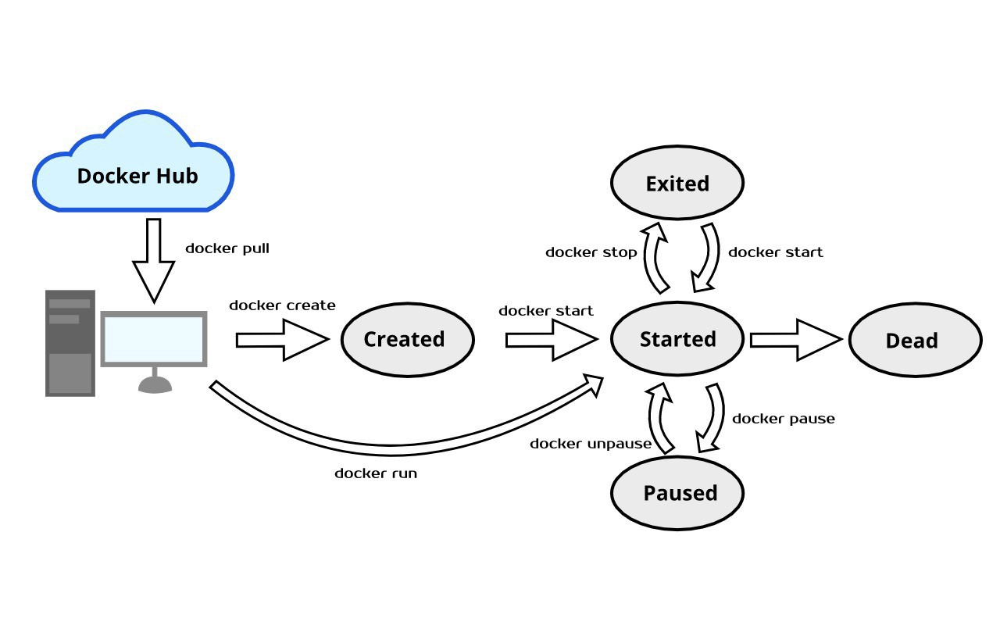

#  Introduction to Docker

| Title                  | Type   | Duration | Author        |
|------------------------|--------|----------|---------------|
| Introduction to Docker | Lesson | 2:00     | Suresh Sigera |

### Learning Objectives (5 minutes)

- Gain a solid understanding of Docker's core concepts and architecture
- Manage the lifecycle of containers effectively
- Master essential Docker commands with practical applications
- Deploy and manage real-world applications using Docker
- Implement best practices for Docker in both development and production environments.

##### The Docker Ecosystem (15 minutes)

Docker has revolutionized application deployment by introducing a standardized approach to containerization. At its
heart lies the Docker Engine, a powerful runtime environment that manages the entire container lifecycle. The Engine
consists of several key components working in harmony to provide a seamless containerization experience.

The Docker Daemon, running as a background process, serves as the orchestrator of all container operations. It manages
everything from image downloads to container execution, ensuring efficient resource utilization and proper isolation
between containers. Think of the daemon as a vigilant manager, overseeing all container-related activities on your
system.



Working alongside the daemon is the REST API, which provides a programmatic interface for container management. This API
layer enables seamless integration with various tools and services, making Docker highly extensible and adaptable to
different use cases. Whether you're using the command-line interface or a graphical tool, all interactions with Docker
flow through this API.

The Docker Client acts as your primary interface with the Docker ecosystem. When you type a Docker command, the client
interprets it and communicates with the daemon through the REST API. This client-server architecture provides
flexibility in how you manage your containers, allowing for both local and remote container management.

#### Core Concepts (10 minutes)

Before diving into practical commands, let's understand the fundamental building blocks of Docker. Docker images serve
as the foundation of container deployment. Think of an image as a blueprint containing everything needed to run an
application: the code, runtime environment, system tools, libraries, and configuration settings. Images are immutable,
meaning once created, they don't change. This immutability ensures consistency across different environments and makes
container deployment predictable.

When you run an image, Docker creates a container - a running instance of that image. Containers provide isolated
environments where applications can run without interfering with each other. Each container has its own filesystem,
process space, and network interface, while sharing the host system's kernel. This isolation ensures that applications
run consistently regardless of where the container is deployed.

#### Getting Started with Hello World (15 minutes)

Let's begin our hands-on journey with Docker's traditional "Hello World" example. Open your terminal and enter:

```text
docker pull hello-world
```

This command contacts Docker Hub, the default public registry, and downloads the hello-world image. The pull command is
your way of telling Docker to fetch an image from a registry. Once downloaded, let's run our first container:

```text
docker run hello-world
```

When you execute this command, several things happen behind the scenes. First, Docker checks if the hello-world image
exists locally. If found, it creates a new container and runs it. The container executes its programmed instruction -
displaying a welcome message - and then exits. This simple example demonstrates the basic flow of container creation and
execution.

#### Working with Ubuntu Container (15 minutes)

Now that we understand the basics, let's work with something more practical - an Ubuntu container. Start by pulling the
Ubuntu image:

```text
docker pull ubuntu
```

After downloading the image, you can verify its presence by listing all local images:

```text
docker images
```

This command shows all images on your system, including their repository names, tags, and sizes. The Ubuntu image will
be significantly larger than hello-world because it contains a minimal Ubuntu operating system.

To create and start an interactive Ubuntu container, use:

```text
docker run -it ubuntu
```

The `-it` flags create an interactive terminal session within the container. You're now working inside a containerized
Ubuntu environment, completely isolated from your host system.

### Container Lifecycle Management (20 minutes)

Managing containers effectively requires understanding their lifecycle. Let's explore the essential commands for
container management. First, you can create a container without starting it:

```text
docker create --name my-ubuntu ubuntu
```

This command prepares a container environment but doesn't start it. The `--name` flag assigns a custom name, making it
easier to reference the container in subsequent commands.

To start the container, use:

```text
docker start my-ubuntu
```

You can view running containers with:

```text
docker ps
```

This command displays detailed information about active containers, including their IDs, names, and status. To see all
containers, including stopped ones, use:

```text
docker ps -a
```

For more detailed information about a container, use:

```text
docker inspect my-ubuntu
```

This command provides comprehensive information about the container's configuration, network settings, and current
state.

To stop a running container gracefully:

```text
docker stop my-ubuntu
```

If you need to restart a container:

```text
docker restart my-ubuntu
```

To view container logs, which is crucial for troubleshooting:

```text
docker logs my-ubuntu
```

Add the `-f` flag to follow log output in real-time:

```text
docker logs -f my-ubuntu
```

#### Hands-on Practice: Running a Calculator API (25 minutes)

Now it's time to apply what you've learned by working with a real containerized API application. We'll pull and run a
calculator API that performs basic arithmetic operations. This exercise will reinforce your understanding of container
management and port mapping.

**Step 1: Pulling the Calculator API Image**

First, let's pull the calculator API image from Docker Hub: `docker pull sureshsigera/calc-api-image`

This command downloads the calculator API image to your local system. You can verify the successful download by checking
your local images:

```text
docker images | grep calc-api-image
```

**Step 2: Running the Container**

Now, let's run the calculator API container. We'll need to map port `3001` on our host machine to the container's port:

```text
docker run -d -p 3001:3001 --name calculator-api sureshsigera/calc-api-image
```

Let's break down this command:

- `-d`: Runs the container in detached mode (in the background)
- `-p 3001:3001`: Maps port 3001 on your host to port `3001` in the container
- `--name calculator-api`: Assigns a friendly name to the container
- `sureshsigera/calc-api-image`: Specifies the image to use

**Step 3: Verifying the Container**

Check if the container is running:

```text
docker ps
```

You should see the calculator-api container in the list of running containers.

**Step 4: Testing the API**

Now that the container is running, open your web browser or use curl to test the addition operation. Navigate to:

[http://localhost:3001/add?num1=10&num2=10](http://localhost:3001/add?num1=10&num2=10)

You should see the result "The sum is 20". The API processes these parameters and returns the sum. Notice that we use
num1 and num2 as our query parameters, as defined in the API's implementation.

For division operations, use:

[http://localhost:3001/divide?num1=10&num2=2](http://localhost:3001/divide?num1=10&num2=2)

This will return "The result is 5". Note that if you try to divide by zero (num2=0), the API will return an error
message.

#### Troubleshooting Tips (10 minutes)

If you encounter any issues:

Check container logs:

```text
docker logs calculator-api
```

Verify port mapping:

```text
docker port calculator-api
```

Ensure no other services are using port `3001`:

```text
lsof -i :3001
```

### Summary (5 minutes)

Through this guide, we've explored Docker's fundamental concepts and essential commands. We've learned how the Docker
ecosystem functions, understood the relationship between images and containers, and mastered basic container lifecycle
management. This knowledge forms the foundation for working with more complex Docker configurations and multi-container
applications.

Remember that becoming proficient with Docker requires practice. Start by experimenting with different images, try
creating your own containers, and gradually move toward more complex scenarios. As you continue your Docker journey,
you'll discover how this powerful tool can streamline your development and deployment processes.

The commands we've covered - pull, run, create, start, stop, restart, ps, and logs - are your basic toolkit for
container management. Master these fundamentals, and you'll be well-prepared to tackle more advanced Docker concepts and
real-world containerization challenges.
