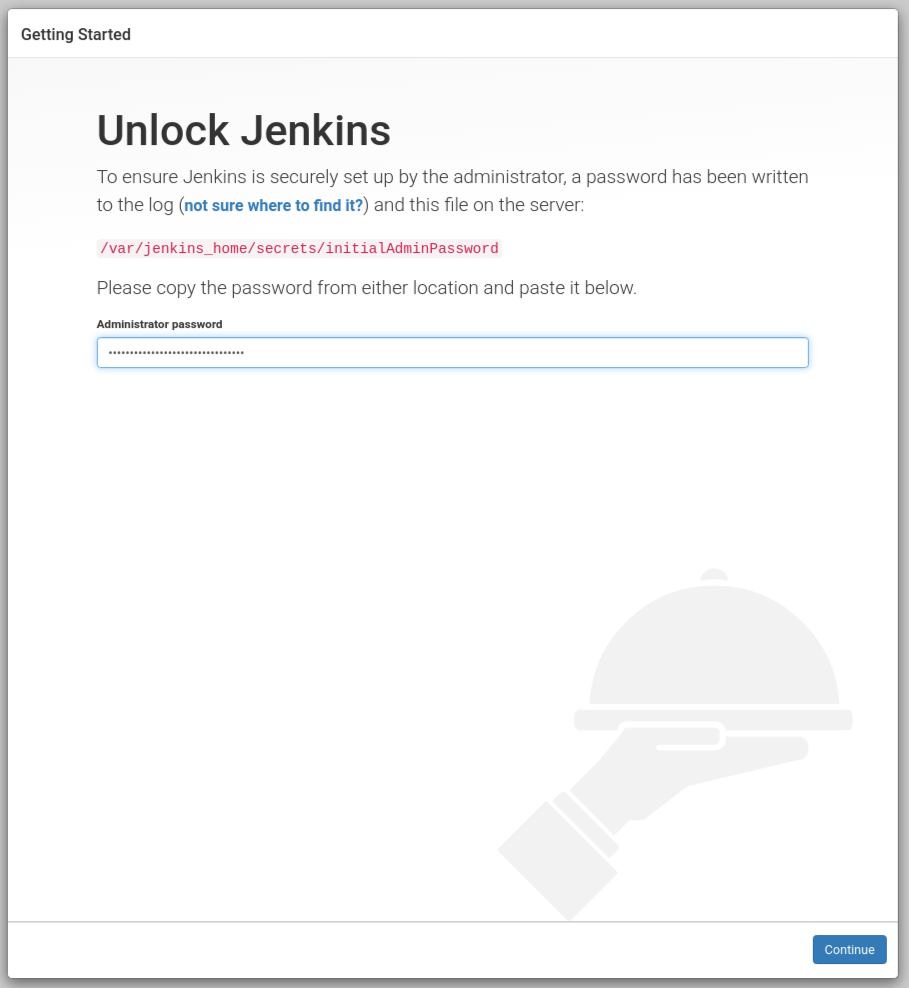
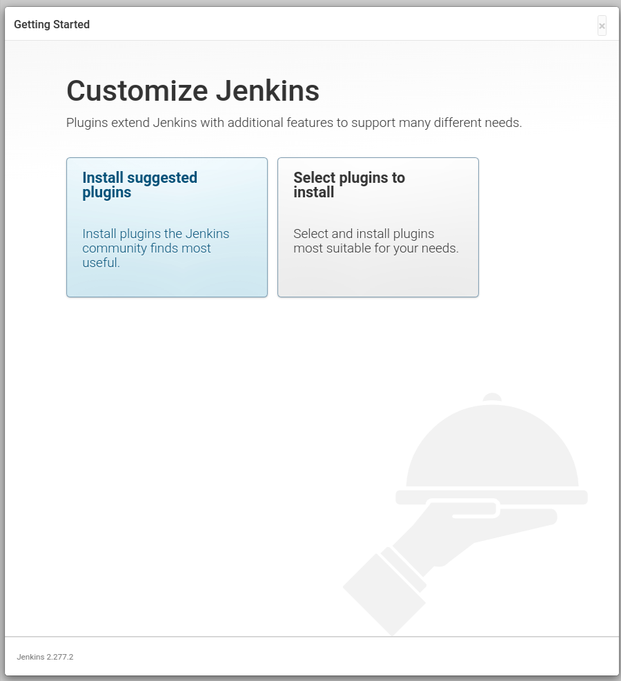
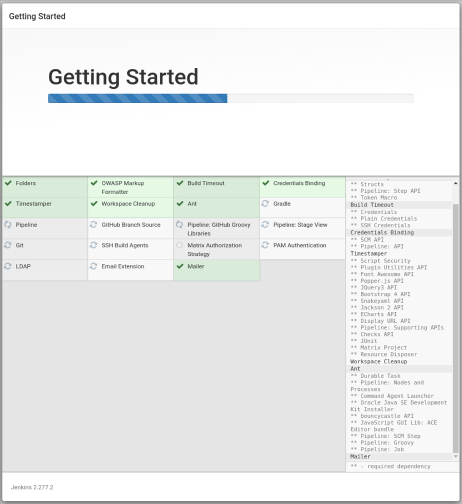
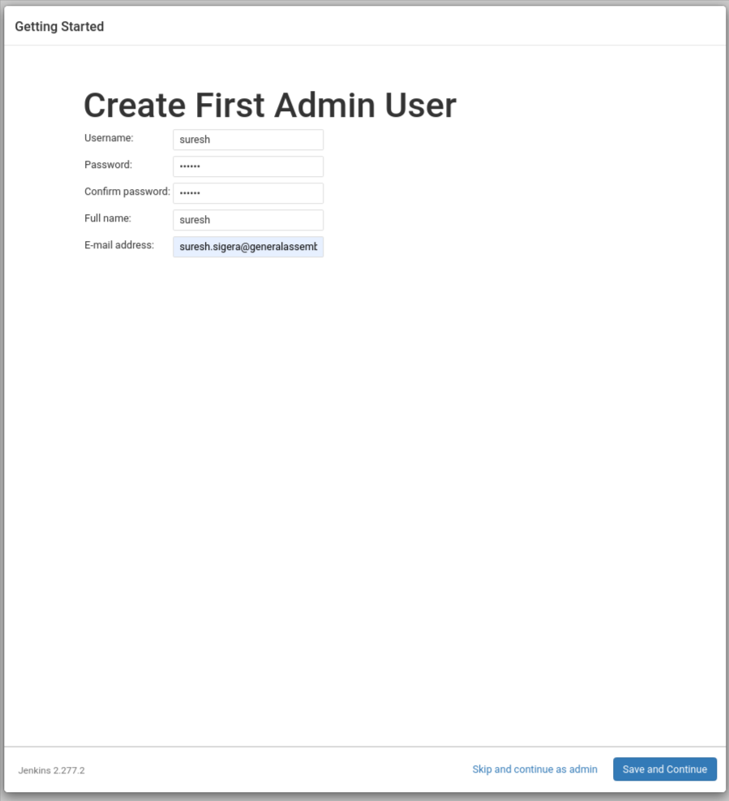
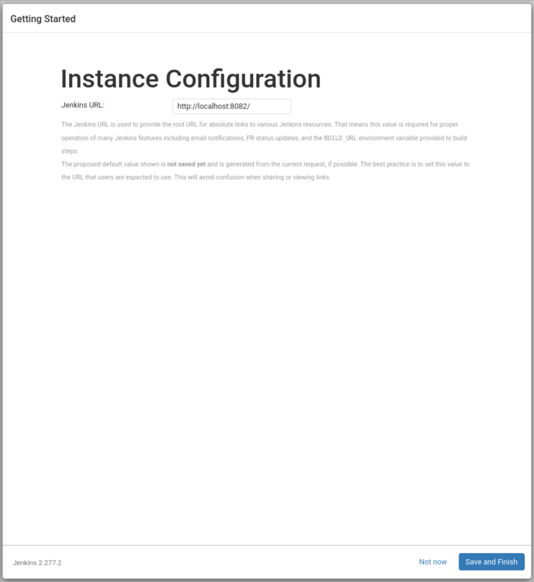
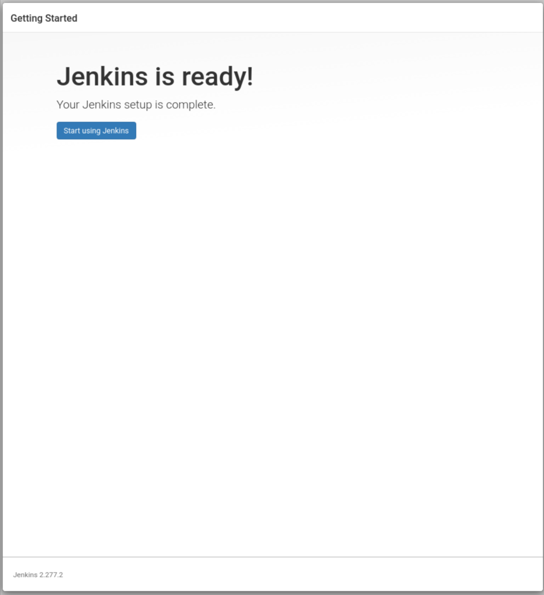
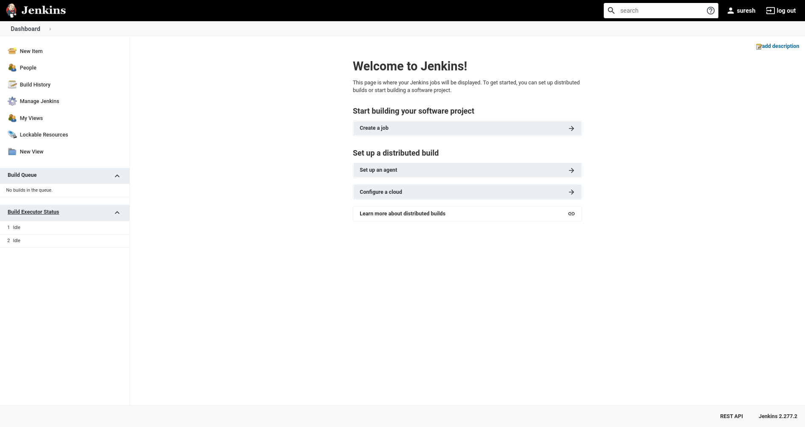

| Title | Type | Duration | Author |
| -- | -- | -- | -- |
| Intro to Jenkins | Lesson | 2:00 | Suresh Melvin Sigera |  

#  Intro to Jenkins

Jenkins is one of the most popular Continuous Integration and Delivery Servers today, so it’s only natural that you’re probably interested in learning more about it. When starting out, you’ll need to first run it on your local machine. However, the problem with that is the Jenkins configuration files will then live directly on your machine. A better solution is to run it as a Docker container, here are some of the reasons why:

-   All of your Jenkins  **configuration files**  live inside the container rather than the host machine. Knowing that all the files you need are inside the container, you can eliminate the issue of accidentally mixing your files with Jenkins configuration files.
-   Docker instances are easier to manage if you are interested in running Jenkins on  _multiple platforms_
-   You can easily create and destroy the Jenkins server and remove all the Jenkins data

Another benefit of using containers is persisting the state of your Jenkins server using Docker volumes. Why do this?

-   You get to keep all your projects and configurations even after restarting your computer (local machine)
-   You don't need to run the whole Jenkins setup again
-   You can remove your container instance and still able to recover the state of your Jenkins server

With that in mind, I’ll show you how you can start configuring Jenkins and persisting state on your local machine. Let’s get started!

## Jenkins setup

Before we get started, you’ll need to install Docker on your machine. If you’re not sure how you can refer to this  [official documentation](https://docs.docker.com/install/).

After installing Docker, download the latest stable Jenkins image by running:

```shell
docker image pull jenkins/jenkins:lts
```

## Persisting Jenkins Data

You can create a volume by running the command below:

```shell
docker volume create [YOUR VOLUME]
```

Volumes are used to make sure that you don't lose your Jenkins data. If you are using the  `-v`  flag on container creation (`docker container run`), feel free to skip this step since Docker will automatically create the volume for you.

Run the container by attaching the volume and assigning the targeted port. In this example, we'll also run it in detached mode. Here is the command to run your Docker container:

```shell
docker container run -d \
    -p [YOUR PORT]:8080 \
    -v [YOUR VOLUME]:/var/jenkins_home \
    --name jenkins-local \
    jenkins/jenkins:lts
```

If you were wondering what the arguments stand for, here is what each means:

-   -d: detached mode
-   -v: attach volume
-   -p: assign port target
-   —name: name of the container

And now, we’re ready to take a look at an example of how you could run this command:

```shell
docker container run -d -p 8082:8080 \
    -v jenkinsvol1:/var/jenkins_home \
    --name jenkins-local \
    jenkins/jenkins:lts
```

In the command we ran,  `/var/jenkins_home`  is the path to where the Jenkins state is stored on our container instance. The most important argument we pass when it comes to data persistence in this example is the  `-v **[YOUR VOLUME]**:/var/jenkins_home`. This argument is what helps Docker link the volume to the file inside the container. To learn more about Docker volumes, you can check out the  [official documentation](https://docs.docker.com/storage/volumes/). If you’re not familiar with Docker, you can start with this helpful docker blog series,  [Learning Docker - The Command Line Interface](https://rangle.io/blog/learning-docker-command-line-interface/). You'll notice that I am using port  `8082`  instead of the default  `8080`. The reason, other than demonstrating that you can use other ports, is that port  `8080`  is used by some web frameworks.

If you run  `docker ps`, you should see your docker container running

After confirming that your container is running, go to  `localhost:[YOUR PORT]`  (`localhost:8082`  on my example) on your browser and you should see this page:



As a part of the Jenkins setup, we need to view the password inside the container instance. In order to do this, we need to use the CONTAINER ID (or the name) and run docker exec.

Here is the full command:

```shell
docker container exec \
    [CONTAINER ID or NAME] \
    sh -c "cat /var/jenkins_home/secrets/initialAdminPassword"
```
After running the command, you should see the code. Copy the code and paste it on the webpage to unlock Jenkins. After unlocking, click on Install suggested plugins on the Customize Jenkins page.



After running the command, you should see the code. Copy the code and paste it on the webpage to unlock Jenkins. After unlocking, click on Install suggested plugins on the Customize Jenkins page.



Wait until the installation is complete and then you can proceed in creating your first admin user.







After creating the admin user, setup the Instance configuration. Since you are only using Jenkins locally, leave the URL to your localhost URL. Click on Save and Finish to start using Jenkins.



---

## Create a Pipeline

A  [**pipeline**](https://jenkins.io/doc/book/pipeline/)  is a suite of plugins that supports implementing and integrating continuous delivery pipelines into Jenkins.

A  **continuous delivery (CD) pipeline**  is an automated expression of your process for getting software from version control to your users and customers. Every change to your software (committed in source control) goes through a complex process on its way to being released. This process involves building the software in a reliable and repeatable manner, as well as progressing the built software (called a  **build**) through multiple stages of testing and deployment.

To start, we'll build a sample Java application with Maven.

Fork  [this repository](https://github.com/saadkhan29/hello-world)  into your own GitHub account and clone the code.

Once the application is set up:

1.  Go back to the Jenkins home page ([http://localhost:8082](http://localhost:8082/)). Scroll down to the end and click  **`Create new jobs`**  under  **`Welcome to Jenkins!`**.
2.  Specify a name for your pipeline (e.g.,  `hello-world`).
3.  Scroll down and click  **`Pipeline`**, then click  `OK`  at the end of the page.
4.  Scroll down to the  `Pipeline`  section. You can also click on the  `Pipeline`  tab. Choose the  **`Pipeline script`**  option, and then add the following code inside script editor.

```
pipeline {
    agent any
    
    tools { 
        maven 'Maven 3.6.3' 
        jdk 'jdk9' 
    }

    stages {
        stage('hello') {
            steps {
                echo 'Hello World'
            }
        }
        
        stage('pull from github') {
            steps {
                git 'https://github.com/sureshmelvinsigera/hello-world.git'
            }
        }
        
        stage('build with Maven') {
            steps {
                sh 'mvn install -DskipTests'
            }
        }
    }
}
```

6.  Click  **`apply`** and then  **`Save`**.

---

## Setting up Jenkins plugins

1.  Go back to the Jenkins home page ([http://localhost:8082](http://localhost:8082/)). 
2.  From the left-hand menu select ***Manage Jenkins***
3. Select ***Manage Plugins***
4. Under Available tab, search and install the following plugins
- [Blue Ocean](https://plugins.jenkins.io/blueocean)
- [Docker](https://plugins.jenkins.io/docker-plugin)
- [Docker Pipeline](https://plugins.jenkins.io/docker-workflow)
5. Finally, click ***Download now and Install after restart
6. Go back to the Jenkins home page ([http://localhost:8082](http://localhost:8082/)). 
7. Select ***Global Tool Configuration***
8. Under  ***JDK***  add the following settings
- Name : jdk9
- Select : Install automatically  
- Version: Java SE Developer Kit 9.0.4
- Select : I agree to the Java SE Development Kit License Agreement
- Oracle Login: Enter the user name and password for Oracle website
9. Under  ***Maven***  add the following settings
- Name : Maven 3.6.3
- Select : Install automatically  (Install from Apache, version 3.6.3)
- Select ***Apply***, and then ***Save***

---

## Running up Pipeline

Finally, go back to Jenkins homepage, open Blue Ocean interface and Click  **Run**  at the top left. Then, quickly click the  **OPEN**  link which appears briefly at the lower-right to see the pipeline run details.

