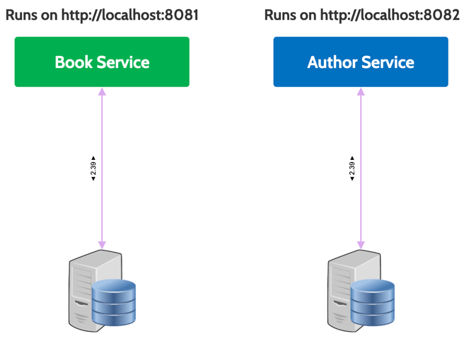
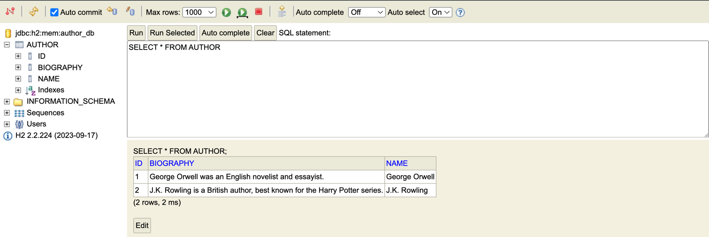
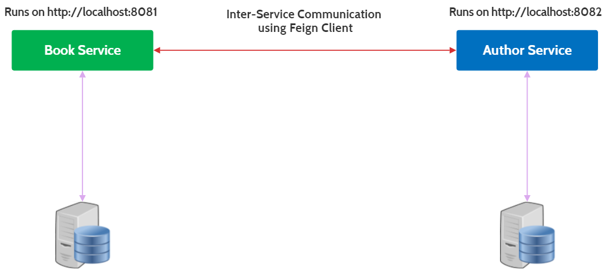

#  Monoliths to Microservices

| Title                      | Type   | Duration | Author               |
|----------------------------|--------|----------|----------------------|
| Monoliths to Microservices | Lesson | 4:00     | Suresh Melvin Sigera |

## Lesson Objectives

- Understand Microservices Architecture
- Learn the key components of a Microservices Architecture
- Explore the benefits of using Microservices
- Implement a Microservices Architecture using Spring Boot
- Create and configure Microservices for Author and Book Management
- Use Feign Clients for inter-service communication
- Implement Data Seeders to populate Microservices with initial data
- Define API endpoints for Microservices
- Demonstrate communication between Microservices

## Microservices Architecture (20 minutes)

In recent years, the architectural shift from monolithic applications to microservices has gained significant traction,
particularly for systems that require scalability, flexibility, and maintainability. A monolithic application,
characterized by its tightly coupled components, can become cumbersome as it grows in complexity. For instance, consider
a system managing both books and authors. In a monolithic setup, these components are often intertwined, leading to
challenges in scaling, deploying, and maintaining the application. Any change to one part of the system, such as the
author management functionality, might necessitate a full redeployment of the entire application, increasing the risk of
introducing bugs and downtime.

To address these challenges, we can decompose the monolithic application into two distinct microservices: the Author
microservice and the Book microservice. This separation allows each microservice to encapsulate its own domain logic and
data, promoting a clear boundary between the two.



The Author microservice is solely responsible for managing author-related data and operations, while the Book
microservice handles book-related functionalities. This division not only enhances the modularity of the system but also
allows each service to be developed, deployed, and scaled independently. By decoupling these components, we can achieve
greater agility in development, as teams can work concurrently on different services without interfering with each
other. Furthermore, this architecture facilitates the use of different technologies and databases tailored to the
specific needs of each service, optimizing performance and resource utilization.

Overall, transitioning from a monolithic architecture to microservices offers numerous benefits, including improved
scalability, flexibility, and resilience. By isolating the book and author functionalities into separate services, we
create a more robust and adaptable system that can evolve with changing business requirements and technological
advancements. This approach not only aligns with modern software development practices but also sets the foundation for
a more efficient and responsive application ecosystem.

## Author Microservice (60 minutes)

In our journey to transform a tightly coupled monolithic application into a more modular and scalable architecture, we
have successfully separated the system into two distinct microservices: the Author Microservice and the Book
Microservice. This strategic decomposition allows each microservice to focus on its specific domain, enhancing
maintainability and scalability.

The Author Microservice is dedicated to managing all operations related to authors, such as creating, retrieving,
updating, and deleting author information. In this new architecture, the Author Microservice's core code remains largely
unchanged, ensuring continuity and stability in its functionality. However, there are some important configurations and
initializations to highlight:

### Author Data Seeder (15 minutes)

To populate the Author Microservice with initial author data, we have implemented an Author Data Seeder. This component
is responsible for seeding the database with sample author records, ensuring that the microservice has sufficient data
for testing and demonstration purposes. By running the Author Data Seeder, you can quickly populate the database with
authors, enabling seamless integration testing and validation of the Author Microservice's functionality.

```java
package org.example.authorms.seed;

import org.example.authorms.model.Author;
import org.example.authorms.repository.AuthorRepository;
import org.springframework.beans.factory.annotation.Autowired;
import org.springframework.boot.CommandLineRunner;
import org.springframework.stereotype.Component;

import java.util.Arrays;

@Component
public class AuthorDataSeeder implements CommandLineRunner {

    private final AuthorRepository authorRepository;

    @Autowired
    public AuthorDataSeeder(AuthorRepository authorRepository) {
        this.authorRepository = authorRepository;
    }

    @Override
    public void run(String... args) throws Exception {
        authorRepository.deleteAll();

        Author author1 = new Author();
        author1.setName("George Orwell");
        author1.setBiography("George Orwell was an English novelist and essayist.");

        Author author2 = new Author();
        author2.setName("J.K. Rowling");
        author2.setBiography("J.K. Rowling is a British author, best known for the Harry Potter series.");

        authorRepository.saveAll(Arrays.asList(author1, author2));
    }
}
```

### Configuration (15 minutes)

The Author Microservice is configured to run on port `8081`, distinguishing it from other services in the system. This
separation of ports is crucial for ensuring that each microservice can operate independently without port conflicts.

```properties
spring.application.name=author-microservice
server.port=8081
spring.datasource.url=jdbc:h2:mem:author_db
spring.datasource.driver-class-name=org.h2.Driver
spring.datasource.username=author_user
spring.datasource.password=author_password
spring.h2.console.enabled=true
spring.jpa.hibernate.ddl-auto=update
```

- **Port Configuration:** The `server.port=8081` setting specifies that the Author Microservice will listen for incoming
  requests on port 8081. This allows it to be easily identified and accessed within the microservices ecosystem.
- **Database Configuration:** The microservice uses an in-memory H2 database for simplicity, with a dedicated
  schema (`author_db`). This setup is ideal for development and testing environments, providing a lightweight and fast
  database solution.

By maintaining these configurations and initializations, the Author Microservice is well-equipped to handle
author-related operations efficiently. The clear separation of concerns between the Author and Book Microservices
ensures that each can evolve independently, enhancing the overall agility and resilience of the application
architecture.

### API Endpoints (30 minutes)

Let's break down the key features of the Author Microservice and its associated API endpoints:

- **GET /authors:** Retrieve a list of all authors.
    - Example Request: `http://localhost:8081/authors`
- **GET /authors/{id}:** Get details of a specific author.
    - Example Request: `http://localhost:8081/authors/1`
- **POST /authors:** Add a new author.
    - Example Request:
      ```json
      {
          "name": "Agatha Christie",
          "biography": "Agatha Christie was an English writer known for her detective novels."
      }
      ```
- **DELETE /authors/{id}:** Remove an author.
    - Example Request: `http://localhost:8081/authors/2`

To access the H2 console for the Author Microservice, open your web browser and navigate
to http://localhost:8081/h2-console. Use the following credentials to log in:

- JDBC URL: `jdbc:h2:mem:author_db`
- Username: `author_user`
- Password: `author_password`



Upon successful login, you will find two sample authors seeded by the Author Data Seeder: George Orwell and J.K.
Rowling. These entries are provided as initial data to facilitate testing and demonstration.

## Book Microservice (60 minutes)

The Book Microservice is the backbone of book-related operations in our system. It's a specialized component that
handles the entire lifecycle of book data, from creation to deletion. By focusing solely on books, this microservice
embodies the single responsibility principle, promoting a clean and maintainable architecture.

### Key Responsibilities

- **Create Book:** The controller provides an endpoint to create a new book. It accepts book details in the request body
  and delegates the task of saving the book to the BookService.
- **Retrieve Book by ID:** The controller allows clients to retrieve a specific book by its unique identifier. It
  fetches the book details from the BookService and returns them to the client.
- **List All Books:** The controller offers an endpoint to list all available books. It retrieves the list of books from
  the BookService and returns it in the response.
- **Delete Book:** The controller provides functionality to delete a book by its ID. It delegates the deletion operation
  to the BookService.
- **Search Books by Author:** The BookService supports searching for books by author name. This feature enhances the
  user experience by allowing clients to discover books based on their favorite authors.

### Book Model (15 minutes)

The Book model represents the core entity in the Book Microservice. It encapsulates essential book attributes such as
title, author, genre, and publication year. Here's a simplified version of the Book class:

```java
package org.example.bookms.model;

import jakarta.persistence.*;
import lombok.Getter;
import lombok.Setter;
import lombok.ToString;

@Getter
@Setter
@ToString
@Entity
public class Book {

    @Id
    @GeneratedValue(strategy = GenerationType.SEQUENCE)
    private Long id;

    private String title;
    private String description;

    @Embedded
    private AuthorDTO author;
}
```

In this model, the `Book` class contains fields for the book's title, description, and author information.
The `AuthorDTO` class encapsulates the author details, ensuring a clear separation of concerns and enhancing modularity.

### Book Repository (15 minutes)

The Book Repository interfaces with the underlying database to perform CRUD operations on book entities. By extending
the `JpaRepository` interface, the Book Repository inherits a set of predefined methods for interacting with the
database. This abstraction simplifies database operations and reduces boilerplate code.

```java
package org.example.bookms.repository;

import org.example.bookms.model.Book;
import org.springframework.data.jpa.repository.JpaRepository;
import org.springframework.stereotype.Repository;

import java.util.Optional;

@Repository
public interface BookRepository extends JpaRepository<Book, Long> {
    Optional<Book> findByTitleAndAuthor_Name(String title, String authorName);
}

```

When the `findByTitleAndAuthor_Name` method is called, Spring Data JPA interprets the method name and automatically
generates the corresponding SQL query. This query searches for a Book entity where the title matches the provided title
parameter and the name field of the embedded `AuthorDTO` matches the provided `authorName` parameter. The
underscore (`_`) in the method name is used to navigate through the embedded `AuthorDTO` object to access its name
field. If a matching `Book` is found, it is returned wrapped in an `Optional`. If no match is found, an empty `Optional`
is returned.

### AuthorDTO (15 minutes)

The `AuthorDTO` class is a data transfer object specifically designed to encapsulate author-related information within
the Book Microservice. By employing a separate DTO class for author details, we maintain a clear distinction between
book and author entities, which is crucial for adhering to best practices in microservice design.

```java
package org.example.bookms.model;

import jakarta.persistence.Embeddable;
import lombok.Getter;
import lombok.Setter;
import lombok.ToString;

@Getter
@Setter
@ToString
@Embeddable
public class AuthorDTO {
    private Long authorId;
    private String name;
}

```

### Key Benefits of Using AuthorDTO

- **Separation of Concerns:** By using `AuthorDTO`, the Book Microservice can manage author information without directly
  depending on the Author entity from the Author Microservice. This separation ensures that changes in the Author
  Microservice do not directly impact the Book Microservice, thereby reducing coupling and enhancing system resilience.
- **Modularity:** The use of a DTO promotes modularity by allowing each microservice to focus on its specific domain.
  The Book Microservice can handle book-related operations independently, while still incorporating necessary author
  information through the `AuthorDTO`.
- **Data Consistency and Integrity:** The `AuthorDTO` ensures that only the necessary author details are included within
  the Book Microservice, preventing unnecessary data exposure and maintaining data integrity. This approach allows the
  Book Microservice to operate with a consistent view of author information.
- **Simplified Data Transfer:** By encapsulating author details in a DTO, data transfer between the Book Microservice
  and other components is streamlined. The DTO acts as a contract that defines the data structure, making it easier to
  serialize and deserialize data across network boundaries.
- **Flexibility in Evolution:** As the system evolves, the `AuthorDTO` can be modified independently of the underlying
  Author entity. This flexibility allows for easier adaptation to changing business requirements or technological
  advancements, without disrupting the overall architecture.

## Communication Between Microservices (60 minutes)

In a microservices architecture, communication between services is crucial for functionality and data exchange. Feign
clients facilitate this communication by providing a simple and efficient way to invoke RESTful services. For example, a
microservice responsible for managing books can use a Feign client to communicate with an author microservice to
retrieve author details. This interaction is defined declaratively, allowing for clear and concise client definitions.

By leveraging Feign, developers can ensure that their microservices communicate effectively, maintaining the loose
coupling and scalability that are hallmarks of a well-designed microservices architecture. This approach not only
enhances productivity but also aligns with best practices in modern software development, where agility and
responsiveness to change are paramount.

Feign is a powerful tool in the microservices ecosystem, designed to simplify the process of creating HTTP clients in
Java applications. Developed by Netflix, Feign is a declarative web service client that allows developers to define HTTP
API clients using simple interfaces and annotations, eliminating the need for boilerplate code associated with
traditional HTTP client libraries.

### Introduction to Feign Clients (15 minutes)

Feign clients are particularly beneficial in a microservices architecture, where services often need to communicate with
each other over HTTP. By using Feign, developers can define a client interface with annotations that specify the HTTP
methods and endpoints. Spring Cloud OpenFeign extends this capability by integrating with Spring Boot, allowing
developers to use Spring MVC annotations and HttpMessageConverters, which are familiar to those working within the
Spring ecosystem.



### Benefits of Using Feign

- **Declarative Syntax:** Feign allows developers to define HTTP clients using interfaces annotated with Feign or Spring
  MVC annotations. This declarative approach simplifies the client code and reduces errors associated with manual HTTP
  request handling.
- **Integration with Spring Cloud:** Feign seamlessly integrates with other Spring Cloud components, such as Ribbon for
  client-side load balancing and Eureka for service discovery. This integration enables Feign clients to automatically
  balance requests across multiple instances of a service.
- **Pluggable Annotations and Encoders/Decoders:** Feign supports pluggable annotation support, including JAX-RS and
  Feign annotations, as well as custom encoders and decoders. This flexibility allows developers to customize how
  requests and responses are handled.
- **Simplified Client Code:** By abstracting the complexity of HTTP communication, Feign allows developers to focus on
  business logic rather than the intricacies of HTTP protocol management. This leads to cleaner and more maintainable
  code.
- **Load Balancing and Service Discovery:** Feign clients can leverage Ribbon for client-side load balancing and Eureka
  for service discovery. This combination ensures that requests are distributed evenly across service instances and that
  clients can locate services dynamically.
- **Error Handling and Retry Logic:** Feign provides built-in support for error handling and retry mechanisms, allowing
  developers to define how to handle exceptions and retries in case of failures. This feature enhances the robustness
  and reliability of microservices communication.
- **Interoperability:** Feign clients can interact with services built on different technologies and frameworks, making
  them versatile tools for inter-service communication in heterogeneous environments.
- **Performance Optimization:** Feign clients can be optimized for performance by configuring connection pooling,
  request compression, and other HTTP-related settings. These optimizations help improve the efficiency of microservices
  communication.

By utilizing Feign clients in a microservices architecture, developers can streamline inter-service communication,
enhance system reliability, and promote best practices in service-oriented design. Feign's declarative syntax,
integration with Spring Cloud, and support for load balancing and service discovery make it a valuable tool for building
resilient and scalable microservices ecosystems.

### Setting Up Feign Clients (60 minutes)

To create a Feign client in a Spring Boot application, you need to follow these steps:

1. Add the `spring-cloud-starter-openfeign` dependency to your Book Microservice's `pom.xml` file:
    ```xml
    <!-- https://mvnrepository.com/artifact/org.springframework.cloud/spring-cloud-starter-openfeign -->
    <dependency>
        <groupId>org.springframework.cloud</groupId>
        <artifactId>spring-cloud-starter-openfeign</artifactId>
        <version>5.0.0</version>
    </dependency>
    ```
2. Enable Feign clients in your Spring Boot application by annotating the main class with `@EnableFeignClients`:

    ```java
    package org.example.bookms;
    
    import org.springframework.boot.SpringApplication;
    import org.springframework.boot.autoconfigure.SpringBootApplication;
    import org.springframework.cloud.openfeign.EnableFeignClients;
    
    @SpringBootApplication
    @EnableFeignClients
    public class BookmsApplication {
    
        public static void main(String[] args) {
            SpringApplication.run(BookmsApplication.class, args);
        }
    
    }
    ```
   This annotation enables Feign clients in your application, allowing you to define and use Feign clients to
   communicate with other microservices.
3. Create a Feign client interface that specifies the target service and its endpoints. For example, to communicate with
   the Author Microservice, you can define an `AuthorFeignClient` interface:

    ```java
    package org.example.bookms.service;

    import org.example.bookms.model.AuthorDTO;
    import org.springframework.cloud.openfeign.FeignClient;
    import org.springframework.web.bind.annotation.GetMapping;
    import org.springframework.web.bind.annotation.PathVariable;
    
    @FeignClient(name = "author-microservice", url = "http://localhost:8081")
    public interface AuthorServiceClient {
    
        @GetMapping("/authors/{id}")
        AuthorDTO getAuthorById(@PathVariable("id") Long authorId);
    }
    ```
   In this interface, the `@FeignClient` annotation specifies the name of the target
   microservice (`author-microservice`) and its base URL (`http://localhost:8081`). The `getAuthorById` method defines
   the endpoint to retrieve author details by ID.
4. Inject the Feign client into your service or controller classes and use it to communicate with the target
   microservice. For example, you can inject the `AuthorServiceClient` into a service class:
    ```java
    package org.example.bookms.service;
    
    import org.example.bookms.exception.InformationNotFoundException;
    import org.example.bookms.model.AuthorDTO;
    import org.example.bookms.model.Book;
    import org.example.bookms.repository.BookRepository;
    import org.springframework.beans.factory.annotation.Autowired;
    import org.springframework.stereotype.Service;
    
    import java.util.List;
    import java.util.Optional;
    
    @Service
    public class BookService {
        private final BookRepository bookRepository;
        private final AuthorServiceClient authorServiceClient;
    
        @Autowired
        public BookService(BookRepository bookRepository, AuthorServiceClient authorServiceClient) {
            this.bookRepository = bookRepository;
            this.authorServiceClient = authorServiceClient;
        }
    
        public Book findBookById(Long id) {
            return bookRepository.findById(id)
                    .orElseThrow(() -> new InformationNotFoundException("Book with ID " + id + " not found."));
        }
    
        public List<Book> findAllBooks() {
            return bookRepository.findAll();
        }
    
        public void deleteBook(Long id) {
            if (!bookRepository.existsById(id)) {
                throw new InformationNotFoundException("Book with ID " + id + " not found.");
            }
            bookRepository.deleteById(id);
        }
    
        // request to author service to get author details using feign client
        public Book saveBook(Book book) {
            AuthorDTO authorDTO = authorServiceClient.getAuthorById(book.getAuthor().getAuthorId());
            book.setAuthor(authorDTO);
            return bookRepository.save(book);
        }
    
        public Optional<Book> findBookByTitleAndAuthorName(String title, String authorName) {
            return bookRepository.findByTitleAndAuthor_Name(title, authorName);
        }
    }

    ```
   In this service class, the `AuthorServiceClient` is injected via the constructor, allowing the `BookService` to
   communicate with the Author Microservice to retrieve author details. The `saveBook` method demonstrates how the Feign
   client is used to fetch author information when saving a new book. The `findByTitleAndAuthor_AuthorId` method queries
   the database for a book based on the title and author ID. If the book is not found, an `InformationNotFoundException`
   is thrown.
5. Next, Update the Book controller to use the `BookService` to handle book-related operations:
    ```java
    package org.example.bookms.controller;
    
    import org.example.bookms.model.AuthorDTO;
    import org.example.bookms.model.Book;
    import org.example.bookms.service.BookService;
    import org.example.bookms.service.AuthorServiceClient;
    import org.springframework.beans.factory.annotation.Autowired;
    import org.springframework.http.ResponseEntity;
    import org.springframework.web.bind.annotation.*;
    
    import java.util.List;
    import java.util.Optional;
    
    @RestController
    @RequestMapping("/books")
    public class BookController {
    
        private final BookService bookService;
        private final AuthorServiceClient authorServiceClient; // Use a client to communicate with the Author microservice
    
        @Autowired
        public BookController(BookService bookService, AuthorServiceClient authorServiceClient) {
            this.bookService = bookService;
            this.authorServiceClient = authorServiceClient;
        }
    
        @PostMapping
        public ResponseEntity<Book> createBook(@RequestBody Book book) {
            // Fetch author details from the Author microservice
            AuthorDTO authorDTO = authorServiceClient.getAuthorById(book.getAuthor().getAuthorId());
            book.setAuthor(authorDTO);
    
            Book savedBook = bookService.saveBook(book);
            return ResponseEntity.ok(savedBook);
        }
    
        @GetMapping("/{id}")
        public ResponseEntity<Book> getBookById(@PathVariable Long id) {
            Book book = bookService.findBookById(id);
            return ResponseEntity.ok(book);
        }
    
        @GetMapping
        public ResponseEntity<List<Book>> getAllBooks() {
            List<Book> books = bookService.findAllBooks();
            return ResponseEntity.ok(books);
        }
    
        @DeleteMapping("/{id}")
        public ResponseEntity<Void> deleteBook(@PathVariable Long id) {
            bookService.deleteBook(id);
            return ResponseEntity.noContent().build();
        }
    
        @GetMapping("/search")
        public ResponseEntity<Book> getBookByTitleAndAuthor(@RequestParam String title, @RequestParam String authorName) {
            Optional<Book> book = bookService.findBookByTitleAndAuthorName(title, authorName);
            return book.map(ResponseEntity::ok)
                       .orElseGet(() -> ResponseEntity.notFound().build());
        }
    }

    ```
   In the `BookController`, the `AuthorServiceClient` is used to communicate with the Author Microservice when creating
   or searching for books. The `createBook` method demonstrates how author details are fetched from the Author
   Microservice using the Feign client before saving the book.
6. Finally, configure the Feign client properties in your `application.properties` file to customize the client
   behavior, such as connection timeouts, retry policies, and logging levels:

    ```properties
    spring.application.name=book-microservice
    server.port=8082
    spring.datasource.url=jdbc:h2:mem:book_db
    spring.datasource.driver-class-name=org.h2.Driver
    spring.datasource.username=book_user
    spring.datasource.password=book_password
    spring.h2.console.enabled=true
    spring.jpa.hibernate.ddl-auto=update
    ```
   These properties allow you to fine-tune the Feign client's behavior to suit your application's requirements, ensuring
   optimal performance and reliability in inter-service communication. Also pay attention to the database configuration
   for the Book Microservice, which uses an in-memory H2 database for simplicity.

### Book Data Seeder (15 minutes)

To populate the Book Microservice with initial book data, you can implement a Book Data Seeder similar to the Author

```java
package org.example.bookms.seed;

import org.example.bookms.model.AuthorDTO;
import org.example.bookms.model.Book;
import org.example.bookms.repository.BookRepository;
import org.springframework.beans.factory.annotation.Autowired;
import org.springframework.boot.CommandLineRunner;
import org.springframework.stereotype.Component;

import java.util.Arrays;

@Component
public class BookDataSeeder implements CommandLineRunner {

    private final BookRepository bookRepository;

    @Autowired
    public BookDataSeeder(BookRepository bookRepository) {
        this.bookRepository = bookRepository;
    }

    @Override
    public void run(String... args) throws Exception {
        // Clear existing data
        bookRepository.deleteAll();

        // Assuming author data is fetched from the Author microservice
        AuthorDTO author1 = new AuthorDTO();
        author1.setAuthorId(1L); // Use the ID that corresponds to the author in the Author microservice
        author1.setName("George Orwell");

        AuthorDTO author2 = new AuthorDTO();
        author2.setAuthorId(2L); // Use the ID that corresponds to the author in the Author microservice
        author2.setName("J.K. Rowling");

        // Create books
        Book book1 = new Book();
        book1.setTitle("1984");
        book1.setDescription("A dystopian novel set in a totalitarian society.");
        book1.setAuthor(author1);

        Book book2 = new Book();
        book2.setTitle("Animal Farm");
        book2.setDescription("A satirical allegory of Soviet totalitarianism.");
        book2.setAuthor(author1);

        Book book3 = new Book();
        book3.setTitle("Harry Potter and the Philosopher's Stone");
        book3.setDescription("The first book in the Harry Potter series.");
        book3.setAuthor(author2);

        // Save books
        bookRepository.saveAll(Arrays.asList(book1, book2, book3));

        // Print out the seeded data
        System.out.println("Seeded Books: ");
        bookRepository.findAll().forEach(System.out::println);
    }
}

```

Here, the `DataSeeder` class populates the Book Microservice with sample book records, including details such as title,
description, and author information. The author details are represented using the `AuthorDTO` class, ensuring a clear
separation between book and author entities. By running the `DataSeeder`, you can quickly seed the database with book
data, enabling efficient testing and validation of the Book Microservice's functionality.
Also, the `DataSeeder` class demonstrates how author details are fetched from the Author Microservice using
the `AuthorServiceClient` Feign client. This approach ensures that the Book Microservice can seamlessly interact with
the Author Microservice to retrieve author information when saving books.

### API Endpoints (30 minutes)

Now that the Book Microservice is equipped with Feign clients to communicate with the Author Microservice, let's explore
the key API endpoints provided by the Book Microservice:

- **POST /books:** Create a new book by providing the book details, including the author's ID. The Book Microservice
  uses the Feign client to fetch author details from the Author Microservice before saving the book.
    - Example Request Body:
      ```json
        {
            "title": "Keep the Aspidistra Flying",
            "description": "A novel about Gordon Comstock, a struggling poet who rebels against the constraints of a capitalist society.",
            "author": {
                "authorId": 1
            }
        }
      ```
- **GET /books/{id}:** Retrieve details of a specific book by its ID.
    - Example Request: `http://localhost:8082/books/1`
- **GET /books:** List all available books.
    - Example Request: `http://localhost:8082/books`
- **DELETE /books/{id}:** Delete a book by its ID.
    - Example Request: `http://localhost:8082/books/1`
- **GET /books/search:** Search for a book by title and author
    - Example Request: `http://localhost:8082/books/search?title=1984&authorName=George Orwell`

By leveraging Feign clients for inter-service communication, the Book Microservice can seamlessly interact with the
Author Microservice, ensuring data consistency and integrity across the system. This approach enhances the modularity
and scalability of the microservices architecture, enabling each service to focus on its specific domain while
collaborating effectively with other services.

## Summary (15 minutes)

In this lesson, we explored the transition from a monolithic architecture to a microservices architecture, focusing on
the Author and Book Microservices. By decomposing a monolithic application into separate microservices, we achieved
greater modularity, scalability, and maintainability. The Author Microservice is responsible for managing author-related
operations, while the Book Microservice handles book-related functionalities. We discussed the key components of each
microservice, including the Author Data Seeder, Book Model, and Feign Clients for inter-service communication.