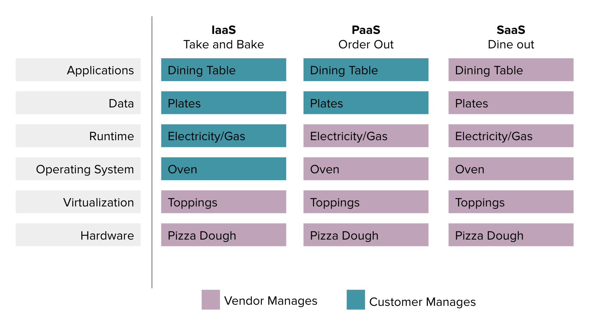

#  Intro to Platform-as-a-Service (PaaS)

## Learning Objectives

*After this lesson, students will be able to:*

- Define PaaS, IaaS, and SaaS.
- Recognize the difference between public and private PaaS.
- Identify the advantages of PaaS.
- Name the “major players” in cloud service providers.

## Lesson Guide

| TIMING  | TYPE  | TOPIC  |
|:-:|---|---|
| 5 min  | Opening    | Lesson Objectives  |
| 15 min | Lecture    | IaaS, PaaS, and SaaS: What's the Difference?   |
| 10 min | Lecture    | What Not to Do in the Cloud           |
| 20 min | Activity   | PaaS Providers           |
| 5 min  | Conclusion | Review/Recap           |

## Opening (5 min)

If you recall from our last lesson, we learned about the major ways in which cloud services are consumed (see what I did there?) by comparing them to pizza.

In this lesson, we'll learn more about the different models, as well as what sets Platform-as-a-Service (PaaS) apart.

------

## IaaS, PaaS, and SaaS: What’s the Difference? (20 min)

Let's dive into each of the three service models: IaaS, PaaS, and SaaS.

### Infrastructure-as-a-Service

We'll start with the basics: Buying a "take and bake" pizza. The restaurant makes the pizza (composed of dough, cheese, and toppings), but it is cooked and consumed at home. 

This cloud service model is called **Infrastructure-as-a-Service (IaaS)** and is the most basic category of cloud computing.
  - You rent IT infrastructure (whether physical servers or virtual machines) from a cloud provider. 
  - This rented infrastructure acts just as a physical server in the sense that you can install applications, databases, or web servers.
  - This is how an enterprise typically moves computing resources out of their data center into a cloud.
  - Can be used to replace or augment existing infrastructure that is currently running on premises.  

While you're managing applications from the operating system up (patching, setting up network topology, etc.), the cloud service provider is managing the resources below it (hardware, data center, storage, etc.). IaaS provides the raw computing power (physical or virtual machine) over the internet. 

Some examples of IaaS are DigitalOcean, Linode, Rackspace, Amazon Web Services (AWS), Cisco's cloud services, Microsoft Azure, and Google Compute Engine (GCE). 

### Software-as-a-Service

If you're feeling really lazy, and you don't want to cook, and you don't want to clean any dishes... you dine out. Dining out is the equivalent of **Software-as-a-Service (SaaS)**. 
  - There's no hardware or software to buy, install, or upgrade.
  - New features are automatically included and added. 
  - Makes applications that were previously accessible only to large corporations affordable to almost everyone.

SaaS delivers an Application-as-a-Service in a subscription or "pay as you go" manner. SaaS can scale as needed and also take the form of Database-as-a-Service, Desktop-as-a-Service, and Identity-as-a-Service. 

Some examples of SaaS? Google Apps, Dropbox, Salesforce, Cisco WebEx, Concur, and GoToMeeting (to name a few). 

### Platform-as-a-Service

Or maybe we're getting pizza delivered to our home. The restaurant makes the pizza, cooks it, and delivers it to you. But, you still use your own plates and dining room table. 

This is called **Platform-as-a-Service (PaaS)**. It's the model of the hour.
  - Allows developers access to a development platform. 
  - This platform could be a web server that's already running, and developers only need access to quickly deploy their web applications with minimal effort and maintenance.  

PaaS operates a layer above the infrastructure (IaaS) and provides a platform to develop, run, and manage applications. It's not concerned with tasks such as setting up load balancers or configuring networks.

The delivery model of PaaS is similar to SaaS, only instead of delivering the software over the internet, PaaS provides cloud components to certain software while being used mainly for applications. 
 
Because this platform is delivered over the web, it gives developers the freedom to concentrate on building the software while not having to worry about operating systems, software updates, storage, or infrastructure. This allows for the design and creation of applications that are scalable and highly available as they take on certain cloud characteristics.

Some common examples of PaaS platforms include AWS Elastic Beanstalk, Microsoft Azure, Heroku, Force.com, Google App Engine, Apache Stratos, and OpenShift.

### Public vs. Private PaaS

In understanding the different methods by which PaaS can be delivered, it’s critical to also understand the pros and cons of both public and private PaaS. 

**Public PaaS**

PaaS works great for the cloud. If you really think about it, the entire idea behind the cloud is that you can rapidly deploy and use infrastructure on demand. But public PaaS can also have drawbacks. For example, how do you manage costs? What if applications need to be internal or private? 

**Private PaaS**

Private PaaS allows deployment and management of enterprise applications while meeting strict security and privacy requirements. This enables running on any type of IaaS or private cloud managed by a company’s internal IT. 

However, with private PaaS, customers are still on the hook for infrastructure. They still have to procure, install, manage, and patch physical servers. Additionally, they are responsible for patching the PaaS itself.

------

## What Not to Do in the Cloud (10 min)

The cloud provides a lot of benefits for businesses and developers, but it's not without its drawbacks.

**Cloud anti-patterns** are ways in which cloud implementations can go wrong. 

1. **Using local file systems**: This is short-lived and not shared among multiple instances.
2. **Services that scale vertically**: Instead of scaling horizontally. 
3. **Manually coordinated builds**: Instead of having builds be automated and repeatable. 
4. **Hard coding**: Embedding assumptions about the environment of a system in its implementation. 
5. **Monolithic applications**: PaaS is suited for applications with decomposed services that can be scaled independently (i.e., microservices). 

------

## PaaS Players (20 min)

It's a crowded space for PaaS providers these days. It's a popular service for companies of all sizes and types, so there are a ton of options from which to choose.

Which PaaS platform you select will depend on your business requirements. 
- Do you need tight integration with other services?
- What is your development environment like? What frameworks and languages do you use?
- Do your applications need to be portable? PaaS can be portable or vertically integrated. Portable ones are independent of the underlying infrastructure provider (IaaS), while vertically integrated offerings seamlessly combine IaaS and PaaS and are not portable.

So yeah, it's a lot to think through. And now, it's your turn to do so!

Let's get into groups of 3–4 people. I will assign each group a popular cloud provider. 

Your task is to do some research and answer the following questions:
- What is this platform great at?
- Where is it lacking?
- What are the best use cases for this platform?

**Major players:**
- Amazon AWS
- Microsoft Azure
- Google App Engine
- Lightning Platform (Salesforce) 
- Cloud Foundry  

-------

## Conclusion (5 min)

With that, you're ready to start deploying applications on the cloud!

By now, you should be able to differentiate between:

- IaaS
- SaaS
- Public PaaS
- Private PaaS

You should also be able to identify what can go wrong with the cloud.

#### Resources

- [Top Cloud Providers](https://www.zdnet.com/article/top-cloud-providers-2018-how-aws-microsoft-google-ibm-oracle-alibaba-stack-up/)  
- [PaaS Providers](https://www.techradar.com/news/best-paas-provider)
- [Google App Engine](https://cloud.google.com/docs/overview/cloud-platform-services)
- [Azure](https://azure.microsoft.com/en-us/overview/what-is-paas/)
- [Salesforce](https://www.salesforce.com/ap/paas/overview/)
- [Cloud Foundry](https://docs.cloudfoundry.org/concepts/overview.html)

