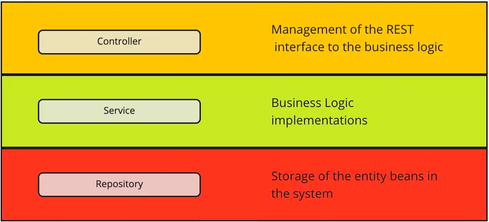

#  Understanding Monolithic Architecture

| Title                                 | Type   | Duration | Author               |
|---------------------------------------|--------|----------|----------------------|
| Understanding Monolithic Architecture | Lesson | 2:00     | Suresh Melvin Sigera |

## Learning Objectives:
- Understand the Fundamentals of Monolithic Architecture
- Identify the Key Characteristics of Monolithic Architecture
- Analyze the Advantages and Disadvantages of Monolithic Architecture
- Determine the Appropriate Use Cases for Monolithic Architecture
- Compare Monolithic Architecture with Other Architectural Styles
- Apply Knowledge of Monolithic Architecture in Software Design

## Introduction to Monolithic Applications

Software architecture is a fundamental aspect of software development, defining the high-level structure of a software
system. It focuses on organizing components and the interactions between them, guiding the design and development to
meet specific requirements such as scalability, performance, and maintainability. Among the various architectural
styles, the three primary ones are **Monolithic**, **Microservices**, and **Service-Oriented Architecture (SOA)**.
This discussion will focus on monolithic architecture, which has been the traditional approach for many years.
Understanding this architecture helps appreciate its role in software development and identify when it might be the
right choice.

Monolithic architecture is a software design pattern where all components of an application are built into a single,
unified unit. Unlike other architectural styles, where different functionalities might be split across multiple services
or modules, a monolithic application bundles everything—user interface, business logic, and data access—into one
deployable package. This approach has its advantages and disadvantages, influencing its suitability for different
projects. It simplifies development and deployment processes since everything is contained within a single application.
However, it can also lead to challenges in scaling and maintaining the application as it grows, due to the tightly
coupled nature of its components. Understanding these characteristics is crucial for making informed decisions about
using monolithic architecture in software projects.

## Key Characteristics:

- **Single Codebase:** The entire application is developed within a single codebase, making it straightforward to manage
  during the initial stages of development.
- **Shared Resources:** All components of the application share resources like memory, file systems, and databases. This
  shared resource environment can lead to high performance since there is no need for inter-process communication.
- **Tightly Coupled Components:** Components within a monolithic application are highly interdependent. Changes in one
  part of the system can have ripple effects throughout the application.

Popular frameworks for building monolithic applications include Spring Boot (Java), Django (Python), and Ruby on Rails.
These frameworks provide tools and libraries to develop, deploy, and maintain monolithic applications efficiently.

## What is a Monolith?

A monolith, in the context of software, refers to a single, indivisible entity. A monolithic application integrates all
the functionality of an application—user interface, business logic, and data access—into a single package. This single
deployable unit contains all the necessary components to run the application. Imagine a house where the kitchen, living
room, and bedroom are all in one large, open space. While everything is accessible and connected, making changes or
upgrading one part of the house can affect the rest of the space. Similarly, in a monolithic application, updating or
modifying one component can impact other components due to their tight coupling.



1. **Components of a Monolithic Application:** A typical monolithic application is structured into three main layers:
    - **Presentation Layer:** This is the user interface (UI) layer where users interact with the application. It
      handles input from the user and displays output.
    - **Business Logic Layer:** This layer contains the core functionality of the application, including business rules
      and processing logic. It acts as the brain of the application, coordinating interactions between the UI and data.
    - **Data Access Layer:** This layer is responsible for interacting with the database. It handles all operations
      related to data storage, retrieval, and manipulation.
    - **Database:** The database serves as the central repository for all data in the application. In a monolithic
      application, there is typically one database that serves the entire application.
2. **Lifecycle of a Monolithic Application:** The lifecycle of a monolithic application encompasses the following
   stages:
    - **Development:** Developers work on the single codebase, implementing features, fixing bugs, and making
      improvements.
    - **Testing:** Testing is conducted on the entire application to ensure that new features work as expected and do
      not introduce regressions.
    - **Deployment:** The entire application is packaged and deployed as a single unit. This simplicity is one of the
      primary advantages of monolithic applications.
    - **Maintenance:** Over time, the application may require updates, patches, and performance tuning. Maintaining a
      monolithic application can become increasingly complex as the codebase grows.

### Advantages and Disadvantages

1. **Advantages of Monolithic Architecture**
    - **Simplicity in Development and Deployment:** Monolithic applications are relatively easy to develop and deploy,
      especially for smaller teams or projects. With a single codebase, developers can quickly implement features, and
      the deployment process is straightforward—just package and deploy the entire application.
    - **Performance:** Since all components of a monolithic application share resources and operate within the same
      process, there is no overhead associated with inter-service communication (such as network calls between
      microservices). This can result in better performance, particularly in low-latency environments.
    - **Ease of Debugging and Testing:** Monolithic applications are easier to debug and test because all components are
      contained within the same environment. Developers can run the entire application locally, set breakpoints, and
      perform end-to-end tests without worrying about distributed systems' complexities.
    - **Less Operational Overhead:** Monolithic applications typically require fewer infrastructure resources. There is
      no need for complex service orchestration, distributed monitoring, or managing multiple instances of services,
      which can reduce operational costs and complexity.
2. **Disadvantages of Monolithic Architecture**
    - **Scalability Challenges:** One of the significant drawbacks of monolithic architecture is the difficulty in
      scaling. Since all components are bundled together, the entire application must be scaled, even if only one
      component requires additional resources. This can lead to inefficient resource usage and increased costs.
    - **Tight Coupling:** Monolithic applications suffer from tight coupling between components. This means that changes
      in one part of the application can have unintended consequences in other parts. Over time, this can lead to a
      fragile codebase that is difficult to maintain and evolve.
    - **Slow Development Over Time:** As the codebase grows, monolithic applications can become unwieldy. New developers
      may struggle to understand the entire system, and making changes can become slower and riskier. This can lead to
      technical debt, where the cost of maintaining the codebase outweighs the benefits of adding new features.
    - **Limited Flexibility:** Monolithic architecture can be less flexible when it comes to adopting new technologies.
      Since all components are tightly integrated, it can be challenging to introduce new tools, frameworks, or
      programming languages without significant refactoring.

## Common Scenarios where Monoliths are Used

**When to Choose Monolithic Architecture**

1. **Startups and Small Projects:** Monolithic architecture is often the best choice for startups and small projects.
   These scenarios typically involve teams with limited resources and a need to deliver a product quickly. Monolithic
   architectures offer the simplicity needed for rapid development, allowing teams to focus on building features rather
   than managing the complexities of distributed systems.
2. **Applications with Low Scalability Requirements:** Not all applications need to scale to support millions of users.
   For applications with stable user bases or those not expected to grow rapidly, a monolithic architecture can be
   ideal. It allows teams to build and maintain applications without the overhead of managing microservices.
3. **Rapid Prototyping:** When the goal is to quickly build and test new ideas, monolithic architecture offers a
   straightforward approach. With fewer complexities involved, teams can prototype rapidly, iterate based on feedback,
   and refine their products before potentially moving to a more complex architecture if needed
4. **Organizations with Limited Resources**: For organizations with limited technical expertise or resources, managing a
   monolithic application is often more feasible than dealing with the intricacies of microservices. The single codebase
   of a monolith simplifies development, deployment, and troubleshooting, making it more accessible for smaller teams.

## Case Study: Example of a Monolithic Application

For this case study, we will examine a hypothetical e-commerce platform designed to serve a small to medium-sized
business. This platform was built using a monolithic architecture, integrating all components into a single codebase.
The application’s purpose is to provide a seamless shopping experience for users, manage inventory, process orders, and
handle customer relationships. It has a stable user base, with moderate traffic and transaction volumes.

**Case Study Overview:**

- **Application:** E-commerce Platform
- **User Base:** Small to medium-sized business customers
- **Purpose:** Provide a shopping interface, manage inventory, process orders

**Analyzing the Architecture**

The architecture of this e-commerce platform is structured into three primary layers:

- **UI Layer:** The user interface, responsible for rendering the web pages and handling user interactions.
- **Business Logic Layer:** The core of the application, where all business rules and processes are implemented, such as
  managing products, processing payments, and handling orders.
- **Data Access Layer:** This layer interacts with the database, executing queries and managing data persistence.

**Flow of Data and Control:**

- **User Interaction:** When a user interacts with the platform, the request is routed through the UI layer.
- **Processing:** The business logic layer processes the request, applying the necessary business rules.
- **Data Handling:** The data access layer retrieves or stores data in the database as needed, before sending the
  response back up through the layers.

**Key Components:**

- **Product Management:** Handles product listings, categories, and inventory.
- **Order Processing:** Manages customer orders, payments, and shipping details.
- **User Authentication:** Manages user sessions, login, and access control.

**Benefits and Challenges Faced**

- **Ease of Deployment:** With all components bundled together, the deployment process is straightforward. The entire
  application can be deployed as a single unit, reducing complexity.
- **Performance:** The tight integration of components within a single codebase often results in better performance, as
  there is no need for inter-service communication over the network.
- **Simplified Development:** Developers can focus on building features without worrying about inter-service
  communication, data consistency across services, or the complexities of managing a distributed system.

**Challenges:**

- **Scalability Issues:** As the user base grows, scaling the monolithic application becomes increasingly difficult.
  Since all components are tightly coupled, scaling specific parts of the application requires scaling the entire
  application.
- **Difficulty Introducing New Features:** Adding new features or making changes to existing ones can become cumbersome,
  especially as the codebase grows. A change in one part of the system can have unintended consequences elsewhere,
  leading to increased risk and slower development cycles.
- **Technical Debt:** Over time, the monolithic architecture can accumulate technical debt, making it harder to maintain
  and evolve. As the application grows, the tightly coupled components can become a source of fragility, where changes
  in one area lead to unexpected issues in others.

## Walkthrough of a Simple Monolithic Spring Boot Application

Let's dive into the provided Spring Boot project that comes with this lesson. The project is pre-configured with the
necessary dependencies and configurations to build a Kafka application. Here are the key dependencies included in the
project:

- **Spring Boot Starter Web:** Provides the necessary components to build web applications using Spring Boot.
- **Spring Boot Starter Data JPA:** Simplifies the process of working with relational databases using Spring Data JPA.
- **Lombok:** A library that helps reduce boilerplate code in Java classes.
- **H2 Database:** An in-memory database for development and testing purposes.
- **Spring Boot Starter Test:** Includes the necessary dependencies for testing Spring Boot applications.

You will notice that it already includes the required dependencies Spring Boot, Lombok, JPA, and H2. Here's an example
of how the dependencies section look like:

```xml

<dependencies>
    <dependency>
        <groupId>org.springframework.boot</groupId>
        <artifactId>spring-boot-starter-data-jpa</artifactId>
    </dependency>
    <dependency>
        <groupId>org.springframework.boot</groupId>
        <artifactId>spring-boot-starter-web</artifactId>
    </dependency>
    <dependency>
        <groupId>com.h2database</groupId>
        <artifactId>h2</artifactId>
        <scope>runtime</scope>
    </dependency>
    <dependency>
        <groupId>org.projectlombok</groupId>
        <artifactId>lombok</artifactId>
        <optional>true</optional>
    </dependency>
    <dependency>
        <groupId>org.springframework.boot</groupId>
        <artifactId>spring-boot-starter-test</artifactId>
        <scope>test</scope>
    </dependency>
</dependencies>
```

The provided Spring Boot project contains two configuration files: `application.properties`
and `application-dev.properties`. Let's explore the purpose and contents of each file.

- **`application.properties`:** This file is the main configuration file for the Spring Boot application. It specifies
  the active profile using the `spring.profiles.active` property. In this case, the active profile is set to "dev",
  which means the application will use the configuration defined in the `application-dev.properties` file.
- **`application-dev.properties`:** This file contains the configuration specific to the development environment. It
  includes properties related to the H2 in-memory database, such as the database `URL`, driver class name, `username`,
  and `password`. Here's an example of how the properties are defined:
   ```properties
    spring.application.name=sdm
    spring.datasource.url=jdbc:h2:mem:monolithdb
    spring.datasource.driverClassName=org.h2.Driver
    spring.datasource.username=sa
    spring.datasource.password=password

    spring.jpa.database-platform=org.hibernate.dialect.H2Dialect
    spring.jpa.hibernate.ddl-auto=create

    spring.h2.console.enabled=true
    spring.h2.console.path=/h2-console
   ```

This file contains the configuration properties specific to the "dev" profile. Here's a breakdown of the properties:

- **spring.application.name:** Sets the name of the Spring Boot application to `sdm`.
- **spring.datasource.url:** Specifies the URL for the H2 in-memory database. In this case, it is set
  to `jdbc:h2:mem:testdb`, which creates an in-memory database named `testdb`.
- **spring.datasource.driverClassName:** Specifies the driver class name for the H2 database.
- **spring.datasource.username and spring.datasource.password:** Sets the `username` and `password` for accessing the H2
  database.
- **spring.jpa.database-platform:** Specifies the Hibernate dialect for the H2 database, which
  is `org.hibernate.dialect.H2Dialect`.
- **spring.jpa.hibernate.ddl-auto:** Configures the DDL (Data Definition Language) auto-generation strategy. In this
  case, it is set to "create", meaning that Hibernate will create the database schema automatically based on the entity.
- **spring.h2.console.enabled:** Enables the H2 console, which is a web-based database management tool.
- **spring.h2.console.path:** Sets the path for accessing the H2 console, which is `/h2-console`.

By having separate configuration files for different profiles, you can easily switch between different environments (
e.g., development, production) by setting the active profile accordingly.

## Creating the Author and Book model

In this section, we will create the `Author` and `Book` models that represent the entities in our application. These
models will be used to define the structure of the database tables and the relationships between them.

### Author Model

```java
package org.example.sdm.model;

import jakarta.persistence.Entity;
import jakarta.persistence.GeneratedValue;
import jakarta.persistence.GenerationType;
import jakarta.persistence.Id;
import lombok.Getter;
import lombok.Setter;
import lombok.ToString;

@Getter
@Setter
@ToString
@Entity
public class Author {

    @Id
    @GeneratedValue(strategy = GenerationType.SEQUENCE)
    private Long id;
    private String name;
    private String biography;
}
```

### Book Model (10 minutes)

```java
package org.example.sdm.model;

import jakarta.persistence.Entity;
import jakarta.persistence.GeneratedValue;
import jakarta.persistence.GenerationType;
import jakarta.persistence.Id;
import jakarta.persistence.ManyToOne;
import lombok.Getter;
import lombok.Setter;
import lombok.ToString;

@Getter
@Setter
@ToString
@Entity
public class Book {

    @Id
    @GeneratedValue(strategy = GenerationType.SEQUENCE)
    private Long id;
    private String title;
    private String description;

    @ManyToOne
    private Author author;
}
```

Here's a brief overview of the `Author` and `Book` models:

- **Author Model:**
    - The `Author` model represents an author entity in the application. It contains fields for the
      author's `id`, `name`, and `biography`.
    - The `@Entity` annotation marks the class as a JPA entity, indicating that it will be mapped to a database table.
    - The `@Id` annotation specifies the primary key of the entity.
    - The `@GeneratedValue` annotation with `GenerationType.SEQUENCE` generates unique primary key values for the
      entity.
    - The `@Getter`, `@Setter`, and `@ToString` annotations are from Lombok and provide getter and setter methods and
      a `toString()` implementation for the class.

- **Book Model:**
    - The `Book` model represents a book entity in the application. It contains fields for the
      book's `id`, `title`, `description`, and a `ManyToOne` relationship with the `Author` entity.
    - The `@ManyToOne` annotation establishes a many-to-one relationship between the `Book` and `Author` entities,
      indicating that many books can be associated with one author.
    - The rest of the annotations and Lombok annotations in the `Book` model serve similar purposes to those in
      the `Author`
      model.

By defining these models, we have established the structure of the database tables and the relationships between
the `Author` and `Book` entities. These models will be used to interact with the database and perform CRUD operations on
the entities.

## Implementing the Author and Book Repositories

In this section, we will create the `AuthorRepository` and `BookRepository` interfaces that extend the `JpaRepository`
interface provided by Spring Data JPA. These repositories will be used to interact with the `Author` and `Book` entities
in the database.

### Author Repository

```java
package org.example.sdm.repository;

import org.example.sdm.model.Author;
import org.springframework.data.jpa.repository.JpaRepository;
import org.springframework.stereotype.Repository;

import java.util.Optional;

@Repository
public interface AuthorRepository extends JpaRepository<Author, Long> {
    Optional<Author> findByName(String name);
}
```

### Book Repository

```java
package org.example.sdm.repository;

import org.example.sdm.model.Author;
import org.example.sdm.model.Book;
import org.springframework.data.jpa.repository.JpaRepository;
import org.springframework.stereotype.Repository;

import java.util.Optional;

@Repository
public interface BookRepository extends JpaRepository<Book, Long> {
    Optional<Book> findByTitleAndAuthor(String title, Author author);
}
```

Here's a brief overview of the `AuthorRepository` and `BookRepository` interfaces:

- **AuthorRepository:**
    - This interface extends `JpaRepository`, designating `Author` as the entity type and `Long` as the primary key
      type.
    - Annotated with `@Repository`, it is recognized as a Spring Data repository, enabling Spring to automatically
      detect and instantiate it.
    - It features a custom query method, `findByName`, which retrieves an `Optional<Author>` by searching for an author
      based on their name.
- **BookRepository:**
    - Extending `JpaRepository`, this interface specifies `Book` as the entity type and uses `Long` for the primary key.
    - The `@Repository` annotation identifies it as a Spring Data repository.
    - It includes a custom query method, `findByTitleAndAuthor`, which returns an `Optional<Book>` by searching for a
      book by its title and author.

By defining these repositories, we have created interfaces that provide methods for performing CRUD operations on
the `Author` and `Book` entities. These repositories leverage Spring Data JPA's built-in functionality to simplify
database interactions and reduce boilerplate code.

## Handling exceptions in Spring Boot

Response status is an important part of building a robust application. Spring Boot offers more than one way of doing it.
As the name suggests, `@ResponseStatus` allows us to modify the HTTP status of our response. It can be applied in the
following places: To address this we can we annotate our Exception class with `@ResponseStatus` and pass in the desired
HTTP response status in its value property:

### Information Exist Exception

```java
package org.example.sdm.exception;

import org.springframework.http.HttpStatus;
import org.springframework.web.bind.annotation.ResponseStatus;

@ResponseStatus(HttpStatus.CONFLICT)
public class InformationExistException extends RuntimeException {
    public InformationExistException(String message) {
        super(message);
    }
}
```

### Information Not Found Exception

```java
package com.food.demo.exception;

import org.springframework.http.HttpStatus;
import org.springframework.web.bind.annotation.ResponseStatus;

@ResponseStatus(HttpStatus.NOT_FOUND)
public class InformationNotFoundException extends RuntimeException {
    public InformationNotFoundException(String message) {
        super(message);
    }
}
```

In the code above, we chose to override all instances of `RuntimeException` with our custom exceptions. While
using `CustomException` was more specific than throwing a generic `Exception`, it still lacked the precision needed to
handle distinct scenarios effectively. The `RuntimeException` class encompasses a variety of exceptions, such
as `ArithmeticException`, `NullPointerException`, `NumberFormatException`, and `IndexOutOfBoundsException`.

To ensure that we're overriding the correct exception class when crafting user-defined exceptions, it's important to
understand the hierarchy of Java `Exception` classes and the principles of Java exception handling. With this knowledge,
we can create descriptive, precise, and helpful user-defined exceptions that contribute to the stability of our program
and maintain our sanity.

By tailoring exceptions to specific situations, we can enhance error handling, making it easier to diagnose and resolve
issues. This approach not only improves the robustness of the application but also provides clearer insights into the
nature of errors, facilitating more efficient debugging and maintenance.

## Implementing the Author and Book Services

In this section, we will create the `AuthorService` and `BookService` classes that handle business logic related to
authors and books. These services will interact with the repositories to perform CRUD operations and manage the
application's data.

### Author Service

```java
package org.example.sdm.service;

import org.example.sdm.exception.InformationExistException;
import org.example.sdm.exception.InformationNotFoundException;
import org.example.sdm.model.Author;
import org.example.sdm.repository.AuthorRepository;
import org.springframework.beans.factory.annotation.Autowired;
import org.springframework.stereotype.Service;

import java.util.List;
import java.util.Optional;

@Service
public class AuthorService {

    private final AuthorRepository authorRepository;

    @Autowired
    public AuthorService(AuthorRepository authorRepository) {
        this.authorRepository = authorRepository;
    }

    public Author saveAuthor(Author author) {
        Optional<Author> existingAuthor = authorRepository.findByName(author.getName());
        if (existingAuthor.isPresent()) {
            throw new InformationExistException("Author with name " + author.getName() + " already exists.");
        }
        return authorRepository.save(author);
    }

    public Author findAuthorById(Long id) {
        return authorRepository.findById(id)
                .orElseThrow(() -> new InformationNotFoundException("Author with ID " + id + " not found."));
    }

    public Author findAuthorByName(String name) {
        return authorRepository.findByName(name)
                .orElseThrow(() -> new InformationNotFoundException("Author with name " + name + " not found."));
    }

    public List<Author> findAllAuthors() {
        return authorRepository.findAll();
    }

    public void deleteAuthor(Long id) {
        if (!authorRepository.existsById(id)) {
            throw new InformationNotFoundException("Author with ID " + id + " not found.");
        }
        authorRepository.deleteById(id);
    }
}
```

### Book Service

```java
package org.example.sdm.service;

import org.example.sdm.exception.InformationExistException;
import org.example.sdm.exception.InformationNotFoundException;
import org.example.sdm.model.Author;
import org.example.sdm.model.Book;
import org.example.sdm.repository.BookRepository;
import org.springframework.beans.factory.annotation.Autowired;
import org.springframework.stereotype.Service;

import java.util.List;
import java.util.Optional;

@Service
public class BookService {

    private final BookRepository bookRepository;

    @Autowired
    public BookService(BookRepository bookRepository) {
        this.bookRepository = bookRepository;
    }

    public Book saveBook(Book book) {
        Optional<Book> existingBook = bookRepository.findByTitleAndAuthor(book.getTitle(), book.getAuthor());
        if (existingBook.isPresent()) {
            throw new InformationExistException("Book with title " + book.getTitle() + " and author " + book.getAuthor().getName() + " already exists.");
        }
        return bookRepository.save(book);
    }

    public Book findBookById(Long id) {
        return bookRepository.findById(id)
                .orElseThrow(() -> new InformationNotFoundException("Book with ID " + id + " not found."));
    }

    public Book findBookByTitleAndAuthor(String title, Author author) {
        return bookRepository.findByTitleAndAuthor(title, author)
                .orElseThrow(() -> new InformationNotFoundException("Book with title " + title + " and author " + author.getName() + " not found."));
    }

    public List<Book> findAllBooks() {
        return bookRepository.findAll();
    }

    public void deleteBook(Long id) {
        if (!bookRepository.existsById(id)) {
            throw new InformationNotFoundException("Book with ID " + id + " not found.");
        }
        bookRepository.deleteById(id);
    }
}
```

Here's a brief overview of the `AuthorService` and `BookService` classes:

- **AuthorService:**
    - The `AuthorService` class contains methods to handle business logic related to authors, such as saving, finding,
      and deleting authors.
    - The `saveAuthor` method saves a new author to the database after checking if an author with the same name already
      exists.
    - The `findAuthorById` and `findAuthorByName` methods retrieve an author by their ID or name, respectively.
    - The `findAllAuthors` method returns a list of all authors in the database.
    - The `deleteAuthor` method deletes an author by their ID after verifying that the author exists.

- **BookService:**
    - The `BookService` class manages business logic for books, including saving, finding, and deleting books.
    - The `saveBook` method saves a new book to the database, ensuring that a book with the same title and author does
      not already exist.
    - The `findBookById` and `findBookByTitleAndAuthor` methods retrieve a book by its ID or title and author,
      respectively.
    - The `findAllBooks` method returns a list of all books in the database.
    - The `deleteBook` method deletes a book by its ID, verifying that the book exists before deletion.

By implementing these services, we have encapsulated the business logic for managing authors and books in the
application.

## Implementing the Author and Book Controllers

To create controllers for managing `Author` and `Book` entities, you can implement `AuthorController`
and `BookController` classes. These controllers will handle HTTP requests and use the `AuthorService` and `BookService`
classes to perform operations. Below is an example implementation of these controllers:

### Author Controller

```java
package org.example.sdm.controller;

import org.example.sdm.model.Author;
import org.example.sdm.service.AuthorService;
import org.springframework.beans.factory.annotation.Autowired;
import org.springframework.http.ResponseEntity;
import org.springframework.web.bind.annotation.*;

import java.util.List;

@RestController
@RequestMapping("/authors")
public class AuthorController {

    private final AuthorService authorService;

    @Autowired
    public AuthorController(AuthorService authorService) {
        this.authorService = authorService;
    }

    @PostMapping
    public ResponseEntity<Author> createAuthor(@RequestBody Author author) {
        Author savedAuthor = authorService.saveAuthor(author);
        return ResponseEntity.ok(savedAuthor);
    }

    @GetMapping("/{id}")
    public ResponseEntity<Author> getAuthorById(@PathVariable Long id) {
        Author author = authorService.findAuthorById(id);
        return ResponseEntity.ok(author);
    }

    @GetMapping
    public ResponseEntity<List<Author>> getAllAuthors() {
        List<Author> authors = authorService.findAllAuthors();
        return ResponseEntity.ok(authors);
    }

    @DeleteMapping("/{id}")
    public ResponseEntity<Void> deleteAuthor(@PathVariable Long id) {
        authorService.deleteAuthor(id);
        return ResponseEntity.noContent().build();
    }
}
```

### Book Controller (15 minutes)

```java
package org.example.sdm.controller;

import org.example.sdm.model.Author;
import org.example.sdm.model.Book;
import org.example.sdm.service.AuthorService;
import org.example.sdm.service.BookService;
import org.springframework.beans.factory.annotation.Autowired;
import org.springframework.http.ResponseEntity;
import org.springframework.web.bind.annotation.*;

import java.util.List;

@RestController
@RequestMapping("/books")
public class BookController {

    private final BookService bookService;
    private final AuthorService authorService;

    @Autowired
    public BookController(BookService bookService, AuthorService authorService) {
        this.bookService = bookService;
        this.authorService = authorService;
    }

    @PostMapping
    public ResponseEntity<Book> createBook(@RequestBody Book book) {
        Book savedBook = bookService.saveBook(book);
        return ResponseEntity.ok(savedBook);
    }

    @GetMapping("/{id}")
    public ResponseEntity<Book> getBookById(@PathVariable Long id) {
        Book book = bookService.findBookById(id);
        return ResponseEntity.ok(book);
    }

    @GetMapping
    public ResponseEntity<List<Book>> getAllBooks() {
        List<Book> books = bookService.findAllBooks();
        return ResponseEntity.ok(books);
    }

    @DeleteMapping("/{id}")
    public ResponseEntity<Void> deleteBook(@PathVariable Long id) {
        bookService.deleteBook(id);
        return ResponseEntity.noContent().build();
    }

    @GetMapping("/search")
    public ResponseEntity<Book> getBookByTitleAndAuthor(@RequestParam String title, @RequestParam String authorName) {
        Author author = authorService.findAuthorByName(authorName);
        Book book = bookService.findBookByTitleAndAuthor(title, author);
        return ResponseEntity.ok(book);
    }
}
```

Let's break down the key features of the `AuthorController` and `BookController` classes:

- **AuthorController:**
    - The `AuthorController` class manages HTTP requests related to authors, such as creating, retrieving, and deleting
      authors.
    - The `createAuthor` method handles POST requests to create a new author, returning the saved author in the
      response.
    - The `getAuthorById` method processes GET requests to retrieve an author by their ID.
    - The `getAllAuthors` method returns a list of all authors in the database.
    - The `deleteAuthor` method handles DELETE requests to delete an author by their ID.

- **BookController:**
    - The `BookController` class is responsible for handling HTTP requests related to books, including creating,
      retrieving, and deleting books.
    - The `createBook` method processes POST requests to save a new book, returning the saved book in the response.
    - The `getBookById` method retrieves a book by its ID in response to GET requests.
    - The `getAllBooks` method returns a list of all books in the database.
    - The `deleteBook` method deletes a book by its ID upon receiving a DELETE request.
    - The `getBookByTitleAndAuthor` method searches for a book by its title and author name, returning the book in the
      response.

By implementing these controllers, we have created endpoints for managing authors and books in the application. These
controllers handle incoming HTTP requests, interact with the corresponding services, and return appropriate responses.

## Seeding Data into the Application

To seed data into the application, you can create a `DataSeeder` class that initializes the database with sample data.
This class can be run at application startup to populate the database with predefined records. Below is an example
implementation of the `DataSeeder` class:

```java
package org.example.sdm.seed;

import org.example.sdm.model.Author;
import org.example.sdm.model.Book;
import org.example.sdm.repository.AuthorRepository;
import org.example.sdm.repository.BookRepository;
import org.springframework.beans.factory.annotation.Autowired;
import org.springframework.boot.CommandLineRunner;
import org.springframework.stereotype.Component;

import java.util.Arrays;

@Component
public class DataSeeder implements CommandLineRunner {

    private final AuthorRepository authorRepository;
    private final BookRepository bookRepository;

    @Autowired
    public DataSeeder(AuthorRepository authorRepository, BookRepository bookRepository) {
        this.authorRepository = authorRepository;
        this.bookRepository = bookRepository;
    }

    @Override
    public void run(String... args) throws Exception {
        // Clear existing data
        bookRepository.deleteAll();
        authorRepository.deleteAll();

        // Create authors
        Author author1 = new Author();
        author1.setName("George Orwell");
        author1.setBiography("George Orwell was an English novelist and essayist.");

        Author author2 = new Author();
        author2.setName("J.K. Rowling");
        author2.setBiography("J.K. Rowling is a British author, best known for the Harry Potter series.");

        // Save authors
        authorRepository.saveAll(Arrays.asList(author1, author2));

        // Create books
        Book book1 = new Book();
        book1.setTitle("1984");
        book1.setDescription("A dystopian novel set in a totalitarian society.");
        book1.setAuthor(author1);

        Book book2 = new Book();
        book2.setTitle("Animal Farm");
        book2.setDescription("A satirical allegory of Soviet totalitarianism.");
        book2.setAuthor(author1);

        Book book3 = new Book();
        book3.setTitle("Harry Potter and the Philosopher's Stone");
        book3.setDescription("The first book in the Harry Potter series.");
        book3.setAuthor(author2);

        // Save books
        bookRepository.saveAll(Arrays.asList(book1, book2, book3));

        // Print out the seeded data
        System.out.println("Seeded Authors: ");
        authorRepository.findAll().forEach(System.out::println);

        System.out.println("Seeded Books: ");
        bookRepository.findAll().forEach(System.out::println);
    }
}
```

In the `DataSeeder` class, we implement the `CommandLineRunner` interface to execute the seeding logic when the
application starts. The `run` method is called at startup, where we clear existing data, create authors and books, save
them to the database, and print out the seeded data.

By creating a `DataSeeder` class, we can easily populate the database with sample data and ensure that the application
has initial records to work with.

## API Documentation and Testing

To test the endpoints created in the `AuthorController` and `BookController` classes, you can use tools like Postman or
cURL to send HTTP requests and verify the responses. Here are some sample requests you can make to test the endpoints:

## Author Endpoints

- **Create Author:**
    - **Method:** POST
    - **URL:** `http://localhost:8080/authors`
    - **Body:**
    ```json
    {
        "name": "Jane Austen",
        "biography": "Jane Austen was an English novelist known for her six major novels."
    }
    ```

- **Get Author by ID:**
    - **Method:** GET
    - **URL:** `http://localhost:8080/authors/{id}`
    - Replace `{id}` with the ID of the author you want to retrieve.
    - **Example:** `http://localhost:8080/authors/1`

- **Get All Authors:**
    - **Method:** GET
    - **URL:** `http://localhost:8080/authors`
    - This request will return a list of all authors in the database.

- **Delete Author by ID:**
    - **Method:** DELETE
    - **URL:** `http://localhost:8080/authors/{id}`
    - Replace `{id}` with the ID of the author you want to delete.
    - **Example:** `http://localhost:8080/authors/1`
    - This request will delete the author with the specified ID.

## Book Endpoints

- **Create Book:**
    - **Method:** POST
    - **URL:** `http://localhost:8080/books`
    - **Body:**
    ```json
    {
        "title": "Pride and Prejudice",
        "description": "A romantic novel by Jane Austen.",
        "author": {
            "id": 1
        }
    }
    ```

- **Get Book by ID:**
    - **Method:** GET
    - **URL:** `http://localhost:8080/books/{id}`
    - Replace `{id}` with the ID of the book you want to retrieve.
    - **Example:** `http://localhost:8080/books/1`
    - This request will return the book with the specified ID.

- **Get All Books:**
    - **Method:** GET
    - **URL:** `http://localhost:8080/books`
    - This request will return a list of all books in the database.

- **Delete Book by ID:**
    - **Method:** DELETE
    - **URL:** `http://localhost:8080/books/{id}`
    - Replace `{id}` with the ID of the book you want to delete.
    - **Example:** `http://localhost:8080/books/1`
    - This request will delete the book with the specified ID.

- **Search for Book by Title and Author:**
    - **Method:** GET
    - **URL:** `http://localhost:8080/books/search?title={title}&authorName={authorName}`
    - Replace `{title}` with the title of the book and `{authorName}` with the name of the author.
    - **Example:** `http://localhost:8080/books/search?title=1984&authorName=George Orwell`
    - This request will return the book with the specified title and author.

## Conclusion

In this lesson, we explored the concept of monolithic architecture, its advantages and disadvantages, and common
scenarios where monoliths are used. We also examined a case study of a monolithic e-commerce application and walked
through a simple Spring Boot application that demonstrates the implementation of a monolithic architecture.

- **Understanding Monolithic Architecture** : We revisited the key characteristics of monolithic architecture,
  emphasizing its single codebase and tightly coupled components. This architecture is often straightforward to develop
  and manage, especially for smaller teams or projects with clear and stable requirements.
- **Advantages of Monoliths**: We discussed the simplicity of development, which can be a significant advantage,
  particularly for smaller teams. With a monolithic architecture, debugging and testing are generally easier due to the
  unified codebase. Additionally, monoliths can offer performance benefits, as there’s no overhead from inter-service
  communication, which is a common concern in distributed systems.
- **Disadvantages of Monoliths**: - On the flip side, we explored the challenges associated with monolithic
  architectures, particularly as applications grow. Scalability can become an issue, as the entire application must be
  scaled together, even if only a small part of it requires more resources. Making changes in a large, tightly coupled
  codebase can also be difficult and risky, often leading to longer development cycles.
- **Comparison with Other Architectures**: We briefly compared monolithic architecture with microservices, discussing
  when it might be advantageous to transition from a monolith to a microservices architecture. Factors such as the size
  of the application, team expertise, and the need for scalability and flexibility play a crucial role in this decision.

As we conclude, it’s important to remember that no single architecture is a one-size-fits-all solution. The choice
between monolithic and microservices architectures should be made based on the specific needs of your project.
Understanding the trade-offs and potential challenges is key to making an informed decision that will support the
success of your application in the long run.
